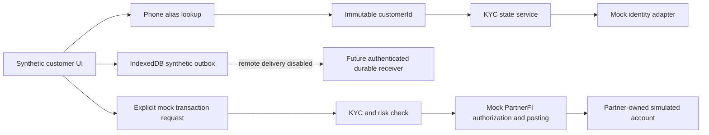

# Enawuga prototype architecture

Wishland is the software/orchestration provider. Future licensed PartnerFI is the financial principal. All adapters below are mocks and do not establish approved integration or regulatory compliance.

## Identity

`src/domain/customer.ts` owns canonical customers and normalized unique phone aliases. Callers receive copies; phone changes retain the UUID. `src/domain/identity.ts` owns pending verification requests and opaque mock identity references. No plaintext FIN/FAN, biometrics or identity credentials enter these APIs.

Transitions: UNVERIFIED → PENDING → VERIFIED; VERIFIED → REVERIFICATION_REQUIRED → VERIFIED; VERIFIED or REVERIFICATION_REQUIRED → SUSPENDED; SUSPENDED → VERIFIED requires explicit partner-admin domain authority. This authority parameter is a mock-domain control, not authentication. No HTTP administrative recovery endpoint is exposed. Production capability checks require authenticated partner roles.

Reasons include PHONE_CHANGE, SIM_CHANGE, ACCOUNT_RECOVERY, KYC_REFRESH_DUE, PARTNER_POLICY, HIGH_RISK_TRANSACTION, SUSPICIOUS_ACTIVITY, IDENTITY_MISMATCH and MANUAL_REVIEW. Transactions require VERIFIED KYC, NORMAL risk, and no blocked/re-verification phone state.

## Financial boundary

`TransactionService` accepts strict UUID-referenced requests with integer minor units, currency, direction and idempotency key. It checks KYC without calling an identity provider. `FinancialInstitutionAdapter` separates customer lookup, authorization, posting, status, account summary and reconciliation. The only implementation is in-memory `MockPartnerFI`; simulated balances belong to PartnerFI, never Wishland. Identical retries return the recorded result; changed idempotency payloads and transaction replay under new keys are rejected.

## Transport boundary

Transport states: LOCAL_PENDING, QUEUED_FOR_SYNC, SYNCED_TO_SUPERVISOR, RECEIVED_BY_PLATFORM. Financial states: PARTNER_AUTH_PENDING, PARTNER_ACCEPTED, PARTNER_REJECTED, RECONCILIATION_REQUIRED. There is no SETTLED state.

`EnawugaSyntheticOutbox` stores strict versioned envelopes. Retry retains event identity and financial-pending status; reconnect does not upload. Legacy GhostSyncDB is untouched. `MockTransportReceiver` is a test-only in-memory receiver demonstrating bounded replay windows, sequence ordering, duplicate receipts and partner outcomes. It is not exposed over HTTP. These checks are not durable across restarts and do not solve multi-device sequencing or exactly-once delivery in production.

## Runtime and security

Express exposes fixture-only `/api/demo/*` operations with strict bodies, same-origin mutation checks and no wildcard CORS. Customer/phone input is limited to declared synthetic fixtures. There is no user authentication and no claim these controls secure a production deployment. Legacy mutation routes return 403. Other mock read/scoring endpoints remain illustrative.

The old SVID decoder did not validate signatures; it has been removed with its mutation route. Console tracing was not OpenTelemetry instrumentation. Request bodies, OTPs, identifiers and untrusted URLs are not logged. Firebase execution and Firestore access are disabled; no frontend Gemini key is injected. Speech capture is disabled. Regulated mode is unavailable regardless of hostname or declared region.

See [classification policy](docs/DATA_RESIDENCY_AND_CLASSIFICATION.md) and [P0 backlog](docs/P0_BACKLOG.md).
