# ENAWUGA / PHYGITAL RURAL AGENT HUB
# WAVE D — BOUNDED ARCHITECTURE DECISION PACKAGE (v1.1.1 FINAL CONSISTENCY RELEASE)

---

**Document ID:** `ENAWUGA_WAVE_D_BOUNDED_ARCHITECTURE_DECISION_PACKAGE`

**Classification:** ARCHITECTURE DECISION PACKAGE — NOT AN IMPLEMENTATION SPECIFICATION

**Version:** 1.1.1

**Date:** 2026-10-17

**Author:** Antigravity AI Architecture Program (Orchestrated Multi-Agent Deep Architecture Design)

**Amendment Authority:** `ENAWUGA_WAVE_D_ARCHITECTURE_CLOSURE_RECONCILIATION.md` (Independent Closure Audit, 2026-10-16)

**Governing Program:** Enawuga Governed Research Program — Waves A → B → C → D

**Prerequisite Documents:**
- `ENAWUGA_WAVE_A_RESEARCH_DECISION_PACKAGE.md` (Wave A — Farmer 360, Privacy, ARDI, PartnerFI Authority)
- `ENAWUGA_WAVE_B_SERVICE_ECOSYSTEMS_RESEARCH_DECISION_PACKAGE.md` (Wave B — PAYG, Commerce, Climate, eKUB)
- `ENAWUGA_WAVE_C_OPERATIONALIZATION_EVIDENCE_ASSURANCE_RESEARCH_DECISION_PACKAGE.md` (Wave C — Evidence Explorer, Operations, Localization, Assurance)
- `Enawuga-Capability-Harvest-Research-Brief.md` (Capability Mining Brief)
- `Enawuga-Independent-Audit-FINAL.md`, `Enawuga-Independent-Audit-Round-2.md`, `Enawuga-Independent-Audit-Closure.md`

**Canonical Repository:** `https://github.com/abeselomchernet/Phygital-rural-Agent-Hub`

**Verified Live Main HEAD:** `9a8578858e0be1f1e78ce1572119ee85fdcfbf85` (2026-10-16T19:13:59Z)

**Mode:** ARCHITECTURE DESIGN / DECISION PACKAGE — READ-ONLY SOURCE INSPECTION — NO IMPLEMENTATION

**v1.1.1 Status Semantics (authoritative):**
- CURRENT_IMPLEMENTED — verified in canonical main at the recorded baseline SHA.
- TARGET_STAGE4_INTERNAL — accepted bounded architecture, not yet implemented unless separately evidenced.
- FUTURE_EXTERNAL_DEPENDENT — requires partner, legal, regulatory, infrastructure, or assurance evidence before activation.
- RESEARCH_ASSUMPTION — illustrative/analytical only; must not be presented as an observed fact.
- LEGAL_POLICY_DEPENDENT — architecture deliberately does not decide the legal/policy outcome.

**External-acceptance rule:** support for a cryptographic algorithm, package format, role, regulator-facing dossier, or institutional integration does not prove that any PartnerFI, insurer, auditor, NBE unit, court, or other external party accepts it. External profiles remain negotiated/verified dependencies.

**Legal-claim rule:** this package does not self-certify legal compliance, admissibility, statutory retention, lawful basis, regulatory approval, or evidentiary sufficiency. Those remain subject to the applicable external review gates.

**DO NOT:**
- Implement any ADR
- Create code, schemas, or databases
- Modify the repository
- Create or merge PRs
- Deploy, install dependencies, or provision infrastructure
- Self-certify legal, regulatory, privacy, or partner dependencies

---

## TABLE OF CONTENTS

### FRONT MATTER & BASELINE
- §1 Executive Architecture Decision
- §2 Program Lineage A → B → C → D
- §3 Current Live GitHub Baseline
- §4 D0 — Live Repository Reconciliation
- §5 Wave-C Gap Reconciliation Matrix
- §6 Current Architecture-Relevant Finding Register
- §7 Immutable Governance Invariants (30 invariants)
- §8 Architecture Principles (8 principles)

### D1 — PERSISTENCE & INFRASTRUCTURE
- §9 D1.1 Persistence Target Architecture
- §10 D1.2 Storage Classification Matrix
- §11 D1.3 Transaction Boundary Diagram
- §12 D1.4 Idempotency / Concurrency Architecture
- §13 D1.5 Outbox / Inbox / DLQ Architecture
- §14 D1.6 Backup / Restore / Recovery Requirements
- §15 D1.7 Filesystem → Target Migration Strategy
- §16 D1.8 ET Residency Logical Topology
- §17 D1 ADRs (ADR-D1-01, ADR-D1-02, ADR-D1-03)

### D2 — CRYPTOGRAPHIC / PRIVACY / IDENTITY
- §18 D2.1 Cryptographic Trust Architecture
- §19 D2.2 Digest-vs-Signature Model
- §20 D2.3 PPID / Identifier Architecture
- §21 D2.4 Low-Entropy Lookup Architecture
- §22 D2.5 Key Hierarchy & Rotation Model
- §23 D2.6 Audit Integrity Architecture
- §24 D2.7 Consent / Purpose Architecture
- §25 D2.8 Browser / External Verification Architecture
- §26 D2 ADRs (ADR-D2-01, ADR-D2-02, ADR-D2-03, ADR-D2-04)

### D3 — INTERNATIONALIZATION / ACCESSIBILITY
- §27 D3.1 Internationalization Architecture
- §28 D3.2 Canonical-State / Display-Language Contract
- §29 D3.3 Locale Bundle Lifecycle
- §30 D3.4 Ethiopian Calendar Architecture
- §31 D3.5 Number / Currency / Date Formatting Architecture
- §32 D3.6 Offline Content Distribution Architecture
- §33 D3.7 Accessibility Architecture Requirements
- §34 D3 ADRs (ADR-D3-01, ADR-D3-02, ADR-D3-03, ADR-D3-04)

### D4 — ROLE / AUTHORIZATION / PROJECTION
- §35 D4.1 Unified Role Model
- §36 D4.2 RBAC/ABAC Decision
- §37 D4.3 Scope Model
- §38 D4.4 Role Projection Matrix
- §39 D4.5 DTO Boundary Architecture
- §40 D4.6 External Reviewer Authentication Architecture
- §41 D4.7 Direct-URL / Privilege-Escalation Threat Analysis
- §42 D4 ADRs (ADR-D4-01, ADR-D4-02, ADR-D4-03, ADR-D4-04)

### D5 — EVIDENCE EXPLORER & HUMAN REVIEW
- §43 D5.1 Evidence Explorer Component Architecture
- §44 D5.2 Evidence Query Architecture
- §45 D5.3 Evidence Detail Projection
- §46 D5.4 Correction / Supersession Architecture
- §47 D5.5 Human Review Architecture
- §48 D5.6 Derived Evidence Invalidation Model
- §49 D5.7 Farmer 360 Integration Seam
- §50 D5.8 ARDI Integration Seam
- §51 D5.9 Evidence UX State Semantics
- §52 D5 ADRs (ADR-D5-01, ADR-D5-02, ADR-D5-03)

### D6 — EXTERNAL EVIDENCE SHARING
- §53 D6.1 External Package Architecture
- §54 D6.2 Package Type / Recipient Matrix
- §55 D6.3 Format Decision
- §56 D6.4 Signature / Verification Flow
- §57 D6.5 Consent / Purpose Gate
- §58 D6.6 Redaction / Projection Architecture
- §59 D6.7 Expiry / Revocation Model
- §60 D6.8 Negative-Assurance Architecture
- §61 D6 ADRs (ADR-D6-01 through ADR-D6-05)

### SERVICE INTEGRATION SEAMS
- §62 B1 PAYG Architecture Seam
- §63 B2 Commerce Architecture Seam
- §64 B3 Climate / Insurance Architecture Seam
- §65 B4 eKUB Architecture Seam

### CROSS-CUTTING ARCHITECTURE
- §66 Unified Threat Model (24 threats)
- §67 Non-Functional Requirements
- §68 Test Architecture
- §69 External Dependency Register (13 dependencies)
- §70 Legal / Privacy / Partner Gates (10 gates)
- §71 DO_NOT_RESURRECT Register (15 items)
- §72 Implementation Dependency Graph
- §73 Bounded Implementation Sequence (6 phases)

### VERDICTS
- §74 Wave-D Exit Criteria Assessment (40 questions)
- §75 Stage-4 Implementation Readiness Matrix
- §76 Final Architecture Verdicts

---

# WAVE D FRONT MATTER, CROSS-CUTTING, AND SYNTHESIS SECTIONS

## §1 EXECUTIVE ARCHITECTURE DECISION

Wave D converts the governed conclusions from Waves A (Foundations), B (Service Ecosystems), and C (Operationalization & Evidence Assurance) into a coherent, bounded architecture decision package suitable for later Stage-4 implementation planning.

### Executive Summary

The Enawuga / Phygital Rural Agent Hub codebase at SHA `9a8578858e0be1f1e78ce1572119ee85fdcfbf85` represents a mature governed domain model with:

- **37 domain files** implementing strict authority separation (42 `z.literal(false)` fields)
- **18 server files** including durable filesystem persistence for all critical stores
- **38 frontend pages** with role-based navigation and evidence display
- **61 test files** covering domain, persistence, security, and frontend behavior
- **Durable persistence** established for transport, idempotency CAS, audit, sessions (PRs #73-75)
- **Localization foundation** with 3-language presentation catalog (PR #76)
- **All feature branches** merged to main via 18 PRs (#58-#76)

Wave D produces **architecture decisions** for 6 workstreams and establishes a bounded implementation sequence. It does NOT implement, deploy, or activate anything.

### Key Architecture Verdicts (Preview)

| Domain | Decision Type | Status |
|--------|-------------|--------|
| Persistence | PostgreSQL as target with filesystem → PG migration | ACCEPTED_INTERNAL |
| Cryptography | Dual-profile signature support: Ed25519 internal/edge profile + ECDSA P-256 compatibility profile; external acceptance unverified | ACCEPTED_INTERNAL |
| i18n | Governed compile-time typed catalog with dynamic bundle loader | ACCEPTED_INTERNAL |
| Roles | RBAC + scoped attributes, 7-role model | ACCEPTED_INTERNAL |
| Evidence Explorer | Shared evidence core + role-specific projections | ACCEPTED_INTERNAL |
| External Sharing | Canonical JSON + detached algorithm-agile signature (Ed25519 / ECDSA P-256) + fail-closed DATA_ACCESS_BASIS_GATE | ACCEPTED_WITH_CONDITIONS |
| Ethiopian Calendar | Dual-calendar display with UTC canonical storage | ACCEPTED_INTERNAL |
| Key Management | Logical key hierarchy with ET-resident KMS requirement | EXTERNAL_BLOCKED |
| Data-Access Basis | Fail-closed basis/purpose gate supporting consent and other separately approved lawful bases | ACCEPTED_INTERNAL |
| Production Deployment | ET-resident infrastructure required | EXTERNAL_BLOCKED |

---

## §2 PROGRAM LINEAGE A → B → C → D

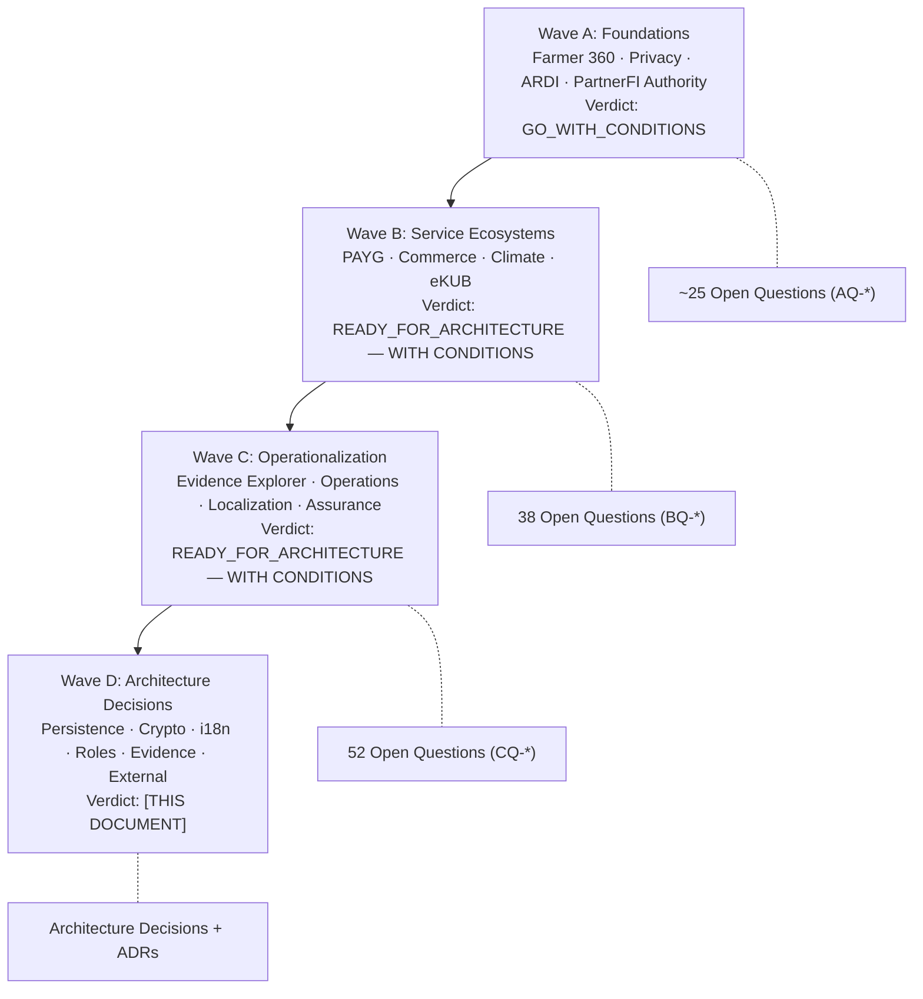

### Cumulative Research Inventory

| Wave | Questions | Gaps | Invariants | Anti-Patterns | External Deps |
|------|----------|------|-----------|---------------|---------------|
| A | ~25 | N/A | 19 | 9 | ~8 |
| B | 38 | N/A | 19 (confirmed) | 12 (expanded) | ~13 |
| C | 52 | 33 (7 CRITICAL) | 19 (verified) | 12 (confirmed) | 13 (0 initiated) |
| D (this) | 40 exit criteria | 33 → 3 closed, 5 partial, 25 open | 30+ (expanded) | 12 (quarantine confirmed) | 13+ (tracked) |

---

## §3 CURRENT LIVE GITHUB BASELINE

**See D0.1 in §4 for full details.**

| Property | Value |
|----------|-------|
| Repository | `https://github.com/abeselomchernet/Phygital-rural-Agent-Hub` |
| Default branch | `main` |
| Current HEAD | `9a8578858e0be1f1e78ce1572119ee85fdcfbf85` |
| Verified at | 2026-10-16T19:22:04Z |
| Open PRs | 0 |
| Total merged PRs | 76 |
| Newest PR | #76 — Audit closure: technical localization completion |
| GPG verified | Yes (valid GitHub web-flow signature) |

---

# D0 — LIVE REPOSITORY RECONCILIATION

## §4 D0.1 Current Main Baseline

| Property | Value |
|----------|-------|
| **Current live main HEAD** | `9a8578858e0be1f1e78ce1572119ee85fdcfbf85` |
| **Default branch** | `main` |
| **Verified at** | 2026-10-16T19:22:04Z |
| **Parent commit** | `f318b4d972a7723706bf9e71d7419e2ab7b49e93` (Wave C reference) |
| **Newest merged PR** | #76 — Audit closure: technical localization completion |
| **Open PRs** | 0 |
| **Wave C baseline SHA** | `a7b1dde` (unverified during Wave C due to network restrictions) |
| **Actual Wave C → D0 delta** | 4 PRs merged (#73, #74, #75, #76) |

### Recent Merged PRs (Post-Wave-C)

| PR | Title | Merged At | SHA | Architecture Impact |
|----|-------|-----------|-----|-------------------|
| #73 | Audit closure: restart-durable synthetic sessions | 2026-10-16T15:26:20Z | `5b26f109842a` | **CRITICAL** — Session persistence now durable |
| #74 | Audit closure: restart-durable Hub idempotency CAS | 2026-10-16T16:21:52Z | `c9bb0e94cb30` | **CRITICAL** — Idempotency CAS now durable with atomic directory persistence |
| #75 | Audit closure: ownership-safe stale lock recovery | 2026-10-16T16:45:05Z | `f318b4d972a7` | **CRITICAL** — File lease system with quarantine-before-delete stale recovery |
| #76 | Audit closure: technical localization completion | 2026-10-16T19:13:59Z | `9a8578858e0b` | **HIGH** — Presentation localization catalog (458L, 3 languages), PresentationLocalization component |

### Earlier Significant PRs (Already in Wave C baseline but confirming lineage)

| PR | Title | Merged At |
|----|-------|-----------|
| #72 | Audit closure: UI hygiene and resilience remediation | 2026-10-16T14:57:51Z |
| #71 | Frontend F10: guided demo and presentation polish | 2026-10-16T14:36:21Z |
| #70 | Frontend F9: end-to-end role journeys and claim audit | 2026-10-16T11:20:29Z |
| #69 | Frontend F8: accessibility, resilience and localization readiness | 2026-10-16T10:41:28Z |
| #68 | Frontend F7: governed Partner Administration portal | 2026-10-16T09:56:54Z |
| #67 | F6: refine Agent field and mobile UX | 2026-10-15T23:13:16Z |
| #66 | F5: add neutrality governance and operations evidence dashboards | 2026-10-15T22:29:39Z |
| #65 | F4: add Corridor Planning and Operator/Device Readiness dashboards | 2026-10-15T21:52:08Z |
| #64 | F3: add Hub Economics and Pilot Evidence dashboards | 2026-10-15T21:14:40Z |
| #63 | F2: integrate governed Hub services and evidence UX | 2026-10-15T20:23:36Z |
| #62 | F1: establish role-based frontend shell and Wishland design system | 2026-10-15T20:05:00Z |
| #61 | Audit follow-up: harden route version pinning and concurrency tests | 2026-10-15T18:37:47Z |
| #60 | Audit follow-up: align Stage-4 presentation claims and package identity | 2026-10-15T18:26:53Z |
| #59 | Security: harden Stage-4 demo API from independent audit | 2026-10-15T18:04:45Z |

### Current Repository File Inventory

**Domain files (src/domain/):** 37 files including:
- `audit.ts`, `adapterRegistry.ts`, `cashFleetPlanning.ts`, `contractCertification.ts`
- `corridorPlanning.ts`, `customer.ts`, `evidenceIntegrity.ts`, `financial.ts`
- `fmcgCommerce.ts`, `hub.ts`, `hubEconomics.ts`, `hubEvidenceManifest.ts`
- `hubLiquidityIntelligence.ts`, `hubNeutralityGovernance.ts`
- `hubOfflineOperationsEvidence.ts`, `hubOperationsTrace.ts`
- `hubOperatorDeviceReadiness.ts`, `hubServiceComposition.ts`
- `hubWorkflowEnvelope.ts`, `hubWorkflowIdempotencyCertification.ts`
- `identity.ts`, `mpesaEthiopiaSandbox.ts`, `mpesaEthiopiaToken.ts`
- `networkLiquidity.ts`, `networkOperationsAuthorization.ts`
- `partnerCapabilityContract.ts`, `partnerEcosystem.ts`
- `partnerOnboarding.ts`, `partnerServiceCatalog.ts`
- `paymentAttempt.ts`, `paymentGateway.ts`, `paymentGatewayReconciliation.ts`
- `paymentGatewayState.ts`, `paymentOrchestration.ts`
- `pilotEvidenceEngine.ts`, `reconciliation.ts`, `residency.ts`
- `stage4StagingTopology.ts`, `syntheticReferencePartners.ts`
- `telebirrPreorderIntent.ts`, `telebirrPreorderResponse.ts`
- `telebirrRawRequest.ts`, `telebirrSandbox.ts`, `telebirrWebCheckout.ts`
- `transport.ts`, `workspaceManifest.ts`

**Server files (src/server/):** 18 files including persistence adapters:
- `app.ts`, `adapter-bootstrap.ts`, `audit.ts`, `audit-persistence.ts`
- `auth.ts`, `customer-persistence.ts`, `demo-api.ts`
- `hub-idempotency-persistence.ts`, `identity-persistence.ts`
- `local-directory-fsync.ts`, `local-file-lease.ts`
- `partner-ledger-persistence.ts`, `payment-attempt-persistence.ts`
- `payment-gateway-persistence.ts`, `payment-gateway-reconciliation-persistence.ts`
- `reconciliation-persistence.ts`, `session-persistence.ts`
- `session-start-rate-limit.ts`, `telebirr-preorder-intent-persistence.ts`
- `transport-persistence.ts`, `workspace.ts`

**Frontend components (src/components/):** 16 files
**Frontend pages (src/pages/):** 38 files
**Test files (tests/):** 61 test files
**Localization:** `src/localization/presentationCatalog.ts`
**Security:** `src/security/edge-storage.ts`

---

## §5 D0.2 Wave-C Gap Reconciliation Matrix

### CRITICAL Gaps (7)

| Gap ID | Wave C Description | Current Main Evidence | Status | Notes |
|--------|-------------------|----------------------|--------|-------|
| **GAP-C2-01** | In-memory transport receiver — crash loses state | `transport-persistence.ts`: `AtomicJsonTransportPersistence` with atomic write-temp-rename, schema validation, crash-safe | **CLOSED_BY_CURRENT_MAIN** | PR #73 introduced durable persistence. Atomic JSON with rename ensures crash safety. |
| **GAP-C2-03** | In-memory idempotency store — crash loses reservations | `hub-idempotency-persistence.ts`: `AtomicDirectoryHubWorkflowIntentPersistence` (212L) with per-scope CAS, bounded lease locks, fsync, atomic rename, ownership-safe stale recovery | **CLOSED_BY_CURRENT_MAIN** | PR #74 introduced restart-durable CAS. Most sophisticated persistence in the codebase. |
| **GAP-C2-10** | In-memory audit events — crash loses audit trail | `audit-persistence.ts`: `AtomicJsonSyntheticAuditPersistence` with atomic write-temp-rename, schema validation | **CLOSED_BY_CURRENT_MAIN** | Audit events now survive process restart. Still single-file JSON snapshot, not append-only WAL. |
| **GAP-C1-03** | No read-access audit trail ("who-viewed-what") | No read-access logging found in `audit.ts` or `auth.ts` — audit events cover AUTH, CUSTOMER, KYC, FINANCIAL, RECONCILIATION, RECOVERY categories only | **STILL_OPEN** | Architecture must add read-access audit event category |
| **GAP-C3-01** | 650+ hardcoded English strings | `presentationCatalog.ts` provides ~60 localized strings (en/am/or). 590+ strings remain hardcoded in page/component TSX files | **PARTIALLY_CLOSED** | PR #76 establishes the pattern but covers only presentation chrome. Domain/page content remains hardcoded. |
| **GAP-C3-03** | Zero Ethiopian Calendar support | No Ethiopian/Ge'ez calendar code found anywhere in current main | **STILL_OPEN** | Architecture must design calendar conversion |
| **GAP-C4-01** | No asymmetric cryptographic signatures | No Ed25519/ECDSA imports, no signing key management, no detached signatures | **STILL_OPEN** | Architecture must design signature infrastructure |

### HIGH Gaps (15)

| Gap ID | Wave C Description | Status | Evidence |
|--------|-------------------|--------|----------|
| **GAP-C1-01** | No unified Evidence Explorer component | **PARTIALLY_CLOSED** | `EvidenceDrawer.tsx` (78L), `OperationsEvidence.tsx` (81L) now exist. Not a full parameterized Evidence Explorer but evidence display components are present. |
| **GAP-C1-02** | Missing roles: Auditor, PFI Reviewer, Pilot Reviewer | **STILL_OPEN** | `auth.ts` still defines only 4 roles: AGENT, SUPERVISOR, OPERATIONS, PARTNER_ADMIN |
| **GAP-C1-04** | Audit stream lacks Merkle sealing | **STILL_OPEN** | No Merkle tree or hash-chain code in audit modules |
| **GAP-C1-08** | Single-string `partnerCustomerId` breaks multi-PFI | **STILL_OPEN** | `customer.ts` still has single-string `partnerCustomerId` |
| **GAP-C2-02** | GhostSync outbox stores plaintext | **STILL_OPEN** | `edge-storage.ts` uses IndexedDB without encryption |
| **GAP-C2-04** | Sandbox-only reconciliation polling | **STILL_OPEN** | Only ArifPay sandbox adapter exists |
| **GAP-C2-06** | All webhook endpoints return 403 | **STILL_OPEN** | Webhook endpoints remain `PROTOTYPE_OPERATION_DISABLED` |
| **GAP-C2-07** | No operational metrics/alerts/dashboards | **PARTIALLY_CLOSED** | `OperationsEvidence.tsx` page exists. No backend metrics/alerting infrastructure. |
| **GAP-C3-02** | Zero Tigrinya and Somali coverage | **STILL_OPEN** | `presentationCatalog.ts` supports only en/am/or |
| **GAP-C3-05** | Legacy pages with invariant violations | **PARTIALLY_CLOSED** | Some legacy pages unmounted but not removed from source tree |
| **GAP-C3-08** | No PWA/Service Worker | **STILL_OPEN** | No service worker registration found |
| **GAP-C3-09** | Sub-12px fonts, low contrast | **PARTIALLY_CLOSED** | PR #69 (F8: accessibility, resilience) addressed some issues. CSS files show improvements. |
| **GAP-C4-03** | No farmer consent schema | **STILL_OPEN** | No ConsentGrant or consent schema in domain files |
| **GAP-C4-04** | No Ethiopian cloud infrastructure | **STILL_OPEN** | `etResidencyApproved: false` correctly maintained |
| **GAP-C4-08** | No defined retention period | **STILL_OPEN** | No retention policy in any domain or server file |

### MEDIUM Gaps (11)

| Gap ID | Wave C Description | Status | Evidence |
|--------|-------------------|--------|----------|
| **GAP-C1-05** | No structured evidence correction workflow | **STILL_OPEN** | No correction schema |
| **GAP-C1-06** | No formal evidence query/filter API | **STILL_OPEN** | Evidence browsing via demo-api only |
| **GAP-C1-07** | No in-browser evidence verification widget | **STILL_OPEN** | No browser-side digest verification UI |
| **GAP-C1-09** | Evidence timestamps lack timezone context display | **STILL_OPEN** | UTC timestamps displayed without localized context |
| **GAP-C2-05** | Human review has no protocol for recording external decisions | **STILL_OPEN** | Placeholder-only human review |
| **GAP-C2-08** | No formal DLQ infrastructure | **STILL_OPEN** | No dead letter queue |
| **GAP-C2-09** | No reconciliation scheduler beyond polling | **STILL_OPEN** | Manual/demo-only reconciliation |
| **GAP-C3-04** | No voice/audio support infrastructure | **STILL_OPEN** | No speech/audio code |
| **GAP-C3-10** | D3 chart alternatives for low-literacy users | **STILL_OPEN** | No alternative data visualization |
| **GAP-C3-11** | No forced-colors/reduced-motion support | **PARTIALLY_CLOSED** | PR #69 addressed some accessibility CSS |
| **GAP-C4-06** | No evidence package versioning | **STILL_OPEN** | No package version schema |
| **GAP-C4-07** | No watermark/classification on exports | **STILL_OPEN** | No classification metadata |

### Gap Reconciliation Summary

| Status | Count | Percentage |
|--------|------:|----------:|
| CLOSED_BY_CURRENT_MAIN | 3 | 9.1% |
| PARTIALLY_CLOSED | 5 | 15.2% |
| STILL_OPEN | 25 | 75.8% |
| **Total** | **33** | 100% |

**The 3 CRITICAL gaps closed by PRs #73-75 (durable persistence for transport, idempotency, audit) represent the single most important architectural change since Wave C. The remaining 4 CRITICAL gaps (read-access audit, localization, Ethiopian calendar, asymmetric signatures) are STILL_OPEN and require D1-D6 architecture decisions.**

---

## §6 D0.3 Current Architecture-Relevant Finding Register

### Finding F-D0-01: Durable Filesystem Persistence Pattern Established

Current main implements a consistent filesystem persistence pattern across all stores:
1. Schema validation via Zod on both load and save
2. Atomic write: `openSync(temp, "wx")` → `writeFileSync` → `fsyncSync` → `renameSync(temp, target)`
3. Crash-safe: temp file cleanup in `finally` block
4. Process-scoped temp filenames: `${file}.${process.pid}.${randomUUID()}.tmp`

The idempotency store (`hub-idempotency-persistence.ts`) goes further with:
- Per-scope directory-based CAS (Compare-And-Set) with revision tracking
- Bounded lease locks via `local-file-lease.ts` with configurable wait/lease timeouts
- Ownership-safe stale lock recovery with quarantine-before-delete pattern
- Directory entry fsync via `local-directory-fsync.ts`

**Architecture implication:** This establishes a PROVEN CURRENT PERSISTENCE PATTERN. The target architecture must evaluate whether to evolve this pattern or replace it with database-backed persistence.

### Finding F-D0-02: Localization Foundation Established But Narrow

PR #76 introduces:
- `presentationCatalog.ts`: Typed localization catalog with 3 languages (en, am, or)
- `PresentationLocaleMetadata` with `regulatedWordingApproved: false` (honest self-assessment)
- `technicalCatalogComplete: true` for all 3 languages
- `localSpeakerReviewRequired: true` for am/or

Coverage: ~60 presentation chrome strings. NOT domain content.

**Architecture implication:** This is a valid starting point but NOT an i18n framework. Architecture must decide whether to extend this pattern or adopt i18next/FormatJS.

### Finding F-D0-03: All Five "Missing" Components Now Exist

Wave C §2.4 classified these as "NOT FOUND":
- `EvidenceDrawer.tsx` (78L) — Evidence detail display
- `BoundedState.tsx` (48L) — Bounded state visualization
- `OperationsEvidence.tsx` (81L) — Operations evidence page
- `GuidedDemo.tsx` (170L) — Interactive guided demo
- `AgentFieldStatus.tsx` (77L) — Agent field status component

All 5 were added by PRs #62-#72 (Frontend F1-F10 series).

**Architecture implication:** The Evidence Explorer gap (GAP-C1-01) is PARTIALLY_CLOSED. Components exist but lack parameterized role-based browsing and full query capabilities.

### Finding F-D0-04: Persistence Interface Pattern for Migration

All persistence stores implement a common interface pattern:
```typescript
interface XxxPersistence {
  load(): XxxSnapshot | undefined;
  save(snapshot: XxxSnapshot): void;
}
```

This clean interface pattern means migrating from filesystem to database requires only new implementations of these interfaces, NOT changes to domain logic.

**Architecture implication:** Clean persistence interfaces make an evolutionary migration feasible, but implementation risk remains to be proven through migration, rollback, concurrency, crash-recovery and backup/restore tests.

### Finding F-D0-05: Local File Lease System Complexity

`local-file-lease.ts` (189 lines) implements a sophisticated lease-based locking system with:
- UUID-based ownership tracking
- PID and hostname recording
- Configurable lease duration (max 300s)
- Stale lock detection and recovery
- Quarantine-before-delete safety
- Atomic lock acquisition and release
- Ownership verification before release

**Architecture implication:** This is a LOCAL/SHARED-FILESYSTEM coordination mechanism, not distributed consensus. Moving to multi-host requires replacing this with database-level locking or distributed lock service.

---

### D0.4 Superseded-Assumption Register

| # | Wave C Assumption | Current Status | Action |
|---|------------------|----------------|--------|
| 1 | "In-memory transport receiver — crash loses state" (GAP-C2-01) | **SUPERSEDED** — `AtomicJsonTransportPersistence` provides crash-safe persistence | CLOSED — remove from gap register |
| 2 | "In-memory idempotency store — crash loses reservations" (GAP-C2-03) | **SUPERSEDED** — `AtomicDirectoryHubWorkflowIntentPersistence` provides durable CAS with lease locks | CLOSED — remove from gap register |
| 3 | "In-memory audit events — crash loses audit trail" (GAP-C2-10) | **SUPERSEDED** — `AtomicJsonSyntheticAuditPersistence` provides crash-safe persistence | CLOSED — remove from gap register |
| 4 | "EvidenceDrawer.tsx NOT FOUND" (§2.4) | **SUPERSEDED** — Component exists (78L) in current main | CLOSED — component present |
| 5 | "BoundedState.tsx NOT FOUND" (§2.4) | **SUPERSEDED** — Component exists (48L) in current main | CLOSED — component present |
| 6 | "OperationsEvidence.tsx NOT FOUND" (§2.4) | **SUPERSEDED** — Page exists (81L) in current main | CLOSED — page present |
| 7 | "GuidedDemo.tsx NOT FOUND" (§2.4) | **SUPERSEDED** — Page exists (170L) in current main | CLOSED — page present |
| 8 | "AgentFieldStatus.tsx NOT FOUND" (§2.4) | **SUPERSEDED** — Component exists (77L) in current main | CLOSED — component present |
| 9 | "12 terms in Amharic and Afaan Oromoo" (Wave C §26) | **SUPERSEDED** — `presentationCatalog.ts` now provides ~60 localized terms | UPDATE — localization foundation expanded but still narrow |
| 10 | Wave C GitHub baseline SHA `a7b1dde` unverified | **SUPERSEDED** — Verified current SHA is `9a857885` via live API | CLOSED — baseline independently verified |
| 11 | "Feature branch family not merged to main" (Wave C §2.2) | **SUPERSEDED** — All E1-E9 feature branch content now merged via PRs #58-#76 | CLOSED — all feature branches merged to main |

**Total superseded assumptions: 11**
**Of which architecturally significant: 3 (persistence gaps closed), 5 (components now exist), 1 (localization expanded)**
## §7 IMMUTABLE GOVERNANCE INVARIANTS

Wave D inherits and expands all Wave A/B/C invariants. The complete set:

### Core Authority Invariants

| # | Invariant | Current / Target Evidence Reference | Architecture Status |
|---|-----------|-------------------|--------|
| 1 | SERVICE ≠ CAPABILITY ≠ ROUTE ≠ ADAPTER | `hubServiceComposition.ts`, `adapterRegistry.ts`, `partnerCapabilityContract.ts` | PRESERVED_IN_BASELINE |
| 2 | Visibility ≠ Authority | All UI components are read-only projections | PRESERVED_IN_BASELINE |
| 3 | UI ≠ Authorization | No UI action creates financial authority | PRESERVED_IN_BASELINE |
| 4 | Data ≠ Evidence | `hubEvidenceManifest.ts` schema validation | PRESERVED_IN_BASELINE |
| 5 | Evidence ≠ Interpretation | ARDI vectors separate from evidence | PRESERVED_IN_BASELINE |
| 6 | Interpretation ≠ Recommendation | ARDI outputs carry separate fields | PRESERVED_IN_BASELINE |
| 7 | Recommendation ≠ Decision | `PARTNERFI_DECISION_REQUIRED` markers | PRESERVED_IN_BASELINE |
| 8 | Recommendation ≠ Approval | 42 `z.literal(false)` fields | PRESERVED_IN_BASELINE |
| 9 | Digest ≠ Semantic Truth | SHA-256 proves byte-equality, not truth | PRESERVED_IN_BASELINE |
| 10 | Integrity ≠ External Verification | `externallyVerified: false` | PRESERVED_IN_BASELINE |

### State Machine Invariants

| # | Invariant | Current / Target Evidence Reference | Architecture Status |
|---|-----------|-------------------|--------|
| 11 | Queued ≠ Submitted | Transport state machine | PRESERVED_IN_BASELINE |
| 12 | Submitted ≠ Acknowledged | Gateway state machine | PRESERVED_IN_BASELINE |
| 13 | Acknowledged ≠ Authorized | Partner authority boundary | PRESERVED_IN_BASELINE |
| 14 | Offline Capture ≠ Acceptance | `hubOfflineOperationsEvidence.ts` re-eval | PRESERVED_IN_BASELINE |
| 15 | Provider Success ≠ PartnerFI Settlement | `paymentGateway.ts` state separation | PRESERVED_IN_BASELINE |

### Domain-Specific Invariants

| # | Invariant | Current / Target Evidence Reference | Architecture Status |
|---|-----------|-------------------|--------|
| 16 | Payment Observation ≠ Debt Settlement | `controlEnabled: z.literal(false)` | PRESERVED_IN_BASELINE |
| 17 | Inventory Observation ≠ Commercial Settlement | `fmcgCommerce.ts` observation-only | PRESERVED_IN_BASELINE |
| 18 | Climate Observation ≠ Insurance Payout Authorization | Insurer decides | PRESERVED_IN_BASELINE |
| 19 | Telemetry ≠ Device Authority | `controlEnabled: z.literal(false)` | PRESERVED_IN_BASELINE |
| 20 | Readiness ≠ Authority | Training completion ≠ regulated authority | PRESERVED_IN_BASELINE |
| 21 | eKUB Participation ≠ Creditworthiness | MA-1 target firewall + mandatory NO_EKUB_DATA_FLOWS_TO_ARDI executable test | PRESERVED_IN_BASELINE |
| 22 | ARDI Recommendation ≠ Credit Approval | `NON_BINDING` mandatory | PRESERVED_IN_BASELINE |

### Evidence Quality Invariants

| # | Invariant | Current / Target Evidence Reference | Architecture Status |
|---|-----------|-------------------|--------|
| 23 | Synthetic ≠ Observed | `syntheticOnly: true` | PRESERVED_IN_BASELINE |
| 24 | Observed ≠ Externally Authoritative | External authority markers | PRESERVED_IN_BASELINE |
| 25 | Missing ≠ Failed | `OUTCOME_UNCERTAIN` ≠ `GATEWAY_FAILED` | PRESERVED_IN_BASELINE |
| 26 | Unknown ≠ Negative | Missing evidence = UNKNOWN | PRESERVED_IN_BASELINE |
| 27 | Expired ≠ Rejected | `GATEWAY_EXPIRED` ≠ `GATEWAY_FAILED` | PRESERVED_IN_BASELINE |

### Pilot Invariants

| # | Invariant | Current / Target Evidence Reference | Architecture Status |
|---|-----------|-------------------|--------|
| 28 | Training ≠ Regulated Authority | `readinessCreatesFinancialAuthority: false` | PRESERVED_IN_BASELINE |
| 29 | Pilot Target ≠ Pilot Approval | `numericThresholdSelfAuthorizesScale: false` | PRESERVED_IN_BASELINE |
| 30 | Pilot Evidence ≠ Scale Authority | Independent approval required | PRESERVED_IN_BASELINE |

**Result: all 30 invariants are preserved by the v1.1.1 architecture baseline. Some controls are CURRENT_IMPLEMENTED; target-only controls remain TARGET_STAGE4_INTERNAL and require implementation plus executable verification before they may be described as enforced in running code.**

---

## §8 ARCHITECTURE PRINCIPLES

### P1: Preserve Authority Boundaries Under All Conditions
No architecture decision may weaken the separation between Enawuga's evidence/orchestration role and authorized institutions' decision-making authority. This applies even when a simpler architecture could be achieved by relaxing boundaries.

### P2: Distinguish Current from Target from Future-External
Every architecture diagram and decision must explicitly label what EXISTS NOW, what the TARGET ARCHITECTURE specifies, and what requires EXTERNAL parties to activate. Conflating these creates false readiness claims.

### P3: Prefer Evolutionary Migration Over Big-Bang Replacement
The current filesystem persistence pattern is PROVEN and TESTED. Any target persistence architecture must define a gradual migration path, not a wholesale replacement.

### P4: Interface Stability Over Implementation Freedom
Clean persistence interfaces (`load()/save()`) enable backend replacement without domain changes. Architecture must preserve and extend this pattern.

### P5: Fail Closed Under Uncertainty
When state is uncertain (OUTCOME_UNCERTAIN, RECONCILIATION_REQUIRED), the system must halt and require human review rather than optimistically proceeding.

### P6: Self-Honest Declaration of Limitations
The codebase's `syntheticOnly: true`, `etResidencyApproved: false`, `regulatedModeAllowed: false` declarations are architectural virtues to be preserved, not embarrassments to be removed.

### P7: No Cryptographic Overengineering
Cryptographic mechanisms serve specific, bounded purposes. Hash chains prove append-only ordering. Signatures prove authorship. Neither proves semantic truth. Architecture must document exactly what each mechanism proves and does not prove.

### P8: Privacy by Architecture, Not by Policy
PPID isolation, field-level redaction, consent gating, and purpose-bound access are architecture-enforced, not documentation-aspirational.

---

# WAVE D WORKSTREAM D1 — PERSISTENCE & INFRASTRUCTURE ARCHITECTURE

---

**Document ID:** `WAVE_D_WORKSTREAM_D1_PERSISTENCE_INFRASTRUCTURE`
**Classification:** ARCHITECTURE DECISION PACKAGE — READ-ONLY SOURCE INSPECTION — NO IMPLEMENTATION
**Version:** 1.0.0
**Date:** 2026-10-16
**Author:** Wave D Orchestrator (D1 assembled from D0 reconciliation + source inspection)
**Live Main Commit Baseline:** `SHA 9a8578858e0be1f1e78ce1572119ee85fdcfbf85`

---

## §9 D1.1 PERSISTENCE TARGET ARCHITECTURE

### Current State (PROVEN)

Current main implements a consistent filesystem persistence pattern across ALL critical stores:

| Store | Adapter | Durability | Concurrency |
|-------|---------|-----------|-------------|
| Transport receipts | `AtomicJsonTransportPersistence` | Atomic write-temp-rename | Single-process |
| Idempotency CAS | `AtomicDirectoryHubWorkflowIntentPersistence` | Per-scope CAS + fsync + lease locks | Multi-process (local filesystem) |
| Audit events | `AtomicJsonSyntheticAuditPersistence` | Atomic write-temp-rename | Single-process |
| Sessions | `session-persistence.ts` | Durable file persistence | Single-process |
| Customers | `customer-persistence.ts` | File persistence | Single-process |
| Identity | `identity-persistence.ts` | File persistence | Single-process |
| Partner ledger | `partner-ledger-persistence.ts` | File persistence | Single-process |
| Payment attempts | `payment-attempt-persistence.ts` | File persistence | Single-process |
| Payment gateway | `payment-gateway-persistence.ts` | File persistence | Single-process |
| Payment reconciliation | `payment-gateway-reconciliation-persistence.ts` | File persistence | Single-process |
| Reconciliation | `reconciliation-persistence.ts` | File persistence | Single-process |
| Telebirr preorder | `telebirr-preorder-intent-persistence.ts` | File persistence | Single-process |

**Architecture Observation:** All adapters implement a clean interface pattern:
```typescript
interface XxxPersistence {
  load(): XxxSnapshot | undefined;
  save(snapshot: XxxSnapshot): void;
}
```

This enables backend replacement WITHOUT domain logic changes.

### Options Evaluated

#### Option A: Continue Filesystem Persistence

**Pros:** Already proven, zero external dependencies, works offline, crash-safe via atomic rename
**Cons:** No ACID transactions spanning multiple stores, no SQL query capability, single-file snapshot serialization limits scale, no multi-host support, backup complexity, no referential integrity

#### Option B: PostgreSQL as Primary Governed Transactional Persistence

**Pros:** ACID transactions, SQL query capability, referential integrity, mature backup/recovery tooling, connection pooling, and row-level locking suitable for replacing the current file-lease coordination in the target design. Production hosting/residency availability remains an external infrastructure decision.
**Cons:** External dependency, operational complexity, requires DBA knowledge, cold-start latency, not available offline (edge must use local store)

#### Option C: PostgreSQL + Append-Only Evidence/Audit Structures

**Pros:** All Option B benefits, plus dedicated append-only tables for audit/evidence with INSERT-only policies (no UPDATE/DELETE), separate retention/archival policies
**Cons:** Slightly more complex schema design

#### Option D: Purpose-Specific Multiple Stores

**Pros:** Best-of-breed per use case (PostgreSQL for transactions, Redis for cache, S3 for evidence blobs)
**Cons:** Operational explosion, inconsistency risks, excessive complexity for current scale

### DECISION: Option C — PostgreSQL + Append-Only Evidence/Audit

**Rationale:** PostgreSQL provides the transactional guarantees needed for multi-host evolution while append-only structures preserve audit immutability. The clean persistence interface pattern supports an evolutionary migration, but migration risk remains implementation-dependent and requires rollback, dual-read/write, concurrency, crash-recovery, and backup/restore validation.

---

## §10 D1.2 STORAGE CLASSIFICATION MATRIX

| Storage Class | Description | Mutability | Retention | Current Implementation | Target |
|--------------|-------------|-----------|-----------|----------------------|--------|
| **TRANSACTIONAL_STATE** | Active workflow state, session state, customer records | Read-write with CAS | Policy-defined; no authoritative post-activity period selected | Atomic JSON files | PostgreSQL tables with row-level locking |
| **APPEND_ONLY_EVIDENCE** | Evidence manifests, workflow envelopes, signed packages | Insert-only, never modified | ILLUSTRATIVE_ONLY — PENDING_LEGAL_REVIEW; no statutory period selected | N/A (in-memory) | PostgreSQL append-only tables with INSERT-only policy |
| **AUDIT_EVENT** | Security events, access logs, state transitions | Insert-only, never modified | ILLUSTRATIVE_ONLY — PENDING_LEGAL_REVIEW; no statutory period selected | AtomicJsonSyntheticAuditPersistence | PostgreSQL partitioned table, monthly partitions, WORM backup |
| **EPHEMERAL_CACHE** | Rate limit counters, session lookup cache | Volatile, TTL-based | Engineering TTL; REQUIRES_BENCHMARK / security policy | In-memory Map/Set | In-memory or governed shared cache if multi-host requires it |
| **OFFLINE_EDGE_STATE** | Offline outbox, intent/evidence queue, cached bundles | Write offline, reconcile/sync online | Freshness/expiry policy is configurable; no fixed production duration | IndexedDB (edge-storage.ts) | Encrypted edge storage target with fail-closed sync semantics |
| **DERIVED_PROJECTION** | Farmer 360 views, ARDI vectors, dashboards | Computed from evidence | Until source invalidation | N/A (computed on demand) | PostgreSQL materialized views or computed cache |
| **CONFIGURATION** | Route definitions, adapter configs, partner contracts | Admin-controlled, versioned | Version/history policy-defined | In-memory / code constants | PostgreSQL config tables with version history |
| **CONTENT_BUNDLE** | Locale bundles, training content, help text | Versioned, digest-verified | Per governed freshness/content lifecycle | presentationCatalog.ts (compiled) | Governed store + online/offline distribution; technology implementation-dependent |
| **EXTERNAL_REFERENCE** | Partner callback receipts, gateway responses | Insert-only, partner-sourced | RETENTION_POLICY_EXTERNAL_DECISION_REQUIRED | Atomic JSON files | PostgreSQL append-only with source attribution |

---

## §11 D1.3 TRANSACTION BOUNDARY DIAGRAM

```mermaid
flowchart TD
    subgraph TX1["Transaction Boundary 1: CAPTURE"]
        C1["Agent captures<br/>farmer request"]
        C2["Validate input<br/>(Zod schema)"]
        C3["Create idempotency<br/>reservation (CAS)"]
        C4["Persist queued<br/>envelope"]
    end
    
    subgraph TX2["Transaction Boundary 2: ROUTING"]
        R1["Load envelope"]
        R2["Resolve route<br/>(version-pinned)"]
        R3["Select adapter"]
        R4["Record routing<br/>decision"]
    end
    
    subgraph TX3["Transaction Boundary 3: SUBMISSION"]
        S1["Submit to<br/>external provider"]
        S2["Record submission<br/>attempt"]
        S3["Await response"]
    end
    
    subgraph EXTERNAL["EXTERNAL — No Transaction Guarantee"]
        E1["Provider processes"]
        E2["Provider responds<br/>or times out"]
    end
    
    subgraph TX4["Transaction Boundary 4: OBSERVATION"]
        O1["Parse provider<br/>response"]
        O2["Record observation<br/>(evidence)"]
        O3["Update workflow<br/>state"]
        O4["Emit audit event"]
    end
    
    subgraph TX5["Transaction Boundary 5: RECONCILIATION"]
        RC1["Query provider<br/>status"]
        RC2["Compare with<br/>internal state"]
        RC3["Record reconciliation<br/>result"]
        RC4["Flag discrepancies<br/>for human review"]
    end
    
    TX1 --> TX2 --> TX3 --> EXTERNAL --> TX4
    TX4 -.->|"OUTCOME_UNCERTAIN"| TX5
    TX4 -.->|"RECONCILIATION_REQUIRED"| TX5
    
    style EXTERNAL fill:#ffe6e6,stroke:#cc0000
```

### Transaction Semantics

| Boundary | Semantics | Failure Behavior | Current | Target |
|----------|-----------|-----------------|---------|--------|
| TX1 Capture | AT_MOST_ONCE — CAS prevents duplicate | CONFLICT_REVIEW_REQUIRED if duplicate | File CAS with lease | PostgreSQL INSERT with unique constraint |
| TX2 Routing | IDEMPOTENT — same input always routes same | Route mismatch → reject | In-memory resolve | PostgreSQL lookup + version check |
| TX3 Submission | AT_MOST_ONCE_ATTEMPT — no automatic retry on ambiguity | OUTCOME_UNCERTAIN if timeout | HTTP call | HTTP call (unchanged) |
| TX4 Observation | IDEMPOTENT_RETRY — same observation updates same record | DUPLICATE_NOOP if already recorded | File write | PostgreSQL UPSERT with revision check |
| TX5 Reconciliation | RECONCILIATION_REQUIRED — external authority determines truth | CONFLICT_REVIEW_REQUIRED if mismatch | Sandbox polling | PostgreSQL state comparison + human review |

---

## §12 D1.4 IDEMPOTENCY / CONCURRENCY ARCHITECTURE

### Current Implementation (PROVEN)

`AtomicDirectoryHubWorkflowIntentPersistence` (212 lines):
- **Scope-based CAS:** Each workflow intent gets a unique scope → SHA-256 digest → file path
- **Revision tracking:** Monotonic revision counter (starts at 1, increments on each CAS)
- **Bounded lease locks:** `withLocalFileLeaseSync()` with configurable wait (max 30s) and lease (max 300s)
- **Ownership-safe recovery:** Stale locks are quarantined-before-deleted with ownership verification
- **Crash safety:** fsync on write, directory entry fsync, atomic rename

### Target Architecture

| Aspect | Current (Filesystem) | Target (PostgreSQL) |
|--------|---------------------|---------------------|
| CAS operation | File rename + fsync | `UPDATE ... WHERE revision = $expected RETURNING revision` |
| Locking | Local file lease | PostgreSQL `SELECT ... FOR UPDATE` or advisory locks |
| Multi-process | Lease-based coordination | Database transaction isolation |
| Multi-host | NOT SUPPORTED | PostgreSQL replication + connection pooling |
| Conflict detection | Lease ownership loss | Serialization failure → retry or reject |
| Stale recovery | Quarantine-before-delete | Lock timeout + advisory lock release |

### Multi-Host Evolution Strategy

1. **Phase 1 (Current):** Single-process, filesystem persistence — PROVEN
2. **Phase 2 (Stage-4):** Single-host, PostgreSQL — database transactions replace file leases
3. **Phase 3 (Future):** Multi-host with PostgreSQL replication — row-level locking + advisory locks
4. **Phase 4 (Scale):** Connection pooling (PgBouncer) + read replicas — NO claims of distributed consensus

**Critical constraint:** Enawuga does NOT claim distributed exactly-once behavior. Multi-host deployment uses AT_MOST_ONCE_ATTEMPT with RECONCILIATION_REQUIRED for uncertain outcomes.

---

## §13 D1.5 OUTBOX / INBOX / DLQ ARCHITECTURE

### Transactional Outbox

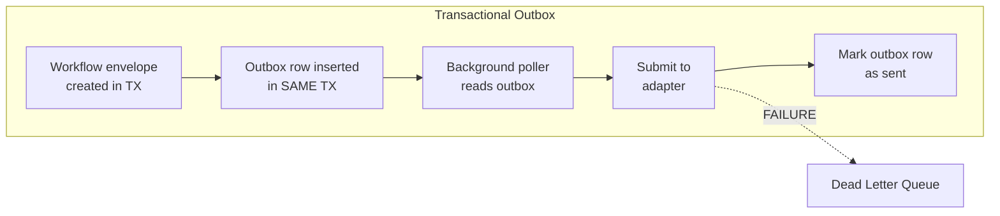

**Design:**
- Outbox rows are created in the same database transaction as the workflow state change
- Background poller reads unsent rows and submits to appropriate adapters
- Poller marks rows as sent only after adapter confirms submission
- Failed submissions (after bounded retry) move to Dead Letter Queue
- No at-most-once guarantee on send — idempotency CAS handles duplicate submission

### Partner Inbox (Callback Receiver)

- Receives webhook callbacks from payment providers (Telebirr, ArifPay, M-PESA)
- Validates HMAC-SHA256 signature on callback payload
- Records callback receipt in APPEND_ONLY_EVIDENCE store
- Updates workflow state via CAS (idempotent — duplicate callbacks produce DUPLICATE_NOOP)
- Current: All webhook endpoints return 403 PROTOTYPE_OPERATION_DISABLED
- Target: Authenticated webhook endpoints with per-partner signing key verification

### Dead Letter Queue

- Receives: failed submissions after retry exhaustion, schema validation failures, route resolution failures
- Each DLQ entry contains: original envelope, failure reason, attempt count, timestamp, correlation ID
- Supervisor notification on DLQ insertion
- Manual review required — NO automatic retry from DLQ
- DLQ entries are APPEND_ONLY (cannot be deleted, only marked as resolved)

### Retry Semantics

| Retry Type | Behavior | Max Attempts | Backoff |
|-----------|----------|-------------|---------|
| TRANSPORT_RETRY | Network-level retry for transient failures | 3 | Exponential (1s, 2s, 4s) |
| BUSINESS_MUTATION_RETRY | NOT ALLOWED — mutations are AT_MOST_ONCE | 0 | N/A |
| RECONCILIATION_RETRY | Status query retry for OUTCOME_UNCERTAIN | 5 | Linear (30s intervals) |
| DLQ_RESUBMISSION | Manual only — requires supervisor approval | 1 (manual) | N/A |

---

## §14 D1.6 BACKUP / RESTORE / RECOVERY REQUIREMENTS

| Requirement | Current | Target |
|-------------|---------|--------|
| Backup frequency | Manual file copy | pg_dump daily + WAL archiving continuous |
| Point-in-time recovery | Not supported | PostgreSQL PITR via WAL replay |
| Recovery Point Objective | Last file write (best-effort) | ≤ 1 transaction (WAL) |
| Recovery Time Objective | Process restart (~seconds) | ≤ 5 minutes (container + consistency check) |
| Backup verification | Manual | Automated restore test weekly |
| Backup encryption | Not encrypted | AES-256 encryption at rest |
| Backup location | Same filesystem | Separate ET-resident storage |
| Audit backup | Same as data | Separate WORM storage (append-only, 10-year retention) |
| Evidence backup | Same as data | Separate archive with digest verification |

---

## §15 D1.7 CURRENT FILESYSTEM → TARGET MIGRATION STRATEGY

### Phase 1: Interface Preservation
- New PostgreSQL adapters implement SAME `XxxPersistence` interfaces
- Domain logic remains unchanged — zero modification to domain files
- Both filesystem and PostgreSQL adapters can coexist

### Phase 2: Dual-Write Period
- Write to BOTH filesystem and PostgreSQL
- Read from filesystem (proven path)
- Compare results to verify PostgreSQL consistency
- Duration: minimum 2 weeks in staging

### Phase 3: Read Switchover
- Read from PostgreSQL, write to both
- Filesystem becomes backup/fallback
- Monitor for discrepancies

### Phase 4: Filesystem Deprecation
- Stop writing to filesystem
- Keep filesystem data for historical reference
- PostgreSQL becomes sole persistence backend

### Migration Data Volumes (Estimated)

| Store | Records (Synthetic) | Estimated Size | Migration Complexity |
|-------|-------------------|----------------|---------------------|
| Customers | ~100 synthetic | < 1 MB | LOW — JSON → row |
| Transactions | ~500 synthetic | < 5 MB | LOW — JSON → rows |
| Audit events | ~2,000 synthetic | < 10 MB | LOW — JSON → append-only rows |
| Idempotency | ~200 synthetic | < 1 MB | MEDIUM — CAS semantics must be preserved |
| Sessions | ~50 synthetic | < 1 MB | LOW — JSON → rows with TTL |

---

## §16 D1.8 ET RESIDENCY LOGICAL TOPOLOGY

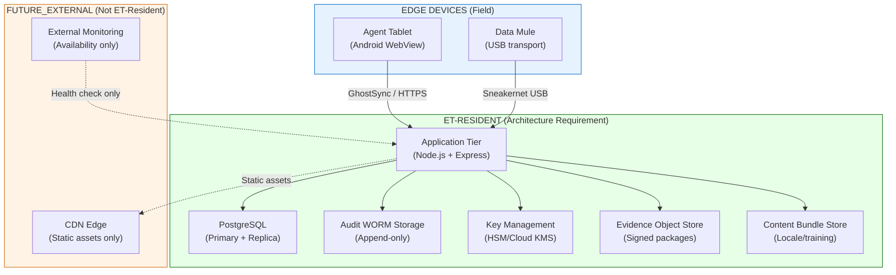

### ET Residency Requirements

| Component | ET Residency | Justification |
|-----------|-------------|---------------|
| Application server | REQUIRED | Processes Ethiopian farmer data |
| Primary database | REQUIRED | Stores PII, financial evidence |
| Replica database | REQUIRED | Contains same data |
| Audit storage | REQUIRED | Ethiopian regulatory compliance |
| Key management | REQUIRED | Signing keys for Ethiopian evidence |
| Evidence store | REQUIRED | Contains farmer evidence |
| Content bundles | REQUIRED | Contains Ethiopian language content |
| CDN edge | NOT REQUIRED | Static assets only (JS, CSS, fonts) |
| Monitoring | NOT REQUIRED | Availability metrics only, no PII |

**Status:** `etResidencyApproved: false` — correctly maintained. Architecture defines REQUIREMENTS, not VERIFIED DEPLOYMENT.

---

## §17 D1 ARCHITECTURE DECISION RECORDS

### ADR-D1-01: Primary Persistence Architecture

| Field | Value |
|-------|-------|
| **ADR ID** | ADR-D1-01 |
| **Title** | PostgreSQL as Primary Governed Transactional Persistence with Append-Only Audit Structures |
| **Status** | ACCEPTED_INTERNAL |
| **Problem** | Current filesystem persistence (atomic JSON + file leases) is proven for single-process but cannot support multi-host deployment, SQL queries, referential integrity, or ACID multi-store transactions |
| **Research Inputs** | Wave C GAP-C2-01 (closed by PR #73), GAP-C2-03 (closed by PR #74), GAP-C2-10 (closed by PR #73). Current persistence interfaces. CQ-CROSS-01 |
| **Current Repository Evidence** | 12 persistence adapters with clean `load()/save()` interfaces. AtomicDirectoryHubWorkflowIntentPersistence (212L) with CAS + lease locks. All adapters use atomic write-temp-rename. |
| **Constraints** | Must preserve existing interface contracts. Must support ET-resident deployment. Must be operational by small team. Must handle offline edge devices. |
| **Options Considered** | A: Continue filesystem. B: PostgreSQL primary. C: PostgreSQL + append-only audit. D: Multi-store (Postgres + Redis + S3). |
| **Decision** | Option C: PostgreSQL + append-only audit/evidence structures |
| **Rationale** | PostgreSQL provides transactional primitives suitable for the target state model and mature backup/query tooling. Append-only application structures can preserve evidence history. Clean interfaces support incremental migration, but migration risk and the production hosting/residency solution require validation. |
| **Security Consequences** | Database access requires authentication. Encryption at rest. Network encryption (TLS). Connection pooling limits exposure. |
| **Privacy Consequences** | PII centralized in database — requires field-level encryption (D2), row-level access control, audit logging of all queries. |
| **Authority Consequences** | None — persistence technology does not affect authority boundaries. |
| **Offline Consequences** | Edge devices continue using IndexedDB. PostgreSQL is server-side only. Offline → online sync unchanged. |
| **Operational Consequences** | Requires DBA operational knowledge. Backup/restore procedures. Monitoring (connection pool, disk, WAL). |
| **Migration Consequences** | Gradual migration via interface preservation. Dual-write period. Zero domain logic changes. |
| **Testing Consequences** | All 61 existing tests must pass against PostgreSQL adapters. Add persistence-specific tests: crash recovery, concurrent access, backup/restore. |
| **What This Decision Does NOT Authorize** | Database creation, schema creation, cloud infrastructure provisioning, production deployment, data migration of real customer data. |
| **External Dependencies** | Production hosting/residency solution: EXTERNAL_VALIDATION_REQUIRED / LEGAL_POLICY_DEPENDENT. |
| **Open Questions** | Connection pooling configuration. Read replica placement. WAL archiving storage. Monitoring tool selection. |
| **Reversibility** | HIGH — interface preservation means filesystem adapters remain available as fallback. |
| **Implementation Preconditions** | ET-resident hosting selection, DBA availability, staging environment. |

### ADR-D1-02: Transaction Boundary Architecture

| Field | Value |
|-------|-------|
| **ADR ID** | ADR-D1-02 |
| **Title** | Five-Boundary Transaction Architecture with AT_MOST_ONCE External Submission |
| **Status** | ACCEPTED_INTERNAL |
| **Problem** | Current single-file transactions cannot span multiple stores. External provider interactions cannot guarantee exactly-once delivery. |
| **Research Inputs** | Wave C §18 state machines, CQ-C2-03, current idempotency CAS design |
| **Current Repository Evidence** | hubWorkflowIdempotencyCertification.ts dual-digest scheme, paymentGateway.ts OUTCOME_UNCERTAIN handling, reconciliation.ts three-way comparison |
| **Constraints** | Cannot claim distributed exactly-once. External providers are black boxes. Offline capture must be AT_MOST_ONCE_ATTEMPT. |
| **Options Considered** | A: Single global transaction. B: Per-boundary transactions with compensation. C: Five-boundary model with explicit failure semantics. |
| **Decision** | Option C: Five transaction boundaries (Capture, Routing, Submission, Observation, Reconciliation) |
| **Rationale** | Each boundary has distinct failure semantics. External submission is inherently uncertain. Reconciliation handles the gap between internal state and external truth. |
| **Security Consequences** | Each boundary enforces its own validation. No cross-boundary trust assumptions. |
| **Privacy Consequences** | PII exposure is bounded to each transaction's scope. |
| **Authority Consequences** | External authority (PartnerFI settlement) remains outside all transaction boundaries. |
| **Offline Consequences** | Offline capture creates TX1 locally. TX2-TX5 execute upon sync. |
| **Operational Consequences** | Clear failure semantics per boundary. OUTCOME_UNCERTAIN triggers human review, not automatic retry. |
| **Migration Consequences** | Current filesystem CAS maps directly to PostgreSQL CAS. |
| **Testing Consequences** | Each boundary requires specific failure-mode testing. |
| **What This Decision Does NOT Authorize** | Distributed transactions, two-phase commit across external providers, automatic settlement. |
| **External Dependencies** | None (internal architecture decision). |
| **Open Questions** | Compensation strategy for partial failures across boundaries. |
| **Reversibility** | MEDIUM — boundary structure is foundational but boundary count can evolve. |
| **Implementation Preconditions** | D1.1 persistence decision. |

### ADR-D1-03: Storage Classification Architecture

| Field | Value |
|-------|-------|
| **ADR ID** | ADR-D1-03 |
| **Title** | Nine-Class Storage Classification with Distinct Retention and Mutability Policies |
| **Status** | ACCEPTED_INTERNAL |
| **Problem** | All data currently stored with same persistence pattern (atomic JSON files) regardless of mutability, retention, or access requirements. |
| **Research Inputs** | Wave C CQ-C4-08 (retention), CQ-C2-01 (persistence), audit requirements |
| **Current Repository Evidence** | 12 persistence adapters, all using same JSON snapshot pattern. No retention enforcement. No access-level distinction. |
| **Constraints** | Must support configurable, legally reviewed retention without hardcoding unsupported periods. Must support data minimization and offline edge operation. |
| **Options Considered** | A: Uniform storage. B: Two-class (mutable/immutable). C: Nine-class per domain requirements. |
| **Decision** | Option C: Nine storage classes (TRANSACTIONAL_STATE, APPEND_ONLY_EVIDENCE, AUDIT_EVENT, EPHEMERAL_CACHE, OFFLINE_EDGE_STATE, DERIVED_PROJECTION, CONFIGURATION, CONTENT_BUNDLE, EXTERNAL_REFERENCE) |
| **Rationale** | Each class has distinct mutability, retention, access, and residency requirements. Uniform treatment either over-retains or under-protects. |
| **Security Consequences** | AUDIT_EVENT class gets highest protection (WORM, separate backup). |
| **Privacy Consequences** | TRANSACTIONAL_STATE enables field-level encryption. DERIVED_PROJECTION uses PPIDs. |
| **Authority Consequences** | EXTERNAL_REFERENCE class explicitly marks partner-sourced data. |
| **Offline Consequences** | OFFLINE_EDGE_STATE class specifically designed for IndexedDB. |
| **Operational Consequences** | Different backup/retention policies per class. |
| **Migration Consequences** | Current JSON files map to appropriate storage classes. |
| **Testing Consequences** | Each class requires retention and access policy testing. |
| **What This Decision Does NOT Authorize** | Specific retention period selection (requires LEGAL_REVIEW_REQUIRED). |
| **External Dependencies** | Legal review for retention periods. Privacy review for data minimization policies. |
| **Open Questions** | Exact retention periods. Archival strategy. Cross-class referential integrity. |
| **Reversibility** | HIGH — classes can be merged or split without fundamental architecture change. |
| **Implementation Preconditions** | D1.1 persistence decision. Legal retention review is required before enforcing production purge/archive periods, not before building policy-neutral storage classes. |
# ENAWUGA / PHYGITAL RURAL AGENT HUB
# WAVE D ARCHITECTURE SPECIFICATION & DECISION PACKAGE
## WORKSTREAM D2: CRYPTOGRAPHIC TRUST, PRIVACY & IDENTITY ARCHITECTURE

---

**Document ID:** `ENAWUGA_WAVE_D_D2_CRYPTO_IDENTITY_SPECIFICATION`  
**Classification:** ARCHITECTURE DESIGN & DECISION PACKAGE — READ-ONLY BASELINE INSPECTION — NO CODE MUTATIONS  
**Baseline Repository SHA:** `9a8578858e0be1f1e78ce1572119ee85fdcfbf85` (origin/main)  
**Parent Reference:** `f318b4d972a7723706bf9e71d7419e2ab7b49e93`  
**Author:** D2 Cryptographic / Privacy / Identity Architect (Wave D Engineering Architecture)  
**Target File Path:** `/home/abese12/.gemini/antigravity/brain/14d6961f-a7d1-448b-95a3-9c4322401ad2/scratch/wave-d/d2-crypto-identity.md`  

---

### Non-Negotiable Invariants Upheld in this Specification

1. **`Digest ≠ Semantic Truth`**: A valid cryptographic hash proves bit-level immutability since computation; it asserts zero truth regarding external real-world correctness.
2. **`Integrity ≠ External Verification`**: Cryptographic tamper-evidence does not equal third-party verification; Stage 4 evidence remains strictly `externallyVerified: false`.
3. **`Visibility ≠ Authority` / `UI ≠ Authorization`**: Rendering an identity, credential, or evidence record in a UI confers zero operational or transactional authority (`uiIsAuthorization: false`).
4. **`Data ≠ Evidence ≠ Interpretation ≠ Recommendation ≠ Decision ≠ Approval`**: Cryptographic pipelines must maintain unambiguous object separation between raw telemetry, sealed evidence envelopes, analytical projections, non-binding recommendations, and external partner decisions.
5. **`Offline Capture ≠ Acceptance`**: Signatures generated on disconnected edge devices attest only to the observation event at the edge; server-side ingestion and partner authorization remain independent.
6. **`ARDI Recommendation ≠ Credit Approval`**: Analytical outputs are non-binding vectors; creditworthiness decisions reside exclusively with licensed external institutions.
7. **`Observed ≠ Externally Authoritative`**: Self-reported or agent-observed assertions cannot overwrite authoritative national registries or partner ledgers.

---

## TABLE OF CONTENTS

- [D2.1 Cryptographic Trust Architecture](#d21-cryptographic-trust-architecture)
  - [2.1.1 The Four-Tier Cryptographic Trust Taxonomy](#211-the-four-tier-cryptographic-trust-taxonomy)
  - [2.1.2 Analysis of Current Repository State](#212-analysis-of-current-repository-state)
  - [2.1.3 Architectural Target State & Trust Boundaries](#213-architectural-target-state--trust-boundaries)
  - [2.1.4 Invariant Enforcement Across Trust Tiers](#214-invariant-enforcement-across-trust-tiers)
- [D2.2 Digest-vs-Signature Model](#d22-digest-vs-signature-model)
  - [2.2.1 Criteria for Digest Sufficiency](#221-criteria-for-digest-sufficiency)
  - [2.2.2 Criteria Mandating Asymmetric Cryptographic Signatures](#222-criteria-mandating-asymmetric-cryptographic-signatures)
  - [2.2.3 Comparative Cryptographic Primitive Evaluation](#223-comparative-cryptographic-primitive-evaluation)
  - [2.2.4 Dual Signature Architecture Specification](#224-dual-signature-architecture-specification)
- [D2.3 PPID / Identifier Architecture](#d23-ppid--identifier-architecture)
  - [2.3.1 Critical Defect Analysis of Current Identifier Model](#231-critical-defect-analysis-of-current-identifier-model)
  - [2.3.2 Multi-Tenant Pairwise Pseudonymous Identifier (PPID) Scheme](#232-multi-tenant-pairwise-pseudonymous-identifier-ppid-scheme)
  - [2.3.3 Hierarchical Identifier Scoping & Cross-Partner Unlinkability](#233-hierarchical-identifier-scoping--cross-partner-unlinkability)
  - [2.3.4 Mathematical Collision & Cryptanalytic Security Proofs](#234-mathematical-collision--cryptanalytic-security-proofs)
  - [2.3.5 Inverted Resolution & Bidirectional Identity Mapping](#235-inverted-resolution--bidirectional-identity-mapping)
- [D2.4 Low-Entropy Lookup Architecture](#d24-low-entropy-lookup-architecture)
  - [2.4.1 Threat Modeling & Cryptanalysis of Ethiopian MSISDN Entropy](#241-threat-modeling--cryptanalysis-of-ethiopian-msisdn-entropy)
  - [2.4.2 Comparative Evaluation of Lookup Strategies](#242-comparative-evaluation-of-lookup-strategies)
  - [2.4.3 Architecture Specification: Blind Index with Envelope Encryption](#243-architecture-specification-blind-index-with-envelope-encryption)
  - [2.4.4 Key Separation, Peppering & Dictionary Attack Defense](#244-key-separation-peppering--dictionary-attack-defense)
- [D2.5 Key Hierarchy & Rotation Model](#d25-key-hierarchy--rotation-model)
  - [2.5.1 Multi-Tier Key Lifecycle Architecture](#251-multi-tier-key-lifecycle-architecture)
  - [2.5.2 Key Derivation Functions & Domain Separation](#252-key-derivation-functions--domain-separation)
  - [2.5.3 Edge Terminal Hardware Custody & Attestation](#253-edge-terminal-hardware-custody--attestation)
  - [2.5.4 Cryptographic Rotation Schedules & Forward Secrecy](#254-cryptographic-rotation-schedules--forward-secrecy)
  - [2.5.5 Emergency Revocation & Key Compromise Protocol](#255-emergency-revocation--key-compromise-protocol)
- [D2.6 Audit Integrity Architecture](#d26-audit-integrity-architecture)
  - [2.6.1 Tamper-Evident Event Chaining](#261-tamper-evident-event-chaining)
  - [2.6.2 Cryptographic Read-Access Auditing ("Who-Viewed-What")](#262-cryptographic-read-access-auditing-who-viewed-what)
  - [2.6.3 Merkle Sealing & Sparse Merkle Trees](#263-merkle-sealing--sparse-merkle-trees)
  - [2.6.4 Epoch-Based Signed Checkpoints for External Regulators](#264-epoch-based-signed-checkpoints-for-external-regulators)
- [D2.7 Consent / Purpose Architecture](#d27-consent--purpose-architecture)
  - [2.7.1 Regulatory & Proclamation 1321/2024 Alignment](#271-regulatory--proclamation-13212024-alignment)
  - [2.7.2 Formal Consent Schema Specifications](#272-formal-consent-schema-specifications)
  - [2.7.3 Purpose Scoping & Verification Engine](#273-purpose-scoping--verification-engine)
  - [2.7.4 Offline Consent Witnessing & Edge Capture](#274-offline-consent-witnessing--edge-capture)
  - [2.7.5 Revocation Propagation & Forward Data Access Denial](#275-revocation-propagation--forward-data-access-denial)
- [D2.8 Browser & External Verification Architecture](#d28-browser--external-verification-architecture)
  - [2.8.1 Client-Side Offline Cryptographic Verification Architecture](#281-client-side-offline-cryptographic-verification-architecture)
  - [2.8.2 Web Crypto API Deterministic Pipeline](#282-web-crypto-api-deterministic-pipeline)
  - [2.8.3 Tamper Detection, Diagnostic Triaging & Negative Claim Enforcement](#283-tamper-detection-diagnostic-triaging--negative-claim-enforcement)
- [D2 Architecture Decision Records (ADRs)](#d2-architecture-decision-records-adrs)
  - [ADR-D2-01: Asymmetric Public-Key Signature Primitives for Evidence & Edge Non-Repudiation](#adr-d2-01-asymmetric-public-key-signature-primitives-for-evidence--edge-non-repudiation)
  - [ADR-D2-02: Pairwise Pseudonymous Identifier (PPID) Generation and Partitioning Scheme](#adr-d2-02-pairwise-pseudonymous-identifier-ppid-generation-and-partitioning-scheme)
  - [ADR-D2-03: Multi-Tier Cryptographic Key Hierarchy, Hardware Custody, and Lifecycle Rotation](#adr-d2-03-multi-tier-cryptographic-key-hierarchy-hardware-custody-and-lifecycle-rotation)
  - [ADR-D2-04: Governed Customer Consent, Granular Purpose Scoping, and Revocation Verification](#adr-d2-04-governed-customer-consent-granular-purpose-scoping-and-revocation-verification)

---

## §18 D2.1 CRYPTOGRAPHIC TRUST ARCHITECTURE

### 18.1 Trust-Tier Separation

Wave D distinguishes four concepts that must never be collapsed:

| Tier | What it can establish | What it does NOT establish |
|---|---|---|
| Digest / hash | Byte-level integrity comparison for a canonical artifact | Signer identity, factual truth, legal validity, external authority |
| Digital signature | Integrity plus possession/use of a configured signing key under a trust policy | Semantic truth, legal non-repudiation, regulator acceptance, financial authority |
| Authenticated transport | Channel peer/authentication properties under the configured TLS/credential model | Independent evidence truth or settlement |
| External authoritative assertion | A statement attributed to the competent external authority under an approved integration | Enawuga authority; correctness beyond what the external evidence actually supports |

Every UI/API/package must keep these distinctions visible. Cryptography secures artifacts and channels; it does not upgrade observations into legal or financial decisions.

### 18.2 Current vs Target

CURRENT_IMPLEMENTED:
- canonical SHA-256 integrity primitives and evidence digests in the current repository;
- existing authenticated callback/security patterns where source-backed by current main.

TARGET_STAGE4_INTERNAL:
- asymmetric artifact signatures;
- key-version references;
- PPID derivation keys;
- encrypted sensitive fields / blind indexes;
- signed content bundles where selected;
- offline cryptographic verification.

FUTURE_EXTERNAL_DEPENDENT:
- production KMS/HSM custody;
- partner-recognized key profiles;
- regulator-facing trust anchors;
- any legal/evidentiary status assigned by an external institution.

### 18.3 Cryptographic Boundary Rules

1. A valid digest means the recomputed canonical bytes match the expected digest.
2. A valid signature means the artifact verifies under the supplied key/trust configuration.
3. A trusted key reference is a separate policy decision from signature validity.
4. Revocation/freshness state is separate from signature validity.
5. No cryptographic success flag implies settlement, approval, licensing, identity truth, or external verification.
6. Production algorithms, libraries, key storage, rotation intervals, and device performance require implementation-specific validation.

---

## §19 D2.2 DIGEST-VS-SIGNATURE MODEL

### 19.1 When a Digest Is Sufficient

A digest is sufficient for internal integrity comparison when origin authentication is not required by the bounded use case. Examples include deterministic fixture/evidence checks, local canonicalization validation, and internal content-address references.

### 19.2 When a Signature Is Required by the Target Architecture

The target architecture uses signatures when an artifact must carry signer-key authenticity across a trust boundary or offline handoff. Examples may include future external evidence packages, signed content bundles, or edge-originated artifacts where the implementation policy requires device/producer attribution.

This is an architecture requirement for future implementation; it is not evidence that a PartnerFI, insurer, auditor, court, regulator, or device platform already accepts the signature profile.

### 19.3 Algorithm-Agility Decision

Wave D selects algorithm agility rather than a single universal algorithm:
- Ed25519 is the internal/edge engineering default where the selected implementation/runtime supports it.
- ECDSA P-256 is a supported compatibility profile for a future recipient or assurance context that independently requires/accepts it.
- RSA and other algorithms are not selected by default but may be evaluated later if a concrete external requirement arises.

External acceptance is PARTNER_DECISION_REQUIRED / REGULATORY_REQUIREMENT_UNVERIFIED. No algorithm is described as universally required by Ethiopian banks or authorities.

### 19.4 Verification Semantics

A verifier reports separate outcomes for digest, signature, trusted-key status, revocation/freshness, provenance and limitations. It must not expose one generic VERIFIED state that could be mistaken for semantic truth or institutional approval.

---

## §20 D2.3 PPID / Identifier Architecture

### 2.3.1 Critical Defect Analysis of Current Identifier Model

Inspection of `src/domain/customer.ts` (lines 35–45 and lines 285–305) exposes a critical privacy and architecture flaw (`GAP-C1-08`):
```typescript
// CURRENT REPOSITORY CODE (customer.ts:L35-43)
export interface Customer {
  customerId: string;
  primaryPhone?: string;
  phoneStatus: PhoneVerificationStatus;
  kycStatus: KycStatus;
  riskState: CustomerRiskState;
  createdAt: string;
  updatedAt: string;
  partnerCustomerId?: string; // CRITICAL FLAW: Single scalar string
  kycMethod?: KycMethod;
  identityReference?: string;
  phoneVerifiedAt?: string;
  kycVerifiedAt?: string;
}
```

**Critical Consequences of Current Implementation**:
1. **Single Partner Overwrite**: If Farmer A registers with PartnerFI Alpha and subsequently engages with PartnerFI Beta, setting `partnerCustomerId` for Beta overwrites Alpha’s identifier, breaking Alpha’s transaction continuity.
2. **Cross-Partner Surveillance & Correlation**: If Enawuga attempts to share customer records across multiple partners using the canonical `customerId` UUIDv4, colluding partners can trivially combine dossiers. This violates Article 29 of the Ethiopian Personal Data Protection Proclamation 1321/2024 (prohibition of cross-purpose profile correlation without explicit consent).
3. **No Granular Scoping**: A partner authorized only for weather index insurance can view the same partner identifier as a credit lending institution.

### 2.3.2 Multi-Tenant Pairwise Pseudonymous Identifier (PPID) Scheme

Enawuga specifies a deterministic, cryptographically keyed Pairwise Pseudonymous Identifier (PPID) engine based on HMAC-SHA256. 

```
                                  ┌───────────────────────────────┐
                                  │ Master PPID Key (K_ppid)      │
                                  │ (Custodied in Hardware HSM)   │
                                  └──────────────┬────────────────┘
                                                 │
                                                 ▼
┌─────────────────────────────────┐   ┌───────────────────────────┐
│ Canonical Customer ID           │   │ Partner Organization ID   │
│ (Internal UUIDv4: Never Leaves) │   │ (e.g., partner_cbe_01)    │
└────────────────┬────────────────┘   └──────────┬────────────────┘
                 │                               │
                 └───────────────┬───────────────┘
                                 │
                                 ▼
         HMAC-SHA256( K_ppid, "PPID:V1:" || PartnerOrgId || ":" || CanonicalCustomerId )
                                 │
                                 ▼
                     Base32 / Base64URL Encoding
                                 │
                                 ▼
                ppid_cbe_7k9x2m4n8p1q5r3v6w0z... (Scoped to PartnerFI Alpha)
```

### 2.3.3 Hierarchical Identifier Scoping & Cross-Partner Unlinkability

To allow both organization-level and service-level data minimization, the PPID scheme supports two scoping tiers:

1. **Partner-Level PPID ($PPID_{partner}$)**:
   $$PPID_{partner} = \text{"ppid\_" } \parallel \text{Slug}(PartnerOrgId) \parallel \text{"\_"} \parallel \text{Base32}(\text{Truncate}_{160}(\text{HMAC-SHA256}(K_{ppid}, \text{"PPID:V1:ORG:"} \parallel PartnerOrgId \parallel \text{":"} \parallel CustomerId)))$$
   - *Intended Consumer*: Primary PartnerFI Core Banking System.
   - *Property*: Partner A and Partner B receive separately scoped pseudonyms intended to be computationally unlinkable under the standard PRF assumption for HMAC-SHA256, assuming confidentiality of the derivation key and absence of auxiliary-data correlation.

2. **Service-Level PPID ($PPID_{service}$)**:
   $$PPID_{service} = \text{"ppid\_svc\_"} \parallel \text{Slug}(ServiceId) \parallel \text{"\_"} \parallel \text{Base32}(\text{Truncate}_{160}(\text{HMAC-SHA256}(K_{ppid}, \text{"PPID:V1:SVC:"} \parallel PartnerOrgId \parallel \text{":"} \parallel ServiceId \parallel \text{":"} \parallel CustomerId)))$$
   - *Intended Consumer*: Granular third-party service adapters (e.g., a satellite drought loss adjuster who only needs to verify soil plot data without access to the general banking profile).

### 2.3.4 Cryptographic Assumptions, Collision Analysis & Residual Linkage Risk

1. **Unlinkability Proof**:
   Let $K_{ppid} \xleftarrow{\$} \{0, 1\}^{256}$ be a cryptographically secure random key. Under the standard PRF (Pseudorandom Function) assumption for HMAC-SHA256, for any two distinct partner organizations $P_1 \neq P_2$ and any customer $C$:
   $$| \Pr[\mathcal{A}(PPID(P_1, C), PPID(P_2, C)) = 1] - \Pr[\mathcal{A}(R_1, R_2) = 1] | \le \text{negl}(\lambda)$$
   where $R_1, R_2$ are uniform random strings of length 160 bits. Thus, polynomial-time adversaries cannot link profiles across partners without compromising $K_{ppid}$.

2. **Collision Resistance**:
   Truncating the HMAC output to 160 bits provides an effective search space of $2^{160}$. By the Birthday Paradox, the probability of a collision among $N = 10^7$ (10 million rural customers) is:
   $$P_{\text{collision}} \approx \frac{N^2}{2 \times 2^{160}} = \frac{10^{14}}{2 \times 1.46 \times 10^{48}} \approx 3.4 \times 10^{-35}$$
   At the illustrative scale this collision probability is negligible, not zero; collision handling and uniqueness constraints remain required.

### 2.3.5 Inverted Resolution & Bidirectional Identity Mapping

While external partners receive only PPIDs, Enawuga must resolve inbound partner requests (e.g., loan repayment confirmation or webhook callback) back to the internal `customerId`.

```typescript
// Target Architecture Schema for Multi-Partner PPID Store
export const PartnerCustomerMappingSchema = z.object({
  customerId: z.string().uuid(),
  partnerOrgId: z.string().regex(/^partner_[a-z0-9_-]+$/),
  ppid: z.string().regex(/^ppid_[a-z0-9_-]+$/),
  createdAt: z.string().datetime({ offset: true }),
  status: z.enum(["ACTIVE", "REVOKED", "SUPERSEDED"]),
  keyEpoch: z.number().int().nonnegative(),
}).strict();
```

- **Persistence Pattern**: Mappings are stored in an indexed, access-restricted database table:
  `CREATE UNIQUE INDEX idx_partner_ppid ON partner_customer_ppid (partner_org_id, ppid);`
- **Zero Raw PII in Inverted Index**: The inverted index contains only `(partnerOrgId, ppid) -> customerId (UUIDv4)`. No phone numbers, names, or national IDs exist in this resolution table.

---

## §21 D2.4 Low-Entropy Lookup Architecture

### 2.4.1 Low-Entropy Identifier Threat Model

Phone numbers and similar human identifiers have far less entropy than cryptographic hash outputs. Plain unsalted hashing therefore does not make a phone number anonymous: an attacker who obtains a hash set can enumerate a plausible phone-number space and compare candidate hashes offline.

**Architecture conclusion:** plain SHA-256, MD5, SHA-1, or another unkeyed deterministic digest of a phone/MSISDN is not an acceptable privacy boundary for Enawuga identity lookup. The exact attack cost depends on the candidate space, hardware, normalization rules, and implementation and is classified REQUIRES_BENCHMARK rather than asserted as an observed millisecond figure.

### 2.4.2 Comparative Evaluation of Lookup Strategies

| Strategy | Privacy / Offline Enumeration Risk | Lookup Characteristics | Architecture Decision |
|---|---|---|---|
| Plain unkeyed hash of phone | INADEQUATE — enumerable low-entropy identifier space | Simple exact lookup | REJECTED |
| Password KDF | Stronger offline cost but operationally expensive for high-volume exact lookup | Tunable, benchmark required | NOT_SELECTED for primary lookup |
| Searchable-encryption family | Potentially strong but materially more complex and leakage-sensitive | Separate research required | DEFERRED |
| HMAC blind index + authenticated field encryption | Keyed exact lookup plus separate recoverable ciphertext under governed access | Requires key separation, rotation and rate limits | SELECTED TARGET pattern |

### 2.4.3 Architecture Specification: Blind Index with Envelope Encryption

To reduce low-entropy identifier exposure, the target architecture adopts the HMAC blind-index plus authenticated field-encryption pattern:

```
Phone Input: "+251911234567"
       │
       ├──────────────────────────────────────────────┐
       ▼                                              ▼
[ 1. Blind Index Generation ]             [ 2. Authenticated Field Encryption ]
  K_index (256-bit HSM secret pepper)       K_data (256-bit AES DEK)
  Normalize(Phone) -> "+251911234567"       IV / Nonce (96-bit random)
  HMAC-SHA256(K_index, Phone)               AAD = CustomerId (prevents ciphertext swapping)
       │                                              │
       ▼                                              ▼
  blind_index = "bidx_" || Hex(HMAC)        ciphertext = AES-256-GCM(Phone, IV, AAD)
       │                                              │
       ▼                                              ▼
  (Indexed for Exact Lookup: O(1))          (Encrypted Storage: Decryptable ONLY by Authorized Role)
```

1. **Storage Schema**:
   ```typescript
   export const EncryptedCustomerPhoneRecordSchema = z.object({
     customerId: z.string().uuid(),
     phoneBlindIndex: z.string().regex(/^bidx_[0-9a-f]{64}$/),
     phoneCiphertext: z.string().base64(),
     phoneNonce: z.string().base64(),
     phoneAuthTag: z.string().base64(),
     keyEpoch: z.number().int().nonnegative(),
     updatedAt: z.string().datetime({ offset: true }),
   }).strict();
   ```

2. **Lookup Operation (`resolve(phone)`)**:
   - Agent inputs phone number into terminal.
   - Terminal normalizes phone to `+251[79]\d{8}`.
   - Server computes $H_{blind} = \text{HMAC-SHA256}(K_{index}, \text{NormalizedPhone})$.
   - Database queries `SELECT customer_id FROM customer_phones WHERE phone_blind_index = $H_{blind}`.
   - If found, internal `customerId` is loaded.

### 2.4.4 Key Separation, Peppering & Dictionary Attack Defense

- **Key Separation**: $K_{index}$ (Blind Index Secret) and $K_{data}$ (AES-GCM Encryption Key) are mathematically separate keys managed under distinct KMS access policies. Compromising the database dump provides zero plaintext phone numbers because $K_{index}$ resides strictly in the KMS/HSM memory.
- **Rate-Limiting on Lookup Endpoints**:
  To prevent an adversary from mounting an online dictionary attack by querying all $2 \times 10^8$ numbers through the API:
  - Phone lookup API is restricted to authenticated sessions (`SyntheticAuthService`).
  - IP and session token rate-limiting enforced (a configurable bounded lookup rate; the numeric threshold is an ENGINEERING_DEFAULT that requires security/usability benchmarking).
  - High lookup failure rates automatically trigger security alerts and agent session suspension.

---

## §22 D2.5 KEY HIERARCHY & ROTATION MODEL

### 22.1 Logical Key Classes

The target architecture separates key purposes so compromise or rotation in one domain does not silently grant another capability:

| Key class | Purpose | Target status |
|---|---|---|
| Root / wrapping key | Protect subordinate server-side key material | TARGET_STAGE4_INTERNAL; physical KMS/HSM EXTERNAL_VALIDATION_REQUIRED |
| Field-encryption keys | Encrypt approved sensitive fields | TARGET_STAGE4_INTERNAL |
| PPID derivation key | Pairwise pseudonymous identifier derivation | TARGET_STAGE4_INTERNAL |
| Blind-index key | Keyed exact lookup of low-entropy identifiers | TARGET_STAGE4_INTERNAL |
| Internal evidence-signing key | Bounded Stage-4 artifact signing | TARGET_STAGE4_INTERNAL |
| External/institutional signing profile key | Future recipient-specific package signing | FUTURE_EXTERNAL_DEPENDENT |
| Edge/device key | Optional device/artifact signing where hardware/runtime supports it | TARGET_STAGE4_INTERNAL with device-security benchmark |
| Content-bundle key | Optional signed localization/content bundles | TARGET_STAGE4_INTERNAL |

Keys for different purposes are not interchangeable. Domain separation and version/epoch identifiers are mandatory design properties.

### 22.2 Physical Custody

Wave D does not select a production KMS/HSM vendor or claim a specific regulator-approved provider. Production key custody remains EXTERNAL_VALIDATION_REQUIRED / LEGAL_POLICY_DEPENDENT and etResidencyApproved remains false.

For edge devices, use a tiered policy rather than requiring StrongBox on every tablet:
1. hardware/TEE-backed platform keystore when available and verified;
2. StrongBox or equivalent enhanced hardware isolation where supported;
3. explicitly synthetic/development software key storage only for non-production testing.

The application must detect key-storage capability and must not label a software test key as hardware-backed.

### 22.3 Rotation and Revocation

No universal numeric rotation interval is established by this architecture package. Each key class requires a configurable versioned policy based on threat model, provider capability, assurance findings, cryptoperiod guidance, and operational recovery requirements.

Required behavior:
- keyVersion/keyEpoch recorded with dependent artifacts;
- support overlap windows where necessary for safe rotation;
- revoked keys are excluded from new signing/derivation;
- historical verification remains possible according to approved retention/trust policy;
- key compromise has a documented emergency rotation and recipient-notification path where applicable;
- rotation does not silently change PPID meaning without a governed migration strategy.

Numeric cryptoperiods are REQUIRES_TARGET_DECISION / SECURITY_REVIEW_REQUIRED, not regulatory facts.

### 22.4 Recovery and Residual Risk

Backups/escrow, recovery ceremonies, split knowledge, and HSM operator roles remain implementation/security-design decisions. Loss of a derivation or encryption key can have different effects from compromise; implementation planning must explicitly test both cases.

---

## §23 D2.6 Audit Integrity Architecture

### 2.6.1 Tamper-Evident Event Chaining

The current implementation in `src/domain/audit.ts` relies on an in-memory synthetic sink (`SyntheticAuditSink`) lacking cryptographic immutability (`GAP-C1-04`). An attacker or compromised operator with database access could delete or reorder audit entries without detection.

Wave D specifies an immutable, tamper-evident **Cryptographic Audit Chain**:

```
[ Audit Event 0 ] ──> Hash_0 = SHA-256( Event_0 || prevHash="GENESIS" )
                            │
                            ▼
[ Audit Event 1 ] ──> Hash_1 = SHA-256( Event_1 || prevHash=Hash_0 )
                            │
                            ▼
[ Audit Event 2 ] ──> Hash_2 = SHA-256( Event_2 || prevHash=Hash_1 )
```

```typescript
export const CryptographicAuditEventSchema = z.object({
  sequenceNumber: z.number().int().nonnegative(),
  eventId: z.string().uuid(),
  timestamp: z.string().datetime({ offset: true }),
  category: z.enum(["AUTH", "KYC", "TRANSACTION", "RECOVERY", "EVIDENCE_ACCESS", "CONSENT"]),
  action: z.string().min(1).max(96),
  actor: z.object({
    userId: z.string(),
    role: z.string(),
    deviceId: z.string().optional(),
    terminalPpkId: z.string().optional(),
  }).strict(),
  targetResource: z.object({
    resourceType: z.string(),
    resourceId: z.string(), // Scoped PPID or ManifestId, NEVER raw PII
  }).strict(),
  outcome: z.enum(["ALLOW", "DENY", "SUCCESS", "FAILURE"]),
  previousEventHash: z.string().regex(/^sha256:[0-9a-f]{64}$/),
  eventDigest: z.string().regex(/^sha256:[0-9a-f]{64}$/),
}).strict();
```

### 2.6.2 Cryptographic Read-Access Auditing ("Who-Viewed-What")

To resolve `GAP-C1-03` and comply with National Bank of Ethiopia financial audit requirements, all read operations on sensitive records (Customer 360, ARDI Decision Vectors, Manifest Dossiers) must emit a signed read-audit event:
- **Zero Raw PII in Audit**: The audit record references the viewed entity via its scoped $PPID$ or opaque $ManifestId$.
- **Actor Signature Binding**: If the viewing actor is a PartnerFI reviewer, the read event captures their authenticated session ID, IP hash, and purpose scope.

### 2.6.3 Merkle Sealing & Sparse Merkle Trees

To allow lightweight, mathematically infallible proof of inclusion without revealing the entire audit log to external auditors, audit events are sealed in a **Sparse Merkle Tree (SMT)**:

```
                          Merkle Root (Root_Epoch_N)
                                ┌──────┴──────┐
                             Node_A         Node_B
                            ┌───┴───┐     ┌───┴───┐
                           H(0)    H(1)  H(2)    H(3)
                            │       │     │       │
                          Evt_0   Evt_1 Evt_2   Evt_3
```

- **Proof of Inclusion**: When a regulator requests proof that audit event $Evt_2$ was logged at time $T$, Enawuga generates an $O(\log N)$ Merkle audit path: $\{H(3), Node\_A\}$. The regulator recalculates the root and compares it against the signed checkpoint.
- **Consistency Proof**: Allows an auditor to verify that the audit tree at Epoch $N+1$ is an append-only extension of Epoch $N$, mathematically proving no historical records were altered or pruned.

### 2.6.4 Epoch-Based Signed Checkpoints for External Regulators

At regular intervals (daily at 24:00 UTC, or upon sealing 10,000 events), the hub produces a signed checkpoint:

```typescript
export const AuditCheckpointManifestSchema = z.object({
  schemaVersion: z.literal(1),
  checkpointId: z.string().regex(/^chk_[a-z0-9_-]+$/),
  epochNumber: z.number().int().nonnegative(),
  startSequenceNumber: z.number().int().nonnegative(),
  endSequenceNumber: z.number().int().nonnegative(),
  eventCount: z.number().int().positive(),
  startEventHash: z.string().regex(/^sha256:[0-9a-f]{64}$/),
  endEventHash: z.string().regex(/^sha256:[0-9a-f]{64}$/),
  merkleRoot: z.string().regex(/^sha256:[0-9a-f]{64}$/),
  sealedAt: z.string().datetime({ offset: true }),
  signatureBlock: CryptographicSignatureBlockSchema,
}).strict();
```

---

## §24 D2.7 DATA-ACCESS BASIS / PURPOSE ARCHITECTURE

### 2.7.1 Boundary and Legal-Policy Status

Wave A/C established that purpose-scoped data access must fail closed. Wave D v1.1.1 does not decide the applicable legal basis for any real deployment. Instead it defines a technical DATA_ACCESS_BASIS_GATE that can represent only an externally approved basis/policy and enforce its scope. Legal interpretation remains LEGAL_POLICY_DEPENDENT and LEGAL_REVIEW_REQUIRED.

The architecture distinguishes:
- CONSENT — requires a valid purpose/recipient-scoped consent grant; withdrawal affects consent-based processing.
- CONTRACTUAL_NECESSITY — may be enabled only by an approved policy and verified contract reference.
- LEGAL_OBLIGATION — may be enabled only by an approved policy and verified mandate/authority reference.
- OTHER_APPROVED_BASIS — disabled by default and only usable when an approved governance/legal policy explicitly defines it.

No basis value is self-authorizing. A free-form string, user claim, UI selection, or partner request cannot satisfy this gate.

### 2.7.2 Conceptual Data-Access Basis Record

The target record must include at minimum: subject reference, requesting organization, purpose, basis type, basis-evidence reference, validity window where applicable, policy version, status, and audit reference. CONSENT additionally requires a consent-grant reference and revocation state. The record is TARGET_STAGE4_INTERNAL and is not present as a production legal authorization in current main.

### 2.7.3 Seven-Predicate Fail-Closed Evaluation

Before a customer-specific projection leaves its authorized boundary, the server evaluates:
1. authenticated role/verb;
2. tenant scope;
3. partner scope;
4. hub/region/service/capability scope as applicable;
5. data/evidence classification;
6. requested purpose;
7. DATA_ACCESS_BASIS_GATE.

The seventh predicate validates the selected basis against an approved policy and evidence reference. Missing, expired, revoked, mismatched, unverifiable, or unsupported basis evidence returns DENY and emits an audit event. The architecture never treats the existence of a contract reference or legal-mandate string alone as authorization.

### 2.7.4 Consent-Specific Capture

Where CONSENT is the approved basis, the target ConsentGrant is purpose-specific, recipient-specific, versioned, time-bounded where policy requires, and revocable. Offline agents may capture a consent intent/evidence record, but offline capture alone does not authorize external sharing. Customer-specific export remains fail-closed until the grant is validated under the synchronized policy state.

No biometric or national-ID secret is required merely to prove consent. Accessibility and low-literacy workflows require separate human/legal review before field use.

### 2.7.5 Withdrawal, Revocation, and Basis Re-evaluation

For CONSENT-based processing, a validated withdrawal closes forward consent-based access and causes affected packages/derived projections to be marked for revocation or re-evaluation according to the package lifecycle. Already-dispatched copies cannot be assumed deleted by Enawuga.

If another separately approved basis is asserted, the request must be re-evaluated independently under that basis; withdrawal of consent does not automatically prove that every other lawful basis is invalid, and architecture must not make that legal determination.

Retention, deletion, recipient notification, and historical-record handling remain LEGAL_POLICY_DEPENDENT. No numeric retention period is authorized by this section.

---

## §25 D2.8 Browser & External Verification Architecture

### 2.8.1 Client-Side Offline Cryptographic Verification

The target verifier allows an authorized recipient or reviewer to check a package artifact without trusting Enawuga's live application server for the byte-verification operation. This improves independent integrity checking; it does not create absolute trust, semantic verification, legal admissibility, regulator acceptance, or institutional endorsement.

A conforming verifier performs the following bounded operations:
1. parse and schema-check the package;
2. canonicalize the signed payload according to the package version;
3. recompute the digest;
4. compare the digest with the signed envelope;
5. select the declared signature algorithm and trusted public-key reference under the verifier's configured trust policy;
6. verify the signature;
7. display provenance, lifecycle/freshness state, key/profile status, and negative-assurance limitations separately.

Verification result vocabulary must distinguish:
- INTEGRITY_VALID / INTEGRITY_INVALID;
- SIGNATURE_VALID_UNDER_CONFIGURED_KEY / SIGNATURE_INVALID;
- TRUST_KEY_UNKNOWN_OR_STALE;
- REVOCATION_STATE_UNKNOWN_OR_STALE;
- SYNTHETIC / OBSERVED / EXTERNALLY_AUTHORITATIVE provenance where supported by evidence;
- limitation and authority flags.

The UI must not collapse these states into a single green VERIFIED badge.

### 2.8.2 Algorithm and Runtime Support

The verifier is algorithm-aware and may support Ed25519 and ECDSA P-256 through standard platform cryptographic primitives or a reviewed implementation. Exact browser/device support and performance are REQUIRES_BENCHMARK. A verifier must fail closed when the algorithm, key, package version, or trust policy is unsupported.

### 2.8.3 Tamper Detection and Claim Boundaries

A digest/signature mismatch indicates that the artifact does not verify under the supplied cryptographic material. A successful signature verifies the artifact under the configured key/trust model; it does not prove the claims are factually true, legally sufficient, regulator-approved, or externally authoritative.

Negative-assurance and Stage-4 provenance labels are part of the signed/canonical package representation. A conforming verifier displays them and treats missing required limitation fields as schema failure.

This architecture is explicitly CLIENT-SIDE OFFLINE CRYPTOGRAPHIC VERIFICATION. It is not a zero-knowledge proof system.

---

## §26 D2 Architecture Decision Records (ADRs)

### ADR-D2-01: Asymmetric Signature Profiles for Evidence Integrity and Signer-Key Authenticity

- **ADR ID:** ADR-D2-01
- **Title:** Dual-Profile Asymmetric Signature Support with Externally Negotiated Recipient Profiles
- **Status:** ACCEPTED_INTERNAL
- **Problem:**
  The current repository relies on SHA-256 digests for byte-level integrity. A digest alone does not authenticate a signer. Stage-4 evidence architecture therefore needs bounded digital-signature support while avoiding claims of legal non-repudiation, institutional acceptance, or semantic truth.
- **Research Inputs:**
  - RFC 8032 (Ed25519)
  - NIST/FIPS digital-signature standards applicable to ECDSA P-256
  - Wave C GAP-C4-01 and the Wave D closure corrections
  - Target-device performance remains REQUIRES_BENCHMARK; no rural-device benchmark is treated as established evidence here.
- **Current Repository Evidence:**
  - evidenceIntegrity.ts provides canonical SHA-256 integrity support.
  - hubEvidenceManifest.ts verifies digest equality but current main has no asymmetric evidence-signature implementation.
- **Constraints:**
  - Must remain usable on low-resource edge devices.
  - Must support algorithm agility.
  - Must permit an institutional compatibility profile without assuming any PartnerFI, NBE unit, insurer, auditor, court, or HSM vendor requires or accepts that profile.
  - Must remain independently verifiable with standard cryptographic tooling.
- **Options Considered:**
  - Option A: Ed25519-only support. Simple internal profile but may not match every future recipient environment.
  - Option B: ECDSA P-256-only support. Broad standards/tooling availability but unnecessarily constrains edge/internal use.
  - Option C: Dual-profile support (selected). Ed25519 is the internal/edge engineering default; ECDSA P-256 is a compatibility profile available when an authenticated recipient contract or competent external requirement selects it.
- **Decision:**
  Adopt Option C. The architecture supports ED25519_INTERNAL_PROFILE, ECDSA_P256_INSTITUTIONAL_PROFILE, NEGOTIATED_EXTERNAL_PROFILE, and EXTERNAL_PROFILE_NOT_YET_DECIDED. No external package type hardcodes an institution-specific algorithm unless that requirement is independently verified and versioned in an approved contract/policy.
- **Rationale:**
  Algorithm agility keeps internal Stage-4 work decoupled from future institutional compatibility requirements. It also prevents architecture documentation from turning a possible compatibility choice into a false claim about Ethiopian banking or regulatory acceptance.
- **Consequences:**
  - Security: signatures provide integrity and signer-key authenticity evidence under the configured trust/key-custody model; they do not prove semantic truth or legal non-repudiation by themselves.
  - Privacy: key identifiers must not become stable cross-partner customer identifiers.
  - Authority: signatures attest to artifacts; they confer no financial, regulatory, settlement, credit, or insurance authority.
  - Offline: edge signing may be supported subject to target-device benchmark and approved key-custody design.
  - Operational: public-key distribution, rotation, revocation, and verification policy are required.
  - Migration: existing digest-only synthetic artifacts remain legacy evidence and are not retroactively represented as signed.
  - Testing: standard test vectors, corrupted-payload verification, key-rotation tests, algorithm-negotiation tests, and unsupported-profile fail-closed tests are required.
- **What This Decision Does NOT Authorize:**
  No production keys, no claim of FIPS-validated implementation, no legal-admissibility claim, no external recipient acceptance, and no transaction authority.
- **External Dependencies:**
  - PARTNER_DECISION_REQUIRED for recipient profile acceptance.
  - REGULATORY_REQUIREMENT_UNVERIFIED for regulator-facing profiles.
  - EXTERNAL_VALIDATION_REQUIRED for production key custody and cryptographic assurance.
- **Open Questions:**
  - Final production key-custody/KMS environment in Ethiopia.
  - Recipient-specific signature/profile contracts.
- **Reversibility:** High; the envelope carries an explicit algorithm identifier.
- **Implementation Preconditions:** D1 persistence baseline, D2 key-lifecycle implementation, benchmark on supported devices, and approved profile-policy configuration.

---

### ADR-D2-02: Pairwise Pseudonymous Identifier (PPID) Generation and Partitioning Scheme

- **ADR ID:** ADR-D2-02
- **Title:** HMAC-SHA256 Pairwise Pseudonymous Identifier Scheme with Partner/Service Scoping
- **Status:** ACCEPTED_INTERNAL
- **Problem:** A single partnerCustomerId does not safely represent multiple partner relationships and can encourage reuse of the canonical internal customer identifier across boundaries.
- **Research Inputs:** Wave A privacy/pseudonymization work, NIST guidance on keyed derivation/PRFs, and the Wave D closure calibration.
- **Current Repository Evidence:** Current customer model includes a single scalar partnerCustomerId; target pairwise mapping is not implemented in main.
- **Constraints:** Reduce direct cross-partner identifier linkability; preserve internal resolution; support version/epoch rotation; avoid raw PII in the mapping index.
- **Options Considered:** random mapping table; public-key-derived identifiers; keyed HMAC derivation. Keyed HMAC derivation is selected for the bounded target.
- **Decision:** Derive partner/service-scoped PPIDs with HMAC-SHA256 using explicit domain separation and a protected versioned derivation key. External PPIDs never replace the canonical internal subject ID inside Enawuga.
- **Rationale:** Provides deterministic scoped pseudonyms with strong direct-linkage resistance under the PRF/key-secrecy assumptions while keeping the mapping compact and operationally manageable.
- **Consequences:**
  - Security: reduces direct identifier correlation; does not eliminate auxiliary-data, insider, timing, geography, transaction-context, collusion, or key-compromise linkage risk.
  - Privacy: pairwise scopes support minimization but do not self-certify compliance.
  - Authority: PPIDs confer no financial or identity authority.
  - Offline: edge derivation is optional and depends on an approved device/key distribution model; central derivation is also valid.
  - Operational: requires protected key lifecycle plus indexed internal resolution.
  - Migration: legacy partner identifiers require explicit source attribution and migration mapping rather than overwrite.
  - Testing: distinct-scope outputs, same-scope determinism, epoch/version behavior, collision handling, key-rotation migration and auxiliary-data leakage review.
- **What This Decision Does NOT Authorize:** cross-partner profile joining, raw canonical-ID export, or data sharing without the full purpose/basis/role policy.
- **External Dependencies:** PRIVACY_REVIEW_REQUIRED for real-person use; production key custody EXTERNAL_VALIDATION_REQUIRED.
- **Open Questions:** production derivation-key custody, multi-region recovery, and whether some services require service-level rather than organization-level scopes.
- **Reversibility:** Moderate because distributed PPIDs require backward-compatible epoch resolution.
- **Implementation Preconditions:** D1 persistence, D2 key-lifecycle support, and synthetic migration tests.

---

### ADR-D2-03: Multi-Tier Cryptographic Key Hierarchy, Custody, and Rotation Policy

- **ADR ID:** ADR-D2-03
- **Title:** Purpose-Separated Versioned Key Hierarchy with Tiered Edge Custody
- **Status:** ACCEPTED_WITH_CONDITIONS
- **Problem:** The target architecture introduces encryption, PPID derivation, blind indexes, signatures and optional edge keys; a single static-secret model would create unacceptable blast radius and rotation problems.
- **Research Inputs:** NIST key-management guidance, platform keystore documentation, Wave C security gaps, and Wave D EC-4/EC-5.
- **Current Repository Evidence:** Current main does not implement the full target key hierarchy; edge encrypted storage remains a bounded/future control where source-backed.
- **Constraints:** Purpose separation, versioning, revocation, offline operation where needed, low-end device compatibility, recoverability, and no assumption that every device offers StrongBox.
- **Options Considered:** static environment keys; single remote KMS for every operation; purpose-separated hierarchy with tiered edge custody. The third option is selected.
- **Decision:** Use separate logical classes for wrapping/encryption, PPID derivation, blind indexing, evidence signing, content signing and optional edge signing. Production physical custody is implementation/external-validation dependent. Edge policy prefers verified hardware/TEE keystore, uses StrongBox only when available, and prohibits software test keys from being labeled hardware-backed.
- **Rationale:** Limits cross-domain key reuse and supports rotation/revocation without making a specific vendor, device, cryptoperiod or residency claim.
- **Consequences:**
  - Security: smaller blast radius and explicit key-purpose boundaries; actual assurance depends on implementation, custody, access policy and independent testing.
  - Privacy: encryption/derivation keys are separated; loss or compromise paths require explicit recovery/incident procedures.
  - Authority: key possession never grants financial/regulatory authority.
  - Offline: edge keys may support local signing/encryption when approved device capability exists.
  - Operational: key inventory, epoch/version registry, rotation, revocation and recovery procedures are required.
  - Migration: current synthetic/plaintext fixtures must migrate through a controlled, testable path rather than an in-place assumption.
  - Testing: key-purpose misuse, version rollover, revoked-key denial, device capability fallback and recovery tests.
- **What This Decision Does NOT Authorize:** production KMS/HSM procurement, a specific ET hosting provider, FIPS-certified status, fixed rotation periods, or StrongBox as a universal requirement.
- **External Dependencies:** production custody/residency review, device capability evidence, security assurance.
- **Open Questions:** selected production KMS/HSM, recovery governance, production cryptoperiods and approved edge-device fleet.
- **Reversibility:** Medium; logical purpose separation is stable while physical custody/profile choices remain replaceable.
- **Implementation Preconditions:** D1 persistence and a bounded synthetic key-registry abstraction; production activation remains blocked.

---

### ADR-D2-04: Governed Data-Access Basis, Purpose Scoping, and Consent Revocation

- **ADR ID:** ADR-D2-04
- **Title:** Fail-Closed DATA_ACCESS_BASIS_GATE with Purpose-Scoped Consent and Other Separately Approved Bases
- **Status:** ACCEPTED_INTERNAL
- **Problem:**
  Current main lacks a unified, server-enforced basis/purpose gate for future customer-specific cross-boundary evidence sharing. A consent-only design would also be incorrect because a real legal/policy review may identify another applicable basis for a specific workflow.
- **Research Inputs:** Wave A privacy/purpose work, Wave C external-sharing gaps, and Wave D MA-6.
- **Current Repository Evidence:** No production data-access-basis domain model exists in current main.
- **Constraints:** Fail closed; purpose/recipient scoped; offline capture must not create authority; raw biometrics are not required; legal interpretation remains external.
- **Options Considered:** external-partner-only control; global boolean consent; or a governed basis/purpose gate. The governed basis/purpose gate is selected.
- **Decision:**
  Introduce DATA_ACCESS_BASIS_GATE as the seventh server-side authorization predicate. CONSENT uses a scoped ConsentGrant. CONTRACTUAL_NECESSITY, LEGAL_OBLIGATION, or OTHER_APPROVED_BASIS are usable only when a separately approved policy validator and verified evidence reference exist. Unknown/unconfigured bases deny by default.
- **Rationale:** Separates technical enforcement from legal conclusion, supports consent withdrawal correctly, and prevents free-form basis claims from becoming authorization.
- **Consequences:**
  - Security: deny-by-default basis/purpose validation with audit on failure.
  - Privacy: data minimization and purpose scope become server-enforced target controls.
  - Authority: Enawuga enforces configured policy but does not decide legal validity or regulated authority.
  - Offline: basis/consent evidence may be captured offline; customer-specific external export remains denied until validated.
  - Operational: policy versioning, evidence references, revocation/re-evaluation, and human-reviewed disclosure content are required.
  - Testing: each basis requires positive/negative tests; unconfigured basis, stale policy, revoked consent, purpose mismatch, and partner mismatch must deny.
- **What This Decision Does NOT Authorize:** legal compliance certification, processing of prohibited data, real external data sharing, or inference that consent is always the required basis.
- **External Dependencies:** LEGAL_REVIEW_REQUIRED, PRIVACY_REVIEW_REQUIRED, and partner/purpose policy approval before real-person use.
- **Open Questions:** final lawful-basis mapping per real product/workflow and evidentiary requirements for each basis.
- **Reversibility:** High through versioned policy/basis schemas.
- **Implementation Preconditions:** D1 persistence, policy/version model, server-side S-ABAC update, and synthetic tests.

---
*End of Workstream D2 Architectural Specification Package.*
# ENAWUGA WAVE D ARCHITECTURE DECISION PACKAGE
## WORKSTREAM D3: INTERNATIONALIZATION, ACCESSIBILITY & LOCAL CONTENT GOVERNANCE

**Document Reference:** `WAVE-D-D3-I18N-A11Y`  
**Governing Baseline:** PR #76 (`9a8578858e0be1f1e78ce1572119ee85fdcfbf85`)  
**Parent Baseline:** Wave C Operationalization Package (`§25–§32`, Gaps `GAP-C3-01` through `GAP-C3-12`)  
**Target Runtime:** Rural Agent Terminals, Mobile Corridors, Operations Reconciliation, Partner Portals  
**Author:** D3 Internationalization / Accessibility Systems Architect  
**Classification:** ARCHITECTURE DECISIONS ONLY — READ-ONLY SOURCE INSPECTION — NO CODE MODIFICATION  

---

## EXECUTIVE SUMMARY & ARCHITECTURAL FOUNDATION

The Enawuga Phygital Rural Agent Hub program bridges formal institutional finance and smallholder agriculture across Ethiopia's rural woredas. In this operating theater, technical efficiency is meaningless if smallholders, kebele agents, and cooperative leaders cannot comprehend system states, or if translations inadvertently create legal liabilities.

Wave C identified critical architectural vulnerabilities: over 650 hardcoded English strings (`GAP-C3-01`), complete omission of Tigrinya and Somali languages (`GAP-C3-02`), zero support for the Ethiopian (Ge'ez) calendar (`GAP-C3-03`), hardcoded `en-US` currency formatting (`GAP-C3-04`), and severe accessibility barriers including sub-12px typography (`GAP-C3-09`) and zero non-visual alternatives for canvas-based visualizations (`GAP-C3-10`). 

PR #76 established an initial localization skeleton: `src/localization/presentationCatalog.ts` (458 lines) and `src/components/PresentationLocalization.tsx` (58 lines) introduced typed catalogs for English (`en`), Amharic (`am`), and Afaan Oromoo (`or`), alongside explicit `regulatedWordingApproved: false` flags and client-side workspace labels. However, PR #76 covers only ~60 workspace chrome keys; 590+ critical workflow strings remain unextracted, and zero infrastructure exists for calendar conversion, dynamic bundle governance, or outdoor accessibility.

This package formalizes the comprehensive architecture for Workstream D3 across seven core technical specifications and four Architecture Decision Records (ADRs).

```
+----------------------------------------------------------------------------------------------------+
|                                    ENAWOY / ENAWUGA ARCHITECTURAL LAYERS                           |
+----------------------------------------------------------------------------------------------------+
| [UI / PRESENTATION PROJECTION LAYER]                                                               |
|  - Multi-language Presentation Catalogs (am, om, ti, so, sid, wal, en)                             |
|  - Dual-Calendar Engine (Ge'ez / Ethiopian Calendar Projection & Bidirectional Picker)             |
|  - Outdoor High-Contrast Sunlight Theme (WCAG AAA 7:1, >=14px Fidel typography, 48px touch targets)  |
|  - Accessible Visual Alternatives & Multimodal Low-Literacy Pictograms / Audio Slips                |
+----------------------------------------------------------------------------------------------------+
                                      |
                     [CANONICAL BOUNDARY CONTRACT (D3.2)]
                     - Immutable ASCII Domain Enums
                     - Strict Read-Only Projection
                     - uiIsAuthorization: false
                                      |
+----------------------------------------------------------------------------------------------------+
| [DOMAIN / ORCHESTRATION / STORAGE LAYER]                                                           |
|  - 100% UTC ISO-8601 Gregorian Timestamps (Zero Ge'ez in DB, Hashes, or Leases)                   |
|  - Canonical State Identifiers (QUEUED_FOR_SYNC, PARTNER_AUTH_PENDING, GATEWAY_CONFIRMED, etc.)    |
|  - Cryptographic Audit Log & Offline Store (AtomicDirectoryCAS, SQLite/IndexedDB)                  |
|  - Tamper-Evident Content Bundle Verifier (Ed25519 Signatures, SHA-256 Content Digests)           |
+----------------------------------------------------------------------------------------------------+
                                      |
                     [EXTERNAL REGULATED BOUNDARY]
                     - PartnerFI Core Banking / Payment Switch (Settlement Authority)
                     - Approved External Reviewers (if any) / Human-Legal Content Review
+----------------------------------------------------------------------------------------------------+
```

---

## §27 D3.1 INTERNATIONALIZATION ARCHITECTURE

### 27.1 Current Baseline

Current main provides a typed presentation/localization foundation for English, Amharic and Afaan Oromoo, with non-English content explicitly review-gated. This is a CURRENT_IMPLEMENTED foundation, not proof of complete product localization, local-speaker approval, or regulated wording approval.

### 27.2 Target Pattern

Wave D selects a governed typed-catalog architecture:
- canonical message/content keys are typed and versioned;
- domain state remains language-neutral;
- content is grouped by bounded namespaces;
- dynamic bundles are schema/version/digest checked;
- external runtime/CDN dependencies are not required for essential field content;
- pluralization/interpolation rules must be bounded and tested rather than evaluated as executable templates.

No specific memory, bundle-size or CPU target is accepted without benchmark on the actual supported devices.

### 27.3 Supported vs Candidate Languages

English is the source/implementation language. Amharic and Afaan Oromoo have current presentation/catalog foundations but remain human/local-speaker-review gated. Tigrinya, Somali, Sidama, Wolaytta and other locally relevant languages are future content candidates, not implemented-language claims.

### 27.4 Governance

Translation lifecycle, terminology review, legal/domain review where applicable, effective version and supersession are part of the content-governance model. Internal review states do not imply regulator approval or government certification.

---

## §28 D3.2 CANONICAL-STATE / DISPLAY-LANGUAGE CONTRACT

Canonical domain/wire values are never translated. Persisted enums, route/capability identifiers, evidence classes, status codes, idempotency keys, cryptographic material and audit identifiers remain stable and language-neutral.

Presentation layers map canonical values to localized labels and explanations. A translation may not:
- turn PENDING into APPROVED;
- turn OBSERVED into SETTLED;
- turn RECOMMENDATION into AUTHORIZATION;
- turn SYNTHETIC into LIVE;
- change a role, route, provider, evidence or authority identifier;
- suppress a required limitation/unknown state.

Missing localized content must use an explicit approved fallback or fail the sensitive presentation flow according to policy. Silent fallback that changes meaning is prohibited.

The language choice is a UI/content preference only. It does not affect server-side authorization or evidence truth.

---

## §29 D3.3 GOVERNED LOCALE / CONTENT BUNDLE LIFECYCLE

### 29.1 Content Is Governed Separately from Domain State

Localized presentation content is versioned configuration. Canonical domain enums, wire values, hashes, idempotency keys and evidence timestamps remain language-neutral. Translation cannot create or alter financial/regulatory authority.

### 29.2 Review States

The target lifecycle uses internal governance states such as:
DRAFT → LOCAL_SPEAKER_REVIEWED → DOMAIN_REVIEWED → LEGAL_REVIEWED_WHERE_REQUIRED → GOVERNANCE_APPROVED → SUPERSEDED.

These are internal content-governance states only. None means regulator approved, regulator notified, certified by government, or legally sufficient unless separate documentary evidence establishes that status.

For non-regulated UI copy, legal review may be not applicable. For financial, privacy, consent, insurance, eKUB, PAYG obligation or other sensitive wording, the applicable review policy must be explicitly configured.

### 29.3 Bundle Manifest

A target locale/content bundle records at minimum:
- bundle ID and schema version;
- language/locale;
- source-content version;
- translation version;
- review-state references;
- effective/freshness metadata;
- digest and optional signature profile;
- superseded-bundle reference;
- required application/content namespace versions.

Numeric validity windows are ENGINEERING_DEFAULT / REQUIRES_FIELD_VALIDATION and are not regulatory periods.

### 29.4 Human Review Boundary

Machine-generated translation may support drafting but cannot self-approve local-language financial, legal, privacy or consent wording. Amharic and Afaan Oromoo content already present in the current repository remains human/local-speaker-review gated unless separate evidence proves review completion. Future languages receive the same rule.

### 29.5 Offline Distribution

Bundles may be distributed online or through approved offline media. The receiving device verifies version, digest and, when implemented, signature before activation. A stale or unverifiable bundle must expose its status and follow the configured fail-safe content policy rather than silently presenting stale sensitive wording as current.

---

## §30 D3.4 ETHIOPIAN CALENDAR ARCHITECTURE

Canonical system time is stored/transmitted as unambiguous UTC/ISO timestamps. Ethiopian-calendar display/input is a presentation projection for contexts where user research supports it.

Target requirements:
- conversion must not alter the canonical timestamp;
- ambiguous/invalid localized input fails closed and asks for correction;
- date conversion requires authoritative test vectors and property/boundary testing;
- evidence/audit views may show both canonical and localized display values, clearly labeled;
- lease, idempotency, expiry and cryptographic checks always use canonical time;
- no statement is made that all Ethiopian users prefer or exclusively use the Ethiopian calendar.

A zero-dependency algorithm may be implemented if it is validated; a tested library is also acceptable if it satisfies offline, licensing, bundle and correctness requirements. The architecture does not elevate an untested conversion algorithm to a mathematical proof.

---

## §31 D3.5 NUMBER / CURRENCY / DATE FORMATTING ARCHITECTURE

Formatting is presentation-only. Canonical numeric amounts, currency codes and timestamps remain machine-stable.

Requirements:
- use ISO currency code ETB internally where currency applies;
- localized currency names/symbols are content-catalog values subject to local-language review;
- never parse a formatted display string back into authoritative amount state without explicit validated parsing;
- number grouping, decimal separators, calendars and clock notation are locale display choices, not stored truth;
- transaction/evidence exports include canonical values alongside any localized rendering;
- translation review must prevent currency-name confusion or wording that implies settlement/approval.

No specific local-language currency term is treated as approved merely because it appears in an architecture draft.

---

## §32 D3.6 OFFLINE CONTENT DISTRIBUTION ARCHITECTURE

### 32.1 Distribution Channels

The target content system supports connected synchronization and governed offline handover. Offline media is treated as untrusted transport: a bundle is activated only after version, digest, compatibility and, when implemented, signature checks succeed.

### 32.2 Freshness and Staleness

Every bundle carries effective/freshness metadata. Exact validity, grace and hard-expiry durations are configurable ENGINEERING_DEFAULT values that require field, legal/content and operational validation. Wave D does not authorize a universal 90/30/120-day policy.

Required states include:
- CURRENT_CONTENT;
- STALE_CONTENT_REVIEW_REQUIRED;
- EXPIRED_SENSITIVE_CONTENT;
- CONTENT_SIGNATURE_OR_DIGEST_INVALID;
- CONTENT_VERSION_INCOMPATIBLE.

Sensitive regulated/purpose/consent language may fail closed when stale according to the approved content policy. Educational/non-authoritative content may use a different degraded-mode policy. The distinction must be explicit and testable.

### 32.3 Fail-Safe Behavior

A device must not silently fall back to wording that changes the meaning of an authority, consent, payment, insurance or obligation state. If no approved current localized wording is available, the UI must disclose the limitation and either use an approved source-language fallback or block the sensitive action, according to policy.

No content bundle update creates provider, PartnerFI, regulatory or financial authority.

---

## §33 D3.7 ACCESSIBILITY / RURAL-DEVICE ARCHITECTURE REQUIREMENTS

Accessibility is a design and validation requirement, not a certification claim.

### 33.1 Required Design Properties

The implementation must support:
- scalable text and local-script rendering;
- keyboard and screen-reader semantics where the platform supports them;
- non-color status communication;
- visible focus and skip navigation;
- reduced-motion and forced-colors support;
- touch targets appropriate for field use;
- responsive layouts on supported low-end devices;
- translated-string expansion without clipping/hidden authority labels;
- offline availability of required fonts/icons/assets;
- clear degraded/error/offline states;
- outdoor/high-glare usability testing with actual target devices.

### 33.2 Contrast and Standards

WCAG contrast ratios may be used as measurable design targets, but Wave D does not claim WCAG certification or assume a fixed outdoor illuminance/device-nit profile. Exact field readability must be validated on the intended hardware and in representative operating conditions.

### 33.3 Fonts and Scripts

Use locally bundled or operating-system fonts that reliably cover the required scripts and whose licensing permits distribution. Specific font-family selection is an implementation/content decision; availability and bundle-size impact require device testing.

### 33.4 Low-Literacy and Comprehension

For high-impact states—queued vs completed, observed vs settled, recommendation vs approval, stale/offline state, consent/basis disclosure, insurance review and PAYG obligation—the program requires field comprehension testing. Icons/audio/progressive disclosure can assist but cannot replace clear text or human review.

### 33.5 Validation Boundary

Automated accessibility tests are necessary but insufficient. Manual keyboard/screen-reader checks, local-script review, small-screen/translated-overflow tests and representative field-device testing remain required before external pilot claims.

---

## §34 D3 ARCHITECTURE DECISION RECORDS

### ADR-D3-01 — Governed Typed Internationalization Catalog

- ADR ID: ADR-D3-01
- Status: ACCEPTED_INTERNAL
- Problem: Current localization is partial and many workflow strings remain source-language only; future field use needs deterministic offline content without allowing translated display text to alter canonical state.
- Decision: Extend the PR #76 typed-catalog pattern into governed namespace bundles. Base/canonical keys are compile-time typed; dynamic content bundles are versioned, schema-checked and digest-verified. Do not adopt i18next/FormatJS now; the decision can be revisited if measured requirements justify it.
- Rationale: Builds on current source evidence, keeps domain state separate from presentation and supports incremental migration.
- Security/Privacy: No remote CDN or telemetry is required by the architecture. Dynamic content must reject executable/script injection and respect role/purpose projections where content itself is sensitive.
- Authority: Translation never changes domain enums, workflow authority or provider/PartnerFI status.
- Offline: Core source-language/catalog content is bundled; optional governed bundles may be cached offline.
- Testing: key completeness, missing-key behavior, translated overflow, canonical-enum stability, stale bundle handling and local-script rendering.
- What This Does NOT Authorize: machine-translated regulated wording as approved content; claims that Amharic/Afaan Oromoo translations are linguistically/legal approved; specific runtime memory/bundle-size performance claims without benchmark.
- External Dependencies: human/local-speaker and domain/legal review for externally used sensitive wording.
- Reversibility: High through versioned catalog interfaces.
- Implementation Preconditions: bounded namespace migration plan and tests.

### ADR-D3-02 — UTC Canonical Time with Local Calendar Presentation

- ADR ID: ADR-D3-02
- Status: ACCEPTED_INTERNAL
- Problem: Rural users may benefit from Ethiopian-calendar presentation while evidence, leases, signatures and partner interfaces require unambiguous canonical timestamps.
- Decision: Persist and transmit canonical UTC/ISO timestamps. Provide Ethiopian-calendar/local-time presentation and input conversion as a UI projection where user research supports it. Conversion algorithms require property tests and representative field validation.
- Rationale: Separates deterministic system time from localized human presentation without assuming every farmer exclusively uses one calendar.
- Security: Security-sensitive expiry/lease/idempotency computations use canonical UTC, not localized display strings.
- Authority: Calendar projection confers no financial/regulatory authority and does not change evidence timestamps.
- Offline: Conversion should function offline once implemented; exact device performance requires benchmark.
- Testing: known-date vectors, leap-year/Pagume boundaries, timezone behavior, round-trip input, DST-not-applicable assumptions where relevant, and ambiguity/error handling.
- What This Does NOT Authorize: representing the conversion engine as mathematically verified before tests; claiming NBE/PartnerFI acceptance of a display convention; storing localized calendar text as authoritative evidence time.
- External Dependencies: user/field validation for which views require dual calendar; none for bounded internal canonical-time architecture.
- Reversibility: Medium at presentation layer; canonical UTC invariant remains stable.
- Implementation Preconditions: tested conversion library/engine and localized UX design.

### ADR-D3-03 — Governed Offline Content Bundle Lifecycle

- ADR ID: ADR-D3-03
- Status: ACCEPTED_WITH_CONDITIONS
- Problem: Localized/help/training content may need updates across intermittently connected devices, and untrusted transport can carry stale or modified content.
- Decision: Use versioned, schema-checked, digest-verified content bundles with optional target digital signatures, internal review-state metadata and configurable freshness policy. Sensitive content follows stricter stale/fail-safe rules. No regulator-notified or government-certified state is implied by internal governance labels.
- Rationale: Supports connected or offline distribution while preserving source/version provenance and avoiding hardcoded legal claims.
- Security: Invalid digest/signature/version fails closed for bundle activation. The actual signing library/key custody is part of D2 implementation and assurance.
- Privacy: Bundles should contain presentation/config content only unless a separately governed policy says otherwise.
- Authority: A bundle signature means artifact integrity/signer-key authenticity under the configured trust model; it does not mean legal approval.
- Offline: Offline handover is untrusted transport; verification happens before activation.
- Testing: corruption/tamper, unsupported version, stale/expired sensitive content, rollback/supersession, key rotation, source-language fallback and translated-overflow cases.
- What This Does NOT Authorize: fixed 90/30/120-day production expiry policy, PartnerFI legal approval without evidence, regulator lodgment, or production content signing keys.
- External Dependencies: human/local-language/domain and applicable legal review for real external/pilot sensitive content.
- Reversibility: Medium through versioned bundle lifecycle.
- Implementation Preconditions: D2 signing/profile foundation if signatures are enabled, policy-neutral freshness configuration and tests.

### ADR-D3-04 — Rural Accessibility and Field-Usability Architecture

- ADR ID: ADR-D3-04
- Status: ACCEPTED_INTERNAL
- Problem: Agent workflows must remain usable across small screens, local scripts, keyboard/screen-reader use, outdoor conditions, low literacy and intermittent connectivity.
- Decision: Require scalable local-script typography, non-color state communication, visible focus/skip navigation, touch-friendly controls, reduced-motion/forced-colors support, semantic alternatives to visual-only charts, translated-string expansion and representative field-device testing.
- Rationale: Accessibility/resilience are cross-cutting product requirements; exact visual/device parameters must be validated rather than invented.
- Security/Privacy: Clarity must not remove required disclosures or expose unnecessary PII; sensitive values need deliberate reveal/minimization patterns.
- Authority: Accessibility changes presentation only.
- Offline: Required fonts/icons/assets for field workflows must not depend on a live CDN.
- Testing: automated accessibility checks plus manual keyboard/screen-reader/local-script/mobile/outdoor-device/comprehension testing.
- What This Does NOT Authorize: WCAG certification, fixed lux/nit assumptions, universal font-size/touch-target values beyond standards-backed/validated product decisions, or claims that field usability is proven before testing.
- External Dependencies: representative user/device/field validation before external pilot claims.
- Reversibility: High through design-system tokens and semantic component contracts.
- Implementation Preconditions: design-system requirements and test plan.

### D3 Implementation Dependency Summary

1. Extend the governed typed catalog and canonical-state/display-language separation.
2. Implement/test calendar projection independently of canonical time.
3. Implement accessibility/rural-device requirements with representative validation.
4. Add governed offline content bundles only after D2 integrity/signing dependencies and content-review policy are available.

---

# WAVE D WORKSTREAM D4 — ROLE / AUTHORIZATION / PROJECTION ARCHITECTURE

---

**Document ID:** `WAVE_D_WORKSTREAM_D4_ROLES_AUTHORIZATION`
**Classification:** ARCHITECTURE DECISION PACKAGE — READ-ONLY SOURCE INSPECTION — NO IMPLEMENTATION
**Version:** 1.0.0
**Date:** 2026-10-16
**Author:** D4 Authorization / Roles / Projection Architect (Wave D Subagent)
**Live Main Commit Baseline:** `SHA 9a8578858e0be1f1e78ce1572119ee85fdcfbf85`

---

## §35 D4.1 UNIFIED ROLE MODEL

### Current State (4 Roles)

`auth.ts` defines 4 synthetic roles: `AGENT`, `SUPERVISOR`, `OPERATIONS`, `PARTNER_ADMIN`

Each role has:
- `SyntheticPrincipal`: userId, role, allowedCustomerIds, allowedNetworkObjectIds, workspaceContext
- `SyntheticWorkspaceContext`: tenantId, activePartnerOrgId, partnerOrgMemberships, regionId, agentGroupIds, serviceScopes, objectScopes, hubAssignments, hubPurposeScopes

### Target State (7 Roles, 3 Governance Classes)

| Class | Role | Purpose | Authority Boundary |
|-------|------|---------|-------------------|
| **A: Field & Fleet** | `AGENT` | Kebele kiosk operations, farmer interaction, offline capture | NO financial authority, NO settlement, NO credit issuance |
| | `SUPERVISOR` | Cluster oversight, dispute handling, agent performance | NO financial authority, escalation only |
| | `OPERATIONS` | Platform SRE, fleet telemetry, pipeline health | NO PII access, NO customer identity, NO financial decisions |
| **B: Partner Boundary** | `PARTNER_ADMIN` | Bilateral IT/SLA management, partner configuration | Partner-scoped only, NO cross-partner access |
| | `PARTNERFI_REVIEWER` | Loan officer / underwriter reviewing decision-support packets | PPID-only identity, NON_BINDING recommendations, `PARTNERFI_DECISION_REQUIRED` |
| **C: Independent Trust** | AUDITOR | Approved independent assurance/audit reviewer; future regulator reviewer only under a separate mandate | Governed audit/evidence projection; no default PII entitlement |
| | `PILOT_REVIEWER` | Governance council evaluator, pilot gate assessment | Aggregate metrics only, NO individual farmer data |

### Invariant: No Role Creates Financial Authority

No role within Enawuga — including PARTNER_ADMIN — possesses:
- Funds disbursement authority
- General ledger debit/credit authority
- Core KYC mutation authority (identity provider decides)
- Remote device lockout capability (`controlEnabled: z.literal(false)`)
- Credit approval authority (PartnerFI decides)
- Insurance claim authority (licensed insurer decides)
- Settlement authority (PartnerFI decides)

---

## §36 D4.2 RBAC / ABAC DECISION

### Problem

Roles alone do not express tenant, partner, hub, service, purpose, and data-class boundaries. A fully external policy engine is not required for bounded Stage-4 and would complicate offline/synthetic operation.

### Decision: Server-Enforced Scoped Attribute-Based Access Control (S-ABAC)

S-ABAC combines a bounded role/verb model with server-side scope evaluation and a non-bypassable DATA_ACCESS_BASIS_GATE for customer-specific data access.

Evaluation flow:
REQUEST → authenticate → role/verb → tenant → partner → hub/region/service → data/evidence class → purpose → DATA_ACCESS_BASIS_GATE → allow/deny + audit

Any missing, unsupported, stale, or mismatched required predicate denies by default. Client navigation, URL parameters, localStorage, or upstream IdP role claims never grant authority.

## §37 D4.3 SCOPE MODEL

### Six Scope Dimensions + One Data-Access Basis Predicate

| # | Predicate | Example source | Boundary |
|---|---|---|---|
| 1 | Tenant | tenantId | tenancy partition |
| 2 | Partner | activePartnerOrgId / memberships | bilateral partner scope |
| 3 | Hub / Region | hubAssignments / regionId | assigned operating scope |
| 4 | Service / Capability | serviceScopes / capability contract | allowed service surface |
| 5 | Data / Evidence Class | projection policy | field/evidence visibility |
| 6 | Purpose | purpose scope | why access is requested |
| 7 | DATA_ACCESS_BASIS_GATE | approved basis policy + evidence reference | whether the requested customer-specific processing has an approved basis |

The seventh predicate is not equivalent to consent. CONSENT is one supported basis type; other bases remain disabled unless separately approved and verifiable. No free-form legalMandateRef or contract string can auto-authorize access.

---

## §38 D4.4 ROLE PROJECTION MATRIX

### Target Data-Domain Access by Role

This is a TARGET_STAGE4_INTERNAL projection policy, not evidence that the seven-role model is already implemented. Every visible cell is additionally subject to tenant/partner/service/purpose and DATA_ACCESS_BASIS_GATE checks where customer-specific data is involved.

| Data Domain | AGENT | SUPERVISOR | OPERATIONS | PARTNER_ADMIN | PARTNERFI_REVIEWER | AUDITOR | PILOT_REVIEWER |
|---|---|---|---|---|---|---|---|
| Customer Identity | Assigned minimum fields; phone masked | Assigned cluster minimum fields; phone masked | FORBIDDEN | Partner-scoped PPID only | Partner-scoped PPID only | Digest/reference only | FORBIDDEN |
| KYC / Identity-Evidence Status | Assigned status only | Assigned status only | FORBIDDEN | Status/reference only | Status/reference only | Digest only | Aggregate only |
| ARDI Recommendation Vectors | Assigned bounded explanation where role policy permits | Cluster bounded explanation | FORBIDDEN | Own-partner scoped | Own-partner scoped + non-binding disclaimer | Method/integrity evidence only | Aggregate evaluation only |
| Financial / Payment Observations | Assigned workflow evidence | Cluster workflow evidence | Operational/reconciliation projection without unnecessary PII | Own-partner scoped | Own-partner scoped | Digest/reconciliation evidence | Aggregate only |
| Workflow Traces | Assigned | Cluster | Operational full trace with PII minimized | Partner-scoped | Partner-scoped | Approved audit projection | Aggregate/approved only |
| Hub Infrastructure | Own hub | Assigned hubs | Operational | Partner hubs | FORBIDDEN unless required | Approved audit projection | Aggregate only |
| Audit Events | FORBIDDEN | FORBIDDEN | Security/operations subset | FORBIDDEN by default | FORBIDDEN | Approved audit projection | FORBIDDEN |
| Pilot Gates | FORBIDDEN | FORBIDDEN | Operational status | FORBIDDEN | FORBIDDEN | Approved evidence only | Pilot projection only |
| Data-Access-Basis / Consent Records | Capture/status for assigned workflow only | Escalation/status | Operational validity metadata, not broad PII | Partner-scoped status/reference | Request-specific status/reference | Approved audit digest/reference | Aggregate only |
| eKUB Records | Service-specific view only if separately approved | Service-specific view only if separately approved | Operational dispute view if approved | Separate eKUB service scope only | FORBIDDEN for credit/ARDI | Audit digest only if approved | Aggregate only if approved |
| PAYG Assets | Assigned service projection | Cluster projection | Operations/reconciliation projection | Partner-scoped | Product-specific evidence only if approved | Digest/assurance projection | Aggregate only |
| Climate / Insurance Evidence | Assigned evidence capture | Cluster evidence review | Operational quality/reconciliation | Partner-scoped | Credit reviewer receives none unless separately justified | Approved assurance projection | Aggregate only |

eKUB data is prohibited from ARDI and PartnerFI credit decision-support irrespective of role. Visibility never creates regulated authority.

## §39 D4.5 DTO BOUNDARY ARCHITECTURE

### Problem: structuredClone() Leaks PII

Current `customer.ts` uses `structuredClone(customer)` which copies ALL fields including internal UUIDs, raw phone numbers, and unmasked KYC data. While preventing in-process mutation, it transmits full PII over HTTP.

### Target: Strict Zod DTO Schemas Per Role

| Role | DTO Schema | Visible Fields | Masked Fields | Forbidden Fields |
|------|-----------|---------------|---------------|-----------------|
| AGENT | `AgentCustomerDto` | Name, masked phone (`+251 9*** **12`), kebele, eligibility, recent receipts | Full phone number | Internal UUID, audit trail, partner data |
| SUPERVISOR | `SupervisorCustomerDto` | Same as Agent + escalation history, cluster metrics | Full phone number | Internal UUID, audit trail |
| OPERATIONS | `OperationsCustomerDto` | **EMPTY** — `403 CUSTOMER_PII_ACCESS_BARRED_FOR_ROLE` | ALL | ALL |
| PARTNER_ADMIN | `PartnerAdminCustomerDto` | PPID, service enrollment status, SLA metrics | Name, phone, UUID | Raw identity, audit trail |
| PARTNERFI_REVIEWER | `PartnerFiReviewerCustomerDto` | farmerPpid, ARDI multidimensional vector, partnerHistoricalRepaymentVector, evidence digest, non-binding disclaimer | Name, phone, UUID | Raw identity, other partner data |
| AUDITOR | `AuditorCustomerDto` | ppidHash, KYC verification digests, consent artifact digests, chain tamper checks | ALL identity | ALL PII |
| PILOT_REVIEWER | `PilotReviewerCustomerDto` | **EMPTY** — individual customer access barred | ALL | ALL |

### Implementation Contract

```typescript
// BANNED at API boundaries:
const dto = structuredClone(customer); // ← NEVER

// REQUIRED at API boundaries:
const dto = AgentCustomerDtoSchema.parse(projectForAgent(customer, scope)); // ← ALWAYS
```

---

## §40 D4.6 EXTERNAL REVIEWER AUTHENTICATION ARCHITECTURE

### Target: Federated OIDC Authentication with Enawuga-Owned Authorization

Future external reviewers may authenticate through a partner/organization identity provider using an approved OIDC profile. This is FUTURE_EXTERNAL_DEPENDENT and does not configure or approve any real IdP today.

| Component | Target decision |
|---|---|
| Protocol | OIDC with PKCE or another approved interoperable profile; final partner profile is PARTNER_DECISION_REQUIRED |
| Upstream claims | Identity claims only after issuer/audience/signature validation; upstream role/privilege claims are stripped or ignored for Enawuga authorization |
| Role assignment | Enawuga server maps authenticated identity to a bounded internal reviewer role and scope from approved partner configuration |
| Session | Short-lived, CSRF-bound secure session; exact TTL is ENGINEERING_DEFAULT / REQUIRES_SECURITY_BENCHMARK |
| Reviewer verbs | GET, HEAD and OPTIONS only for external review surfaces unless a later separately governed action is approved |
| Scope | Tenant/partner/purpose/data-class + DATA_ACCESS_BASIS_GATE where required |

Constraints:
- Enawuga does not become the external organization identity provider merely by consuming OIDC.
- Authentication is not authorization and never creates financial/regulatory authority.
- Partner registration and claim mapping require bilateral configuration and security review.
- Direct URL access is checked at the server/API layer, not merely hidden in navigation.

---

## §41 D4.7 DIRECT-URL / PRIVILEGE-ESCALATION THREAT ANALYSIS

### Threats Mitigated

| Threat | Mitigation |
|--------|-----------|
| Direct URL to admin page | Server-side role check on every API endpoint, not just navigation |
| Parameter tampering (change partnerId in URL) | Server-side scope validation against session context |
| Role claim manipulation | Role assigned server-side from authenticated session, not client claims |
| Cross-tenant access | Tenant ID derived from session, not request parameter |
| Mass assignment | Strict Zod DTO schemas reject unexpected fields |
| Offline kiosk tampering | IndexedDB encrypted (D2 ARCH-13), envelope digest verification on sync |

---

## §42 D4 ARCHITECTURE DECISION RECORDS

### ADR-D4-01: Unified 7-Role Governed Architecture

| Field | Value |
|-------|-------|
| **ADR ID** | ADR-D4-01 |
| **Title** | Unified 7-Role Governed Architecture for Internal and External Actors |
| **Status** | ACCEPTED_INTERNAL |
| **Problem** | Current 4-role model cannot support external reviewers (PartnerFI, auditors, pilot evaluators). GAP-C1-02. |
| **Research Inputs** | Wave C GAP-C1-02, CQ-CROSS-02, current auth.ts, hub.ts, networkOperationsAuthorization.ts |
| **Current Repository Evidence** | 4 roles in SyntheticPrincipal. Workspace context with 6 scoping dimensions. Hub access authorization. |
| **Constraints** | No role may create financial authority. Must support offline. Must prevent role explosion. |
| **Options Considered** | A: Extend current 4 roles. B: 7-role 3-class model. C: Dynamic role system. |
| **Decision** | Option B: 7 roles across 3 governance classes (Field, Partner, Trust) |
| **Rationale** | 3-class taxonomy maps to trust boundaries. 7 roles avoid explosion while covering all reviewer personas. |
| **Security Consequences** | Clear privilege separation. External roles have minimal access. |
| **Privacy Consequences** | PPID-only for cross-boundary roles. Zero PII for AUDITOR/PILOT_REVIEWER. |
| **Authority Consequences** | NO role creates financial authority. PartnerFI DECIDES. |
| **What This Decision Does NOT Authorize** | Role implementation, identity provider configuration, production access grants. |
| **External Dependencies** | Partner agreements for PARTNERFI_REVIEWER. Regulatory framework for AUDITOR. |
| **Reversibility** | MEDIUM — role additions are easy, role removals require migration. |
| **Implementation Preconditions** | D1 persistence, D2 PPID. |

### ADR-D4-02: Scoped ABAC Authorization Engine with Data-Access Basis Gate

| Field | Value |
|---|---|
| **ADR ID** | ADR-D4-02 |
| **Title** | Server-Enforced Scoped Attribute-Based Access Control with Non-Bypassable DATA_ACCESS_BASIS_GATE |
| **Status** | ACCEPTED_INTERNAL |
| **Problem** | Roles alone cannot enforce tenant/partner/service/purpose/data-class boundaries, and customer-specific access also requires an approved, verifiable processing basis. |
| **Decision** | S-ABAC evaluates role/verb plus scoped predicates and DATA_ACCESS_BASIS_GATE. Missing or unsupported required predicates deny and audit. CONSENT is one basis type, not the universal legal answer. |
| **Rationale** | Keeps authorization server-owned, bounded, testable and fail-closed while preserving legal/policy decisions outside architecture. |
| **Security Consequences** | Client claims, URLs and upstream IdP roles cannot bypass internal scope/basis evaluation. |
| **Privacy Consequences** | Purpose, data class and approved basis are enforced before customer-specific projection. |
| **Authority Consequences** | Access permission never grants regulated financial/insurance authority. |
| **Offline Consequences** | Offline capture may record evidence/intents; customer-specific external sharing remains fail-closed until required policy state is valid. |
| **Testing Consequences** | Cross-tenant/partner tests, direct-URL tests, purpose mismatch, revoked consent, unsupported legal/contract basis, stale policy and missing-predicate tests. |
| **What This Decision Does NOT Authorize** | OPA deployment, legal-basis determination, real partner access, or client-side privilege grants. |
| **External Dependencies** | Legal/privacy policy for real data; partner agreement for external identities/scopes. |
| **Reversibility** | High through versioned policy/projection contracts. |
| **Implementation Preconditions** | D1 persistence plus D2 data-access-basis policy model. |

### ADR-D4-03: Federated OIDC for External Reviewers

| Field | Value |
|-------|-------|
| **ADR ID** | ADR-D4-03 |
| **Title** | Federated OIDC Identity Integration for External Reviewers |
| **Status** | ACCEPTED_WITH_CONDITIONS |
| **Problem** | External reviewers need authentication without Enawuga becoming an identity provider. |
| **Decision** | OIDC-compatible federation with PKCE where supported; strip/ignore upstream privilege claims; Enawuga assigns bounded role/scope; external reviewer APIs are GET/HEAD/OPTIONS only by default |
| **Conditions** | PARTNER_REQUIRED (bilateral agreement), LEGAL_REVIEW_REQUIRED (data processing terms) |
| **What This Decision Does NOT Authorize** | IdP deployment, partner onboarding, production authentication. |

### ADR-D4-04: Wire-Boundary Strict Zod DTO Projections

| Field | Value |
|-------|-------|
| **ADR ID** | ADR-D4-04 |
| **Title** | Strict Zod DTO Projections Replacing structuredClone() at API Boundaries |
| **Status** | ACCEPTED_INTERNAL |
| **Problem** | structuredClone() leaks internal UUIDs and unmasked PII over HTTP. |
| **Decision** | Ban structuredClone() at API boundaries. Implement per-role Zod DTO schemas with server-side projection. |
| **Rationale** | Type-safe, testable, auditable. Zod already used throughout codebase. |
| **What This Decision Does NOT Authorize** | DTO implementation, schema migration, API versioning. |
| **Reversibility** | LOW — DTO schemas are a fundamental API contract. |

# WAVE D WORKSTREAM D5 — EVIDENCE EXPLORER & HUMAN REVIEW ARCHITECTURE

---

**Document ID:** `WAVE_D_WORKSTREAM_D5_EVIDENCE_EXPLORER_HUMAN_REVIEW`
**Classification:** ARCHITECTURE DECISION PACKAGE — READ-ONLY SOURCE INSPECTION — NO IMPLEMENTATION
**Version:** 1.0.0
**Date:** 2026-10-16
**Live Main Commit Baseline:** `SHA 9a8578858e0be1f1e78ce1572119ee85fdcfbf85`

---

## §43 D5.1 EVIDENCE EXPLORER COMPONENT ARCHITECTURE

### Current State

Current main (post-PRs #62-#76) includes evidence display components:

| Component | Lines | Purpose |
|-----------|------:|---------|
| `EvidenceDrawer.tsx` | 78 | Evidence detail side panel |
| `OperationsEvidence.tsx` | 81 | Operations evidence page |
| `BoundedState.tsx` | 48 | Bounded state visualization |
| `AgentFieldStatus.tsx` | 77 | Agent field status display |
| `GuidedDemo.tsx` | 170 | Interactive guided demonstration |
| `PilotEvidence.tsx` | page | Pilot evidence dashboard |
| `OperationsReconciliation.tsx` | page | Reconciliation operations view |

### Options Evaluated

#### Option A: One Parameterized Workspace
Single Evidence Explorer component with role-based filter parameters. All roles see the same component with different data.

**Pros:** Single codebase, consistent UX
**Cons:** Complexity explosion in one component, security risk from shared UI surface

#### Option B: Specialized Role-Specific Workspaces
Separate Evidence Explorer for each role (Agent Explorer, Supervisor Explorer, Auditor Explorer).

**Pros:** Clear separation, role-specific optimizations
**Cons:** Code duplication, inconsistent behavior, maintenance burden

#### Option C: Shared Evidence Core + Role-Specific Projections
Common evidence rendering engine with role-specific projection layers. Core handles evidence display, integrity verification, and navigation. Projection layers filter, mask, and format evidence per role.

**Pros:** Shared rendering quality, role-specific data boundaries, testable projections
**Cons:** Requires clear projection API contract

### DECISION: Option C — Shared Evidence Core + Role-Specific Projections

**Rationale:** The existing `EvidenceDrawer.tsx` provides a foundation for the shared core. Role-specific projections enforce D4's DTO boundary architecture at the UI level. This pattern aligns with the `projectHubOperationsTrace()` function already in `hubOperationsTrace.ts` which provides tenant-scoped, role-filtered projections.

### Architecture

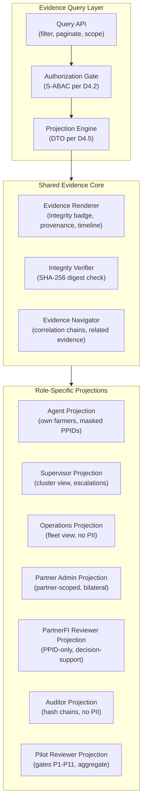

---

## §44 D5.2 EVIDENCE QUERY ARCHITECTURE

### Query Dimensions

| Dimension | Type | Example | Role Access |
|-----------|------|---------|-------------|
| Evidence ID | Exact match | `evt-uuid-1234` | All roles (within scope) |
| Correlation ID | Exact match | `corr-uuid-5678` | All roles (within scope) |
| Workflow type | Enum filter | `PAYMENT`, `COMMERCE`, `INSURANCE` | All roles |
| Service | Enum filter | `PAYG`, `FMCG`, `CLIMATE` | Scoped by service permission |
| Partner | Scoped filter | `partner-alpha` | Scoped by partner membership |
| Hub | Scoped filter | `hub-adama-01` | Scoped by hub assignment |
| Date range | UTC range | `2026-09-01..2026-10-01` | All roles |
| Status | Enum filter | `QUEUED`, `SUBMITTED`, `OUTCOME_UNCERTAIN` | All roles |
| Evidence class | Enum filter | `TRANSACTIONAL`, `AUDIT`, `RECONCILIATION` | Role-dependent |
| Reconciliation state | Enum filter | `MATCHED`, `DISCREPANCY`, `PENDING` | OPERATIONS, PARTNER_ADMIN |
| Review state | Enum filter | `PENDING_REVIEW`, `REVIEWED`, `ESCALATED` | SUPERVISOR, OPERATIONS |

### Anti-Enumeration Controls

- Maximum result set: 100 records per query
- Rate limiting: 10 queries per minute per session
- Mandatory scope: Every query MUST include at least one scoping dimension (partner, hub, or date range)
- No wildcard PII queries: Cannot search by phone, name, or customer ID without specific evidence ID
- PPID-only in cross-boundary queries: PartnerFI Reviewer queries return PPIDs, not Enawuga UUIDs

---

## §45 D5.3 EVIDENCE DETAIL PROJECTION

### Multi-Dimensional Evidence Quality Model

Every evidence display MUST present quality as MULTIPLE SEPARATE INDICATORS, not a single "Verified" badge.

| Dimension | Display | Values | Color Semantics |
|-----------|---------|--------|----------------|
| **Integrity** | Hash badge | DIGEST_VALID, DIGEST_MISMATCH, DIGEST_UNAVAILABLE | Green/Red/Grey |
| **Source** | Source label | AGENT_CAPTURED, SYSTEM_GENERATED, PARTNER_CALLBACK, RECONCILIATION | Neutral (informational) |
| **Provenance** | Chain link | FULL_CHAIN, PARTIAL_CHAIN, ORPHAN | Blue/Amber/Grey |
| **Evidence Class** | Class tag | TRANSACTIONAL, AUDIT, RECONCILIATION, DERIVED | Neutral (categorical) |
| **Freshness** | Age indicator | CURRENT, STALE, EXPIRED | Green/Amber/Red |
| **Limitations** | Warning banner | SYNTHETIC, OFFLINE_CAPTURED, UNRECONCILED, OUTCOME_UNCERTAIN | Amber |
| **External Authority** | Authority badge | EXTERNALLY_VERIFIED, PARTNER_PENDING, NOT_EXTERNALLY_VERIFIED | Green/Amber/Grey |
| **Review State** | Review badge | NOT_REVIEWED, PENDING_REVIEW, REVIEWED, DISPUTED | Grey/Amber/Green/Red |
| **Correction State** | Correction indicator | ORIGINAL, CORRECTED, SUPERSEDED | Green/Amber/Red |
| **Dispute State** | Dispute indicator | NO_DISPUTE, DISPUTED, RESOLVED | Green/Red/Green |

### Mandatory UI Rules

1. **No single green "Verified" badge** — integrity verification, external authority, and review state are SEPARATE indicators
2. **SYNTHETIC evidence** must display prominently: "This evidence was generated from synthetic fixtures. It does not represent real farmer data, real transactions, or real institutional decisions."
3. **OUTCOME_UNCERTAIN** must display: "The outcome of this operation is uncertain. Reconciliation with the external provider is required before any settlement decision."
4. **Digest verification disclaimer:** "SHA-256 digest verification proves that the evidence bytes have not been modified since capture. It does NOT prove that the captured information is semantically true, externally verified, or institutionally authoritative."

---

## §46 D5.4 CORRECTION / SUPERSESSION ARCHITECTURE

### Append-Only Correction Model

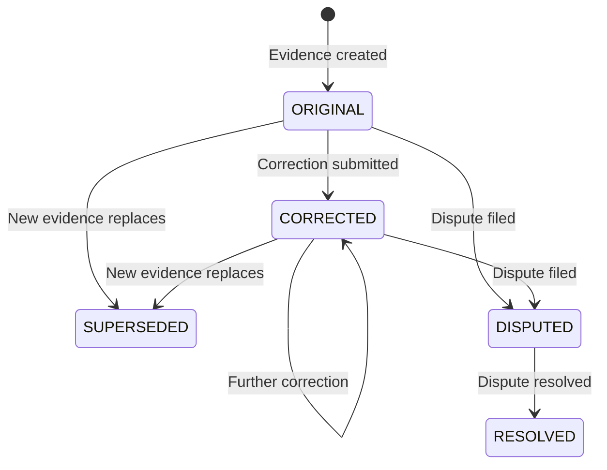

### Correction Schema (Conceptual)

```
EvidenceCorrection {
  correctionId: UUID
  originalEvidenceId: UUID
  correctionType: AGENT_ERROR | DATA_ENTRY | SYSTEM_ERROR | RECONCILIATION_UPDATE
  correctedFields: Map<FieldName, { previous: Value, corrected: Value }>
  correctedBy: { userId, role, timestamp }
  reason: string (max 500 chars)
  evidenceDigest: SHA-256 of correction record
  signedBy: Ed25519 signature (TARGET)
}
```

### Rules

1. **Original evidence is NEVER modified** — corrections create new evidence records
2. **Corrections are APPEND-ONLY** — corrections cannot be deleted
3. **Derived projections may be invalidated** — Farmer 360 and ARDI must be notified
4. **Authority boundaries preserved** — Agent can correct own data entry errors; PartnerFI corrections require partner authority
5. **Correction chain** — each correction references the original, forming an auditable chain

---

## §47 D5.5 HUMAN REVIEW ARCHITECTURE

### Common Human Review Queue

| Case Type | Trigger | Authority Owner | Resolution Options |
|-----------|---------|----------------|-------------------|
| Identity conflict | Duplicate detection, KYC mismatch | OPERATIONS | Merge, separate, escalate |
| Transport conflict | GhostSync sequence mismatch | OPERATIONS | Accept, reject, reconcile |
| Idempotency conflict | CAS collision on different content | OPERATIONS | Accept first, reject duplicate |
| Outcome uncertainty | Provider timeout, ambiguous response | OPERATIONS + PARTNER | Wait, reconcile, manual confirm |
| Reconciliation discrepancy | Internal ≠ external state | OPERATIONS + PARTNER | Accept external, dispute, escalate |
| Evidence correction | Agent error, data entry mistake | SUPERVISOR | Approve correction, reject |
| Payment ambiguity | Partial payment, currency mismatch | OPERATIONS + PARTNER | Reconcile, human confirm |
| Service fulfillment dispute | Delivery dispute, quality issue | SUPERVISOR + PARTNER | Investigate, resolve, escalate |
| ARDI evidence conflict | Contradictory evidence sources | OPERATIONS | Review sources, flag, exclude |
| Policy exception | Edge case requiring human judgment | SUPERVISOR | Approve exception, deny |
| Privacy exception | Consent dispute, data access request | OPERATIONS | Process, deny, escalate to legal |

### Case Lifecycle

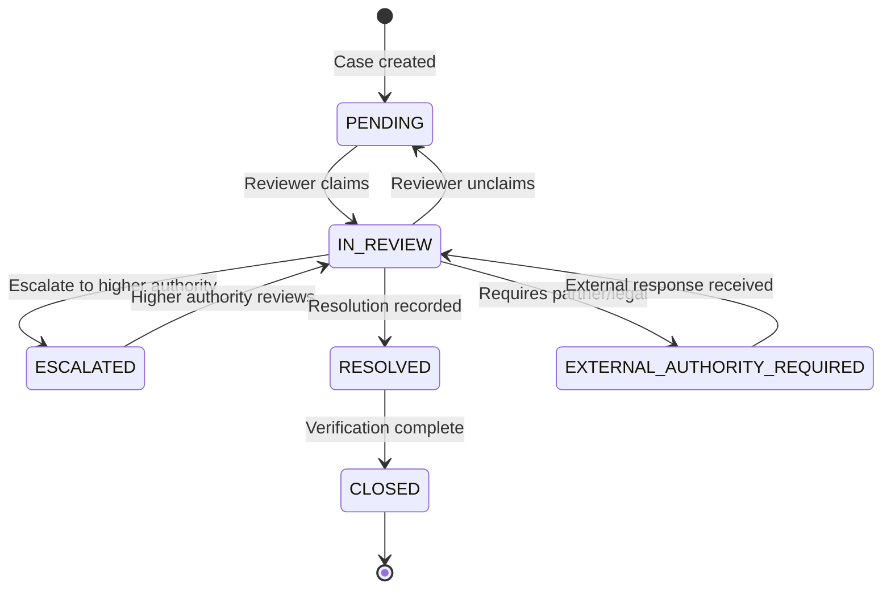

### Authority Enforcement

- Every case exposes `authorityOwner: AuthorityOwner` indicating who has final decision authority
- Enawuga reviewer CANNOT override external authority
- Cases requiring PartnerFI decision are marked `EXTERNAL_AUTHORITY_REQUIRED`
- Resolution recording is APPEND-ONLY with reviewer identity, timestamp, and rationale
- All review actions emit AUDIT events

---

## §48 D5.6 DERIVED EVIDENCE INVALIDATION MODEL

### Dependency Propagation Chain

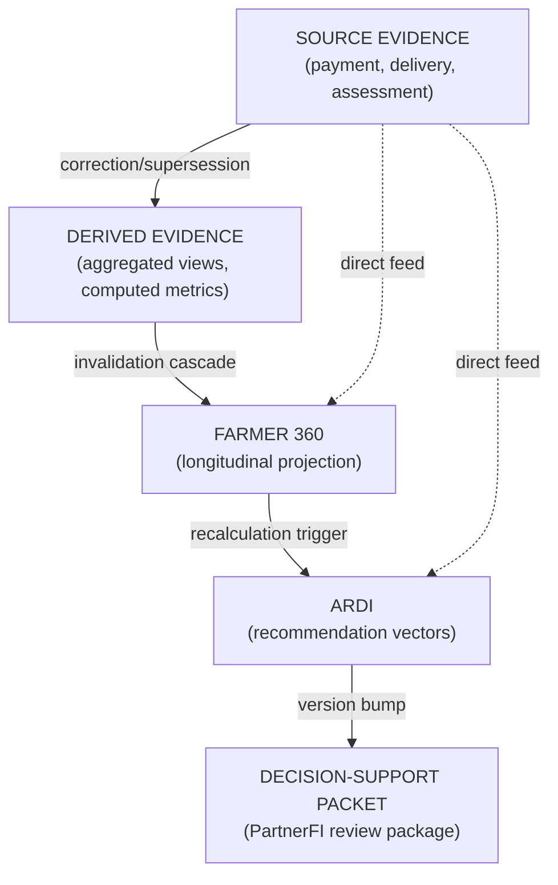

### Invalidation Semantics

| Event | Source | Downstream Impact |
|-------|--------|------------------|
| Evidence correction | Source evidence corrected | Derived evidence marked STALE, Farmer 360 flagged for refresh, ARDI input marked REQUIRES_RECALCULATION |
| Evidence supersession | New evidence replaces old | Same as correction |
| Consent withdrawal | Farmer revokes sharing consent | External packages containing this evidence are REVOKED. Internal projections may remain (legal obligation basis). |
| Expiry | Evidence freshness expires | Derived projections using expired evidence are flagged STALE |
| Dispute | Evidence disputed | Derived projections using disputed evidence are flagged DISPUTED |

---

## §49 D5.7 FARMER 360 INTEGRATION SEAM

### Architecture: Governed Longitudinal Projection

Farmer 360 is a **read model** — a governed projection of multiple evidence sources, NOT a system of record.

| Aspect | Design |
|--------|--------|
| **Source of truth** | Individual evidence records in APPEND_ONLY_EVIDENCE store |
| **Projection** | Computed from evidence via materialized view or event-driven computation |
| **Identity** | Internal Enawuga UUID for computation, PPID for cross-boundary display |
| **Role views** | Agent: full local view. Supervisor: cluster aggregate. PartnerFI Reviewer: PPID + ARDI vectors. Auditor: digest chains only. |
| **Freshness** | Each projection field carries `lastUpdated` and `evidenceSource` |
| **Retention** | Follows source evidence retention (ILLUSTRATIVE_ONLY — PENDING_LEGAL_REVIEW) |
| **Correction** | Re-computed when source evidence is corrected |
| **Offline subset** | Agent tablet caches assigned farmer projections (encrypted, D2 ARCH-13) |
| **Cross-partner isolation** | No cross-partner data mixing. Each partner sees only farmers within their bilateral scope via PPID. |

### Farmer 360 Projection Fields (Architecture)

| Category | Fields | Source Evidence |
|----------|--------|---------------|
| Identity | PPID, kebele, registration date | Customer registration |
| KYC | Verification status, last verified | Identity provider |
| Financial | Payment history timeline, repayment discipline | Payment observations |
| Agriculture | Crop types, land size, seasonal patterns | Agent assessments |
| Services | Active services, service history | Service enrollment records |
| ARDI | Multidimensional vector (D1-D5), explanation | ARDI computation |
| Insurance | Coverage status, claims history | Insurance evidence |
| eKUB | Participation history, contribution regularity | eKUB evidence |
| PAYG | Asset status, repayment timeline | PAYG observations |

---

## §50 D5.8 ARDI INTEGRATION SEAM

### ARDI Architectural Pipeline

```mermaid
flowchart LR
    ER["EVIDENCE REGISTRY<br/>(governed evidence store)"]
    FE["FEATURE EXTRACTION<br/>(dimension-specific extractors)"]
    QF["QUALITY / FRESHNESS CHECK<br/>(evidence validation)"]
    PP["PRODUCT-SPECIFIC POLICY<br/>(partner requirements)"]
    MR["MULTIDIMENSIONAL<br/>RECOMMENDATION<br/>(D1-D5 vectors)"]
    EX["EXPLANATION<br/>(transparent reasoning)"]
    DSP["PARTNERFI<br/>DECISION-SUPPORT<br/>PACKET"]
    
    ER --> FE --> QF --> PP --> MR --> EX --> DSP
    
    DSP -.->|"PARTNERFI_DECISION_REQUIRED"| PFI["PartnerFI<br/>(DECIDES)"]
```

### ARDI Output Architecture

| Dimension | Evidence Source | Output Type | Binding |
|-----------|---------------|-------------|---------|
| D1: Repayment Discipline | Payment observations | Ratio (0.0-1.0) | NON_BINDING |
| D2: Agricultural Productivity | Crop assessments, yield data | Category (LOW/MED/HIGH) | NON_BINDING |
| D3: Operational Activity & Network Tenure | Transaction frequency, seasonal regularity, platform usage duration | Category with explanation | NON_BINDING |
| D4: Market Access | Commerce activity, transport accessibility | Index with factors | NON_BINDING |
| D5: Climate Resilience | Insurance coverage, crop diversity | Risk category | NON_BINDING |

### ARDI Invariants

1. **NON_BINDING** — Every ARDI output carries `binding: false, partnerFiDecisionRequired: true`
2. **No single scalar score** — Output is always multidimensional (D1-D5 vectors)
3. **Missing evidence ≠ adverse evidence** — Dimensions with missing data are `UNKNOWN`, not `NEGATIVE`
4. **Explanation transparency** — Each dimension includes human-readable explanation of contributing evidence
5. **Partner-specific policy** — Different PartnerFIs may weight dimensions differently
6. **eKUB participation ≠ creditworthiness** — eKUB data is PROHIBITED from all ARDI dimensions, all PartnerFI decision-support packets, and all external evidence packages. No eKUB group membership, contribution record, attendance metric, or community reference may feed into ARDI feature extractors. Test requirement: `NO_EKUB_DATA_FLOWS_TO_ARDI`. Future research into eKUB-derived signals requires 5 conditions: RESEARCH + PURPOSE_REVIEW + PRIVACY_REVIEW + FAIRNESS_REVIEW + LEGAL_POLICY_REVIEW.

---

## §51 D5.9 EVIDENCE UX STATE SEMANTICS

### State Display Rules

| State | Icon | Color | Label | Tooltip |
|-------|------|-------|-------|---------|
| DIGEST_VALID | 🔒 Shield | Green | "Integrity verified" | "SHA-256 digest matches. Bytes unchanged since capture. This does NOT verify semantic truth." |
| DIGEST_MISMATCH | ⚠️ Warning | Red | "Integrity failed" | "SHA-256 digest does not match. Evidence may have been modified." |
| EXTERNALLY_VERIFIED | 🏛️ Institution | Green | "Externally confirmed" | "Confirmed by [Partner Name] on [Date]" |
| NOT_EXTERNALLY_VERIFIED | ○ Empty | Grey | "Not externally verified" | "This evidence has not been confirmed by any external institution." |
| SYNTHETIC | 🧪 Flask | Amber | "Synthetic fixture" | "Generated from synthetic test data. Does not represent real farmers or transactions." |
| OUTCOME_UNCERTAIN | ❓ Question | Amber | "Outcome uncertain" | "External provider response is ambiguous. Reconciliation required." |
| RECONCILIATION_REQUIRED | 🔄 Sync | Amber | "Needs reconciliation" | "Internal and external records must be compared." |
| OFFLINE_CAPTURED | 📡 No signal | Grey | "Captured offline" | "Captured on offline device. Server-side re-evaluation required upon sync." |
| EXPIRED | ⏰ Clock | Red | "Evidence expired" | "Evidence freshness period has passed. May not reflect current state." |
| CORRECTED | ✏️ Pencil | Amber | "Corrected" | "This evidence has been corrected. View correction history." |
| SUPERSEDED | 📋 Archive | Grey | "Superseded" | "Newer evidence replaces this record." |

### Prohibited UI Patterns

1. **NO single "Verified" badge** that conflates integrity, authority, and review state
2. **NO green checkmark** on synthetic evidence
3. **NO "Approved" label** on ARDI recommendations
4. **NO "Settled" indicator** until PartnerFI confirms settlement
5. **NO "Certified" language** on any Enawuga-generated evidence
6. **NO removal of uncertainty indicators** when offline evidence syncs — server re-evaluation must occur first

---

## §52 D5 ARCHITECTURE DECISION RECORDS

### ADR-D5-01: Evidence Explorer Architecture Pattern

| Field | Value |
|-------|-------|
| **ADR ID** | ADR-D5-01 |
| **Title** | Shared Evidence Core with Role-Specific Projections |
| **Status** | ACCEPTED_INTERNAL |
| **Problem** | Evidence browsing must serve 7 roles with different data access levels without code duplication or security leakage |
| **Research Inputs** | Wave C GAP-C1-01, current EvidenceDrawer.tsx (78L), projectHubOperationsTrace() pattern |
| **Current Repository Evidence** | EvidenceDrawer.tsx provides basic evidence display. hubOperationsTrace.ts provides tenant-scoped projection function. 5 "missing" components now exist post-PRs #62-#76. |
| **Constraints** | Must enforce D4 DTO boundaries. Must work offline for agent role. Must not enumerate PII. |
| **Options Considered** | A: Single parameterized workspace. B: Role-specific workspaces. C: Shared core + role projections. |
| **Decision** | Option C: Shared evidence core with role-specific projection layers |
| **Rationale** | Aligns with existing `projectHubOperationsTrace()` pattern. Shared rendering ensures consistent quality. Role projections enforce D4 DTO boundaries at UI level. |
| **Security Consequences** | Projection layer is the security boundary — server-side enforcement. |
| **Privacy Consequences** | PPIDs displayed for cross-boundary roles. Full identity only for authorized Agent/Supervisor. |
| **Authority Consequences** | Evidence Explorer is READ-ONLY. No mutation capability. |
| **Offline Consequences** | Agent sees cached projection. Full evidence browsing requires connectivity. |
| **Operational Consequences** | Single core to maintain. Projection schemas versioned with role model. |
| **Migration Consequences** | Existing EvidenceDrawer.tsx becomes part of shared core. |
| **Testing Consequences** | Each projection requires PII leakage testing. Cross-role access testing mandatory. |
| **What This Decision Does NOT Authorize** | Implementation of Evidence Explorer UI, creation of database views, external API exposure. |
| **External Dependencies** | D4 role model, D2 PPID implementation. |
| **Open Questions** | Pagination strategy for large evidence sets. Real-time vs cached projections. |
| **Reversibility** | HIGH — projection layers can be refactored independently. |
| **Implementation Preconditions** | D1 persistence, D2 PPID, D4 role model. |

### ADR-D5-02: Human Review Queue Architecture

| Field | Value |
|-------|-------|
| **ADR ID** | ADR-D5-02 |
| **Title** | Common Human Review Queue with Domain-Specific Case Types |
| **Status** | ACCEPTED_INTERNAL |
| **Problem** | Multiple domain areas (payment, identity, reconciliation) generate cases requiring human judgment. No unified review architecture exists. |
| **Research Inputs** | Wave C GAP-C2-05, CQ-C2-10, current placeholder review triggers |
| **Current Repository Evidence** | 5 trigger conditions with non-mutating placeholders in current main. `mutationEnabled: false` on all review actions. |
| **Constraints** | Must preserve authority boundaries. Enawuga reviewer cannot override external authority. Must be audit-trailed. |
| **Decision** | Common queue infrastructure with 11 domain-specific case types, each with explicit authorityOwner |
| **Rationale** | Common lifecycle (claim → review → resolve/escalate) applies to all case types. Authority owner varies by domain. |
| **What This Decision Does NOT Authorize** | Implementation of review UI, automated case resolution, override of PartnerFI decisions. |
| **Reversibility** | HIGH — case types can be added/removed independently. |
| **Implementation Preconditions** | D1 persistence, D4 role model. |

### ADR-D5-03: Append-Only Correction Model

| Field | Value |
|-------|-------|
| **ADR ID** | ADR-D5-03 |
| **Title** | Append-Only Evidence Correction with Invalidation Cascade |
| **Status** | ACCEPTED_INTERNAL |
| **Problem** | Evidence errors must be correctable without destroying audit trail or silently changing derived projections. |
| **Research Inputs** | Wave C GAP-C1-05, audit immutability requirements |
| **Current Repository Evidence** | No correction schema exists in current main. Evidence manifests are digest-sealed. |
| **Constraints** | Original evidence must be preserved. Corrections must be auditable. Derived projections must be notified. |
| **Decision** | Corrections create new evidence records referencing the original. Derived projections (Farmer 360, ARDI) receive invalidation notifications. |
| **Rationale** | Append-only preserves audit trail. Invalidation cascade prevents stale projections. Authority boundaries preserved (only authorized roles can correct). |
| **What This Decision Does NOT Authorize** | Deletion of evidence, silent modification, override of PartnerFI-sourced evidence. |
| **Reversibility** | LOW — append-only is a fundamental architectural property. |
| **Implementation Preconditions** | D1 persistence (append-only tables), D2 signatures (correction signing). |
# WAVE D WORKSTREAM D6 — EXTERNAL EVIDENCE SHARING, ASSURANCE & RECIPIENT PACKAGES

---

**Document ID:** `WAVE_D_WORKSTREAM_D6_EXTERNAL_EVIDENCE_SHARING`  
**Classification:** ARCHITECTURE DECISION PACKAGE — READ-ONLY SOURCE INSPECTION — NO IMPLEMENTATION  
**Version:** 1.0.0  
**Date:** 2026-10-16  
**Author:** D6 External Evidence Sharing Architect (Wave D Architecture Working Group)  
**Governing Program:** Enawuga / Phygital Rural Agent Hub Program (Waves A → B → C → D)  
**Target File:** `scratch/wave-d/d6-external-sharing.md`  
**Parent Orchestrator:** Wave D Orchestrator (`14d6961f-a7d1-448b-95a3-9c4322401ad2`)  
**Canonical Repository:** `https://github.com/abeselomchernet/Phygital-rural-Agent-Hub`  
**Live Main Commit Baseline:** `SHA 9a8578858e0be1f1e78ce1572119ee85fdcfbf85` (Parent: `f318b4d972a7`, PR #76 merged)  

---

## EXECUTIVE SUMMARY & GOVERNING PRINCIPLES

Workstream D6 defines the target architecture for exporting, cryptographically sealing, and sharing evidence generated across the Enawuga Phygital Rural Agent Hub ecosystem with authorized external institutions.

### Governing Principle
> **Enawuga is TECHNOLOGY + ORCHESTRATION + EVIDENCE INFRASTRUCTURE + NON-BINDING DECISION SUPPORT.**  
> Authorized external institutions (licensed commercial banks, microfinance institutions, licensed insurance carriers, regulatory bodies) retain **sole, unalienable decision-making authority**.  
> Architecture convenience, algorithmic sophistication, or UI streamlining **MUST NEVER WEAKEN OR OBSCURE THIS PRINCIPLE**.

### Core Authority Invariants Preserved
Every architectural mechanism specified in this document enforces the program's non-negotiable invariants:
1. `SERVICE != CAPABILITY != ROUTE != ADAPTER`
2. `Visibility != Authority; UI != Authorization`
3. `Data != Evidence; Evidence != Interpretation; Interpretation != Recommendation; Recommendation != Decision; Recommendation != Approval`
4. `Digest != Semantic Truth; Integrity != External Verification`
5. `Queued != Submitted; Submitted != Acknowledged; Acknowledged != Authorized`
6. `Offline Capture != Acceptance; Provider Success != PartnerFI Settlement`
7. `Payment Observation != Debt Settlement; Inventory Observation != Commercial Settlement`
8. `Climate Observation != Insurance Payout Authorization; Telemetry != Device Authority`
9. `Readiness != Authority; eKUB Participation != Creditworthiness`
10. `ARDI Recommendation != Credit Approval; Synthetic != Observed`
11. `Observed != Externally Authoritative; Missing != Failed; Unknown != Negative`
12. `Expired != Rejected; Training != Regulated Authority`
13. `Pilot Target != Pilot Approval; Pilot Evidence != Scale Authority`

### Key Wave C Gaps Addressed & Resolved
- **GAP-C4-01 (CRITICAL — No Asymmetric Signatures):** ARCHITECTURALLY_BOUNDED by ADR-D6-01 and D6.4 with algorithm-agile detached-signature support. Current main still requires implementation and cryptographic verification before any signed-package capability claim.
- **GAP-C4-03 (HIGH — No Consent Schema):** Resolved via ADR-D6-02 & D6.5 establishing the governed `ConsentGrant` schema and fail-closed pre-sharing validation gate.
- **GAP-C4-04 (HIGH — ET Residency Requirement):** Architecturally bounded in D6.4 & ADR-D6-01 requiring ET-resident KMS key custody prior to production signing.
- **GAP-C4-05 (HIGH — Fake NBE Sandbox Permit in `AuditCompliance.tsx`):** Resolved via ADR-D6-03 & D6.8 by permanently quarantining simulation artifacts, enforcing mandatory negative assurance headers, and prohibiting synthetic regulatory permits.
- **GAP-C4-06 (MEDIUM — No Evidence Package Versioning):** Resolved via D6.1 & D6.7 with strict package schema versioning, lifecycle states, and deterministic identifiers.
- **GAP-C4-07 (MEDIUM — Export Format & Classification):** ARCHITECTURALLY_BOUNDED by ADR-D6-01 and D6.3 through a dual-artifact model: canonical JSON + detached algorithm-agile signature, with an optional human-review PDF/A-3 derivative. External acceptance remains unverified.
- **GAP-C4-08 (HIGH — No Defined Retention Period):** ARCHITECTURALLY_BOUNDED by ADR-D6-05 and D6.7. Package TTL examples are engineering defaults only; statutory retention remains LEGAL_REVIEW_REQUIRED / EXTERNAL_BLOCKED.

---

## §53 D6.1 EXTERNAL PACKAGE ARCHITECTURE

### 53.1 Boundary

External evidence sharing is a TARGET_STAGE4_INTERNAL architecture with FUTURE_EXTERNAL_DEPENDENT activation. Current main does not implement a production external evidence-package service, and no recipient organization is deemed authorized merely because a package family is described here.

### 53.2 Package Families

The architecture supports distinct package families rather than one unrestricted export:
- PartnerFI decision-support package;
- insurer/service-partner evidence package;
- pilot/evaluation evidence package;
- independent audit/assurance package;
- future regulator-facing package only if a verified competent-authority requirement exists.

Each family has a separately versioned recipient projection and negative-assurance profile. Package-family naming does not prove an institution requested or accepts it.

### 53.3 Canonical Envelope Concepts

A target package envelope contains:
- schema/package version and deterministic package reference;
- package family and classification;
- producer and recipient references;
- purpose code;
- data-access basis and evidence reference;
- consent reference only when CONSENT is the selected basis;
- generation/freshness/lifecycle metadata;
- provenance/completeness status;
- canonical payload/manifest digest;
- negative-assurance block;
- detached signature envelope under the selected profile;
- recipient-scoped projected payload.

The envelope is a technical evidence container. It is not a loan approval, settlement record, insurance decision, regulatory permit, or scale authorization unless a separately authenticated external authority actually supplies such a decision and the package clearly attributes it to that source.

### 53.4 Current Reuse and Target Additions

CURRENT_IMPLEMENTED building blocks include source-backed evidence integrity/manifests, workflow provenance and limitation semantics in the current repository. TARGET_STAGE4_INTERNAL additions include recipient projections, package lifecycle, signatures, basis gating, revocation/freshness and verifier UX.

No target control may be described as current capability until implemented and tested.

---

## §54 D6.2 PACKAGE TYPE / RECIPIENT PROJECTION POLICY

External sharing is TARGET_STAGE4_INTERNAL plus FUTURE_EXTERNAL_DEPENDENT. The architecture defines fail-closed projection categories; it does not grant any external organization a data entitlement. Actual recipient fields require an approved partner contract, purpose, DATA_ACCESS_BASIS_GATE result, privacy/legal policy, and role/scope authorization.

### 2.1 Default-Deny Projection Matrix

| Data class | PartnerFI review projection | Insurer/service-partner projection | Pilot/evaluation projection | Audit/assurance projection | Future regulator-facing projection |
|---|---|---|---|---|---|
| Subject identifier | PPID only when approved | PPID only when approved | Aggregated/anonymized by default | Digest/reference by default | Minimum necessary only if formally required |
| Raw national-ID value | PROHIBITED by default | PROHIBITED | PROHIBITED | PROHIBITED by default | PROHIBITED unless a separately authorized legal workflow requires it |
| Phone / MSISDN | Masked/minimized only when purpose requires | Masked/minimized only when purpose requires | PROHIBITED | Masked or prohibited per audit purpose | Minimum necessary only under verified mandate/policy |
| Precise geolocation | Minimized/aggregated by default | Purpose-specific minimized projection | Aggregate only | Aggregate/digest by default | Minimum necessary under verified mandate/policy |
| ARDI recommendation vectors | Own-partner/product-specific only; non-binding | PROHIBITED unless separately justified | Aggregate evaluation only | Method/integrity evidence | Aggregate/method evidence unless legally required otherwise |
| Scalar credit score | PROHIBITED — not generated | PROHIBITED | PROHIBITED | PROHIBITED | PROHIBITED |
| Payment observations | Own-route evidence only when purpose-approved | Service-specific only | Aggregate metrics | Integrity/reconciliation evidence | Aggregate or minimum necessary under verified mandate |
| Settlement / credit decision claim | Enawuga cannot assert; external authority source required | PROHIBITED | PROHIBITED | Evidence of source/decision only | Evidence of source/decision only |
| Climate / insurance evidence | Only if separately justified | Purpose-specific minimized evidence | Aggregate | Assurance evidence | Minimum necessary under verified mandate |
| Insurance payout authorization | PROHIBITED as Enawuga-generated state | Insurer-authoritative reference only | PROHIBITED | Source evidence only | Source evidence only |
| eKUB membership/contribution/community data | PROHIBITED for credit/ARDI | PROHIBITED by default; any future non-credit sharing requires separate eKUB-specific approval | Aggregate only if independently approved | Digest/reference only if independently approved | No default entitlement; legal mandate required |
| Device telemetry | Observed state only if product purpose requires | Service-specific observed state only | Aggregate reliability | Assurance projection | Aggregate/minimum necessary |
| Remote device control | PROHIBITED | PROHIBITED | PROHIBITED | PROHIBITED | PROHIBITED |
| Competitor / other-partner commercial data | PROHIBITED | PROHIBITED | Aggregated only if neutrality/privacy policy allows | Aggregated assurance only | No default entitlement; verified mandate required |

### 2.2 Permanent Projection Guardrails

1. Raw secrets, private keys, API tokens, unrestricted internal UUIDs, and prohibited raw identity data never enter an external package.
2. eKUB data never enters ARDI, a credit dossier, or PartnerFI credit decision-support.
3. Cross-partner commercial data is isolated by default.
4. Field masking, aggregation, coordinate minimization, and PPIDs reduce exposure but do not themselves prove legal compliance or anonymity.
5. Any field not explicitly mapped by the recipient projection is omitted. Projection implementation must be tested for leakage; documentation alone does not guarantee omission.

### 2.3 Candidate Transport Channels

The architecture may support authenticated push, governed pull, and bounded offline handover. Exact protocol, authentication profile, transport SLA, key profile, and recipient role are PARTNER_DECISION_REQUIRED / SECURITY_REVIEW_REQUIRED.

| Package family | Candidate online channel | Candidate constrained-connectivity channel | External status |
|---|---|---|---|
| PartnerFI decision-support | authenticated API exchange | governed deferred handover if approved | PARTNER_REQUIRED |
| Insurance/service review | governed pull/push | governed deferred handover if approved | PARTNER_REQUIRED |
| Pilot evaluation | governed read-only pull | approved offline evidence bundle | PILOT_POLICY_REQUIRED |
| Independent audit/assurance | governed read-only pull | approved offline evidence bundle | ASSURANCE_SCOPE_REQUIRED |
| Regulator-facing package | no default channel | no default channel | EXTERNAL_PROFILE_NOT_YET_DECIDED / REGULATORY_REQUIREMENT_UNVERIFIED |

No transport acknowledgement, download, or receipt creates financial/regulatory authority.

---

## §55 D6.3 FORMAT DECISION

### 3.1 Candidate Formats

- **Option A — Canonical JSON + detached signature:** RFC 8785 canonical JSON with an algorithm identifier and detached signature envelope. The architecture supports Ed25519 and ECDSA P-256 profiles; recipient acceptance is external.
- **Option B — W3C Verifiable Credentials / JSON-LD:** retained as RESEARCH_CANDIDATE / DEFERRED_EXTERNAL because Wave D has no validated interoperability requirement that justifies the additional identity/context infrastructure.
- **Option C — Human-review PDF/A-3 derivative:** optional presentation derivative embedding or referencing the canonical machine artifact and carrying visible negative-assurance text. PDF format does not by itself establish legal admissibility.

### 3.2 Qualitative Tradeoff Matrix

| Criterion | Canonical JSON + detached signature | W3C VC / JSON-LD | PDF/A-3 derivative |
|---|---|---|---|
| Deterministic machine processing | STRONG with RFC 8785 | POSSIBLE but more complex | SECONDARY; PDF is not the canonical machine representation |
| Offline verification | STRONG once verifier/key material is available | DEPENDS on chosen VC/DID profile | DEPENDS on PDF/signature tooling |
| Human review | LIMITED without renderer | LIMITED without renderer | STRONG for visual review |
| External interoperability | RECIPIENT_PROFILE_REQUIRED | EXTERNAL_REQUIREMENT_NOT_ESTABLISHED | RECIPIENT/ASSURANCE_REQUIREMENT_REQUIRED |
| Legal admissibility | LEGAL_REVIEW_REQUIRED | LEGAL_REVIEW_REQUIRED | LEGAL_REVIEW_REQUIRED |
| Bandwidth / performance | REQUIRES_BENCHMARK | REQUIRES_BENCHMARK | REQUIRES_BENCHMARK |
| Implementation complexity | LOWER relative to the other candidates | HIGHER | MODERATE/HIGH depending on renderer |

No weighted legal/market score is treated as evidence.

### 3.3 Decision — Governed Dual-Artifact Model

The primary Enawuga package artifact is canonical JSON plus a detached signature selected through the governed signature-profile policy. It is the canonical **Enawuga package representation**, not an external institution's legal system of record. An optional PDF/A-3 derivative may be generated for human review from the canonical artifact; it must preserve the evidence digest, algorithm/key reference, package classification, and negative-assurance language.

The selected signing profile is not hardcoded to Ed25519 for every recipient. Ed25519 is the internal/edge engineering default; ECDSA P-256 is a supported compatibility profile. Partner/regulator acceptance remains externally negotiated or unverified.

W3C VC remains deferred until a concrete interoperability requirement and trust/identity model justify it. The architecture makes no claim about Fayda DID availability or local bank JSON-LD capability.

---

# WAVE D WORKSTREAM D6 — EXTERNAL EVIDENCE SHARING (CONTINUED)
## SECTIONS D6.4 THROUGH D6.8 & ARCHITECTURE DECISION RECORDS ADR-D6-01 THROUGH ADR-D6-05

**Document Supplement:** `WAVE_D_WORKSTREAM_D6_EXTENSIONS_V1_1`  
**Classification:** ARCHITECTURE DECISION PACKAGE — READ-ONLY SOURCE INSPECTION — NO IMPLEMENTATION  
**Governing Program:** Enawuga / Phygital Rural Agent Hub Program (Waves A → B → C → D v1.1)  
**Parent Orchestrator:** Wave D Orchestrator (`14d6961f-a7d1-448b-95a3-9c4322401ad2`)  
**Canonical Repository Baseline:** `https://github.com/abeselomchernet/Phygital-rural-Agent-Hub` @ `9a8578858e0be1f1e78ce1572119ee85fdcfbf85`  
**Closure Gate Reference:** `ENAWUGA_WAVE_D_ARCHITECTURE_CLOSURE_RECONCILIATION.md`  

---

## §56 D6.4 SIGNATURE / VERIFICATION FLOW

### 4.1 Dual-Profile Cryptographic Architecture & Boundary

Wave D supports two signature profiles for algorithm agility:

1. **ED25519_INTERNAL_PROFILE** — internal/edge engineering default for bounded Stage-4 signing where the implementation and target runtime support it.
2. **ECDSA_P256_INSTITUTIONAL_PROFILE** — compatibility profile available when a recipient contract, approved institutional profile, or verified external requirement selects it.

This is architectural support, not evidence that any Ethiopian bank, insurer, auditor, NBE unit, court, HSM vendor, or national PKI mandates or accepts either profile. Target-device performance and side-channel properties are implementation/benchmark concerns, not assumed field evidence.

### 4.2 Package-Type × Profile Policy

| Package type | Internal engineering default | External profile selection | Acceptance classification |
|---|---|---|---|
| PartnerFiCreditDossierPackage | ED25519_INTERNAL_PROFILE for synthetic/internal testing | Ed25519 or ECDSA P-256 only through approved partner profile | PARTNER_DECISION_REQUIRED |
| InsurerClimateAssessmentPackage | ED25519_INTERNAL_PROFILE | Negotiated external profile | PARTNER_DECISION_REQUIRED |
| PilotEvaluationPackage | ED25519_INTERNAL_PROFILE | Recipient-specific if externally shared | PILOT_POLICY_REQUIRED |
| ComplianceAuditDossierPackage | ED25519_INTERNAL_PROFILE | Negotiated assurance profile | ASSURANCE_SCOPE_REQUIRED |
| RegulatorSupervisoryPackage | none asserted | EXTERNAL_PROFILE_NOT_YET_DECIDED | REGULATORY_REQUIREMENT_UNVERIFIED |

The package compiler must reject unsupported or unconfigured profiles. Package type alone is insufficient to infer external algorithm acceptance.

---

### 4.3 Target Envelope / Signature Contract

The implementation must use strict, versioned schemas, but this architecture package does not claim those schemas already exist in current main.

Required envelope concepts:
- schemaVersion and packageId;
- packageType and classification;
- producer and recipient references;
- purposeCode;
- dataAccessBasis;
- basisEvidenceRef;
- consentGrantRef only when CONSENT is the selected basis;
- generatedAt and expiresAt/freshness metadata;
- lifecycle state;
- payload and manifest digests;
- completeness/provenance classification;
- negative-assurance block;
- detached signature envelope.

Required signature-envelope concepts:
- algorithm identifier supporting ED25519 and ECDSA_P256_SHA256;
- key identifier and key version/epoch;
- signed canonical digest;
- signature bytes;
- signing timestamp;
- bounded signer role/type.

Fail-closed validation rules include:
1. unsupported signature algorithms reject;
2. CONSENT basis without a valid consentGrantRef rejects;
3. any basis without verifiable basisEvidenceRef rejects;
4. expiry/freshness timestamp must be coherent with generation time;
5. authority-grant booleans in the negative-assurance block remain false;
6. package projection must pass recipient/data-class/purpose policy before signing.

A schema match proves structural conformance only. It does not prove lawful basis, factual correctness, external authority, or recipient acceptance.

---

### 4.4 Key Selection, Custody, and Residency Boundary

Key/profile selection is driven by approved internal policy plus any authenticated recipient profile. Package type alone never proves which algorithm an external organization requires.

Target selection sequence:
1. resolve the package and recipient scope;
2. load the configured signature-profile policy;
3. if no approved profile exists, fail closed as EXTERNAL_PROFILE_NOT_YET_DECIDED;
4. resolve an active, non-revoked key reference for the selected profile;
5. enforce environment and key-custody policy;
6. sign only the canonical digest and return the detached signature envelope;
7. record key/profile version in the evidence/audit trail.

Production signing remains disabled while etResidencyApproved is false. The eventual location, provider, KMS/HSM technology, and residency requirement are EXTERNAL_VALIDATION_REQUIRED / LEGAL_POLICY_DEPENDENT; Wave D does not name a regulator-approved provider or assume a specific NBE directive mandates a particular location.

Synthetic/test environments may use explicitly marked test keys or mock key services. Test-key output must never be represented as production/institutional assurance.

---

### 4.5 Client-Side Offline Cryptographic Verification Workflow (Browser WebCrypto)
To satisfy the governing principle that **Integrity ≠ External Verification**, external recipients must be able to verify packages without relying on Enawuga servers, network connectivity, or proprietary SDKs.

Verification is implemented via standard, zero-dependency browser primitives using the **W3C Web Cryptography API** (`window.crypto.subtle`):

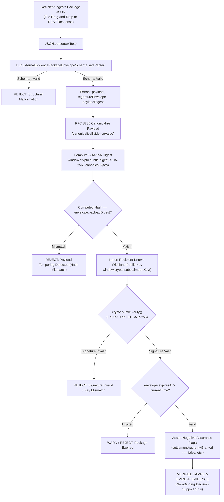

#### Step-by-Step Verification Implementation Algorithm:
1. **JSON Canonicalization (RFC 8785):** The verifier isolates `package.payload` and serializes it using deterministic JSON Canonicalization Scheme (JCS).
2. **Digest Verification:** The verifier executes `crypto.subtle.digest("SHA-256", utf8PayloadBytes)` and formats the output as `sha256:<64-hex>`. If this string does not exactly equal `package.payloadDigest`, execution terminates immediately.
3. **Public Key Import:** The public key associated with `signatureEnvelope.keyId` is imported into WebCrypto (`NODE-ED25519` or `ECDSA` with named curve `P-256`).
4. **Signature Evaluation:** The verifier executes `crypto.subtle.verify()` over the canonical digest. If the verification fails, the package is rejected as unauthenticated or altered.
5. **Negative Assurance Inspection:** The client application parses `package.negativeAssurance`. If any boolean assertion is `true`, or if any statutory disclaimer is truncated or missing, the package is flagged as non-compliant.

> [!NOTE]
> **Correct Terminology (Closure §8, Known Issue 5):**
> This process represents standard **Client-Side Offline Asymmetric Cryptographic Verification**. It contains zero zero-knowledge proofs (no zk-SNARKs, zero cryptographic blinding of evidence). The verifier inspects the entire payload in plaintext. Calling this "Zero-Knowledge" is cryptographic terminology inflation and is strictly prohibited across all documentation.

---

### 4.6 Air-Gapped / Offline Verification Path & Trust Distribution
For field evaluation panels, rural cooperative auditors, and air-gapped forensic inspectors operating without internet connectivity:
* **Self-Contained Verification Bundle:** An external reviewer receives a standalone, single-file HTML/JS distribution (`enawuga-offline-verifier.html`, ~45 KB gzipped, zero external CDN dependencies).
* **Public Key Trust Anchor File (`trust-anchors.json`):** A pre-distributed JSON manifest containing Wishland's governed public keys, associated key identifiers (`urn:wishland:key:...`), valid date ranges, and institutional signing roles.
* **Air-Gapped Operation:** The HTML tool runs entirely inside the browser's local sandbox, reading the package file via the local File System API and executing verification via local WebCrypto without dispatching any network packets.

---

## §57 D6.5 DATA-ACCESS BASIS / PURPOSE GATE

### 5.1 Fail-Closed Package Gate

No customer-specific external package may be generated merely because a user can see data or because a partner asks for it. The target package compiler evaluates all server-side authorization predicates, including DATA_ACCESS_BASIS_GATE, before projection/signing.

Required checks include:
1. authenticated internal role and allowed verb;
2. tenant/partner/service scope;
3. requested purpose and data/evidence class;
4. recipient projection policy;
5. verified DATA_ACCESS_BASIS_GATE result;
6. minimization/redaction policy;
7. package freshness/lifecycle and synthetic/external-state restrictions.

Any missing or unsupported required check denies and audits.

### 5.2 Basis Types

- CONSENT: requires a valid, scoped ConsentGrant; revoked/expired/mismatched consent denies consent-based processing.
- CONTRACTUAL_NECESSITY: disabled unless an approved policy validator verifies the relevant contract reference, subject, partner and purpose.
- LEGAL_OBLIGATION: disabled unless an approved policy validator verifies the competent mandate/authority and requested scope. A free-form mandate string never auto-authorizes access.
- OTHER_APPROVED_BASIS: disabled by default and only enabled by a versioned, approved governance/legal policy.

Architecture does not determine which basis applies to a real workflow. That remains LEGAL_POLICY_DEPENDENT.

### 5.3 Consent-Specific Records

Where CONSENT is the approved basis, the ConsentGrant/withdrawal model is purpose- and recipient-scoped, versioned, auditable, and fail-closed. An offline agent may capture consent evidence or a withdrawal intent, but offline capture alone does not authorize external sharing. Export remains denied until the record and policy state are validated.

Digital signatures on a consent record provide artifact integrity/signer-key authenticity under the configured trust model; they do not prove that the person legally consented, that disclosure wording was adequate, or that the consent is legally sufficient. Those require field/legal validation.

### 5.4 Purpose Codes

Purpose codes are versioned policy identifiers, not self-authorizing labels. Generic catch-all purposes are prohibited. Final real-purpose catalogues require product, privacy, legal and partner review.

### 5.5 Withdrawal, Revocation and Re-Evaluation

For packages whose approved basis is CONSENT, a validated withdrawal closes forward consent-based access and marks affected active packages for revocation/re-evaluation. Already-dispatched copies cannot be assumed deleted or controlled by Enawuga. Recipient notification is a target workflow and requires a bilateral protocol.

If another separately approved basis is asserted after consent withdrawal, it must pass a fresh basis/purpose evaluation; architecture does not assume that other basis is valid.

### 5.6 Legal Status

The gate is designed to support purpose limitation and data-governance controls. It does not self-certify compliance with Ethiopian law, determine lawful basis, establish retention periods, or create regulator/partner approval. Real-person use remains LEGAL_REVIEW_REQUIRED and PRIVACY_REVIEW_REQUIRED.

---

## §58 D6.6 REDACTION / PROJECTION ARCHITECTURE

### 58.1 Default-Deny Projection

External packages are compiled from explicit typed projections. A field absent from the approved recipient projection is omitted. This is a target design property and must be proven by executable leakage tests before external use.

Projection evaluation combines:
- recipient role/organization;
- partner/service scope;
- data/evidence class;
- requested purpose;
- DATA_ACCESS_BASIS_GATE result;
- minimization/masking policy;
- provenance/freshness state;
- package-family policy.

### 58.2 Identifier and PII Minimization

Internal canonical customer IDs never leave the approved boundary by default. Pairwise pseudonymous identifiers are used where a stable external subject reference is justified. PPIDs reduce direct cryptographic linkability across scopes under the stated assumptions but do not defeat auxiliary-data correlation, insider access, key compromise, or collusion.

Phone, location, identity and other sensitive fields are either omitted, masked, aggregated or transformed according to a versioned purpose-specific policy. No universal coordinate grid, masking precision, or anonymity guarantee is accepted by architecture alone.

### 58.3 Domain Firewalls

Permanent target firewall rules include:
- no eKUB membership, contribution, attendance, peer/community reference or group position in ARDI or credit decision-support;
- no raw national-ID secrets/biometrics in generic external evidence packages;
- no cross-partner commercial data merging by default;
- no remote device-control authority in evidence projections;
- no settlement/credit/payout authority synthesized from observations;
- no scalar universal credit score.

A separately approved non-credit eKUB service package may carry minimum necessary eKUB evidence for its own purpose, but that data remains outside ARDI/credit paths.

### 58.4 Geospatial Minimization

Precise farm/location data can be sensitive. The architecture requires a purpose-specific minimization decision before export. Candidate techniques may include omission, administrative-area aggregation, coarse grid/centroid projection, or other reviewed transformations. Exact precision must be justified by the service purpose, privacy risk and external data needs; 1 km or any other fixed grid is not a universal architecture rule.

### 58.5 Verification Requirements

Future implementation tests must cover:
- forbidden-field leakage;
- cross-partner isolation;
- PPID scope separation;
- basis/purpose mismatch;
- eKUB-to-ARDI/credit firewall;
- raw identity/phone/location minimization;
- unmapped-field omission;
- correction/supersession invalidation;
- stale policy and stale basis evidence.

Projection success is not legal compliance certification and does not create recipient authority.

---

## §59 D6.7 EXPIRY / REVOCATION MODEL

### 7.1 Purpose and Boundary

Package lifecycle controls freshness and Enawuga-side usability of evidence packages. They do not determine statutory retention, create a right to erase external records, reverse external decisions, or bind a recipient unless a separately approved contract/policy says so.

The target lifecycle states are:
- SEALED_SIGNED — package compiled and signed under the configured profile.
- DISPATCHED — package handed to the configured transport.
- ACKNOWLEDGED_RECEIVED — recipient transport acknowledgement recorded; acknowledgement does not prove business approval, settlement, or semantic truth.
- EXPIRED — the configured evidence-freshness window has elapsed; this means the package is stale for the governed Enawuga use case, not automatically unlawful to retain or impossible to review.
- REVOKED — Enawuga has marked the package unusable for forward governed use because the applicable basis/policy, package integrity, or governance state no longer permits reliance.

State transitions are append-only evidence events. An original package is not silently rewritten.

### 7.2 Freshness TTLs Are Engineering Policy, Not Retention Law

Wave D may exercise configurable freshness TTLs in synthetic Stage-4 tests. Numeric defaults are ENGINEERING_DEFAULT / REQUIRES_BENCHMARK and must remain configuration values rather than statutory assertions.

| Package family | Stage-4 freshness policy | Governance status |
|---|---|---|
| PartnerFI decision-support package | Configurable synthetic test TTL | ENGINEERING_DEFAULT; PARTNER_DECISION_REQUIRED before external use |
| Insurer/service review package | Configurable synthetic test TTL | ENGINEERING_DEFAULT; PARTNER_DECISION_REQUIRED before external use |
| Pilot evaluation package | Configurable synthetic test TTL | ENGINEERING_DEFAULT; PILOT_POLICY_REQUIRED |
| Independent audit/assurance package | Configurable synthetic test TTL | ENGINEERING_DEFAULT; ASSURANCE_SCOPE_REQUIRED |
| Regulator-facing package | No authoritative default | REGULATORY_REQUIREMENT_UNVERIFIED / REQUIRES_EXTERNAL_DECISION |

No production freshness duration or legal retention duration is authorized by this architecture package.

### 7.3 Basis-Aware Revocation and Re-Evaluation

Revocation is evaluated against the package's recorded data-access basis and policy version:

1. CONSENT — a validated consent withdrawal closes forward consent-based access and marks active consent-based packages for revocation or re-evaluation under approved policy.
2. CONTRACTUAL_NECESSITY — contract termination, scope change, or invalidation must be verified through the approved policy validator; consent withdrawal alone does not automatically determine this basis.
3. LEGAL_OBLIGATION — the competent mandate and policy must be independently re-evaluated; a free-form mandate reference is insufficient.
4. OTHER_APPROVED_BASIS — the approved policy defines invalidation conditions; this basis is disabled by default.

Where no valid basis can be established, the package fails closed for forward Enawuga sharing/use.

### 7.4 Recipient Notification Is a Target Integration

A future bilateral integration may notify a recipient that a package has been revoked, superseded, corrected, or expired. Such notice is evidence of Enawuga's state change; it is not a legal command and does not prove that the recipient deleted data, reversed a decision, or ceased processing.

Any notification protocol requires:
- authenticated recipient configuration;
- package and policy version references;
- idempotent delivery/retry semantics;
- recipient acknowledgement evidence;
- fail-closed handling when delivery outcome is uncertain;
- partner/legal/privacy review before real-person use.

### 7.5 Retention Boundary

Retention remains LEGAL_POLICY_DEPENDENT and LEGAL_REVIEW_REQUIRED. The architecture deliberately carries no authoritative 5-year, 7-year, 10-year, or other statutory period.

Required implementation behavior:
- keep automated permanent purge workers disabled until an approved retention policy exists;
- distinguish operational freshness TTL from retention/destruction policy;
- version retention policy and preserve its evidence reference;
- record hold/suspension conditions where an approved legal policy requires them;
- never delete primary evidence merely because a derived package expires;
- never describe an illustrative engineering duration as a regulatory mandate.

### 7.6 Offline Revocation Freshness

An offline verifier may validate the package's embedded signature and expiry timestamp, but it may not possess the latest revocation/policy state. The verifier must therefore expose revocation-state freshness. When a use case requires current revocation state and the cache is stale or unavailable, the result is UNKNOWN / REQUIRES_SYNCHRONIZATION rather than VALID.

---

## §60 D6.8 NEGATIVE-ASSURANCE ARCHITECTURE

### 8.1 Machine-Readable Negative Assurance

Every target external package carries explicit false authority fields. Zod literal-false contracts are schema/runtime validation controls and can also support TypeScript type checking; they are not legal guarantees, tamper-proof by themselves, or proof that every downstream system will honor the flags.

The target negative-assurance block includes, at minimum:
- settlementAuthorityGranted = false
- creditDecisionConferred = false
- insurancePayoutApproved = false
- regulatoryPermitConveyed = false
- deviceActuationAuthorized = false
- externalFactVerified = false
- singleScalarCreditScoreGenerated = false
- scaleAuthoritySelfConferred = false
- syntheticPermitActive = false
- remoteDeviceLockoutConferred = false
- crossPartnerDataMerged = false
- eKubDataUsedForCreditScoring = false

These fields are included in the canonical payload before signing. A conforming verifier must reject a package that violates the target schema. This proves only that the received artifact conforms to the configured package contract under the verified signature/digest; it does not prove the underlying facts are true.

### 8.2 Human-Readable Limitation Text

Every human-review derivative must display conspicuous limitation text that communicates, in substance:

EVIDENCE / NON-BINDING DECISION SUPPORT ONLY. THIS PACKAGE DOES NOT CONFER CREDIT APPROVAL, FINANCIAL SETTLEMENT, INSURANCE PAYOUT AUTHORITY, REGULATORY APPROVAL, DEVICE CONTROL, OR SCALE AUTHORITY. EXTERNAL AUTHORITIES RETAIN THEIR OWN DECISION RESPONSIBILITIES.

This English wording is an architecture-level draft, not approved legal disclosure language.

Non-English limitation text is REVIEW_GATED. Amharic, Afaan Oromoo, Tigrinya, Somali, Sidama, Wolaytta, or any other translated legal/financial wording must not be represented as approved merely because a machine or internal agent produced it. Required gates include local-speaker/domain review and any legal/regulatory wording review applicable to the real use case.

### 8.3 Human-Review Derivative Integrity Display

If the optional PDF/A-3 derivative is implemented, it should display:
- package identifier;
- canonical payload digest;
- signature algorithm and key reference;
- package lifecycle state;
- synthetic/observed/external provenance classification;
- freshness/expiry state;
- limitation/negative-assurance text.

The PDF display is a derivative. The canonical package artifact remains the Enawuga machine representation. Printing a digest/signature does not make the PDF legally admissible or externally authoritative.

### 8.4 Prohibited Claims

The package compiler and claim-truth tests must prohibit output that states or implies that Enawuga itself:
- approved or issued a loan;
- generated a universal scalar credit score;
- authorized an insurance payout;
- executed settlement or PartnerFI posting;
- issued a regulator/sandbox permit;
- authorized remote device lockout/control;
- self-authorized pilot scale;
- externally verified facts merely because integrity checks passed;
- used eKUB membership, contribution, attendance, peer, or community data for ARDI/creditworthiness;
- implemented a zero-knowledge proof where no ZK protocol exists.

### 8.5 Stage-4 Provenance

During bounded Stage-4 implementation, package fixtures remain synthetic unless an explicitly authorized later environment changes the mode under all applicable program, partner, privacy, legal, infrastructure, and assurance gates.

The architecture requires an explicit provenance classification for each evidence item/package. Synthetic test data must never be presented as real pilot observation. An observed future pilot event must not automatically be described as externally verified or authoritative.

### 8.6 DO_NOT_RESURRECT Boundary — 15 Items

The authoritative anti-pattern register contains 15 items:
1. automatic dynamic credit-line issuance;
2. Sovereign Core settlement/authority claims;
3. CommunityCoin/token-reward mechanics;
4. Web3/DAO authority governance;
5. fake regulator or sandbox permit issuance;
6. remote physical device lockout/control as Enawuga authority;
7. unauthenticated provider webhooks;
8. ungrounded standards/regulatory dossier claims;
9. single universal scalar credit score;
10. automated insurance smart-contract payout authority;
11. eKUB pool-balance custody by Enawuga;
12. peer/social-credit indexing, including eKUB-derived credit signals;
13. Hyperledger Fabric as a default dependency without a justified requirement;
14. blockchain/distributed-ledger adoption for prestige rather than a proven need;
15. zero-knowledge claims without a mathematically specified and independently reviewed ZK protocol.

These are architecture quarantine rules. Their existence in historical or unmounted code does not make them current capability, and their absence from a screen does not replace executable regression tests where relevant.

---

## §61 D6 ARCHITECTURE DECISION RECORDS

### ADR-D6-01: External Package Format and Signature Profile

| # | Field | Value |
|---|---|---|
| 1 | ADR ID | ADR-D6-01 |
| 2 | Title | Governed Dual-Artifact External Evidence Package with Algorithm-Agile Detached Signatures |
| 3 | Status | ACCEPTED_WITH_CONDITIONS |
| 4 | Problem | Future approved recipients may need deterministic machine-readable evidence and a human-review derivative, but current main has no asymmetric package-signing implementation and no external recipient profile has been validated. |
| 5 | Research Inputs | Wave C external-assurance gaps, RFC 8785, PDF/A-3 as a candidate human-review format, ADR-D2-01, and the Wave D closure corrections. |
| 6 | Current Repository Evidence | Current main provides canonical digest/manifest primitives but no asymmetric package signer, external package generator, or recipient acceptance evidence. |
| 7 | Constraints | Preserve negative assurance; minimize data; support offline verification; remain algorithm-agile; avoid legal-admissibility and institutional-acceptance claims. |
| 8 | Options Considered | Canonical JSON only; W3C VC/JSON-LD; human-review PDF derivative; governed dual-artifact model. |
| 9 | Decision | Use RFC 8785 canonical JSON as the canonical Enawuga package representation with a detached signature selected through the governed profile policy. Permit an optional PDF/A-3 human-review derivative generated from the canonical artifact. Ed25519 is the internal/edge engineering default; ECDSA P-256 is a supported compatibility profile. External profile acceptance is negotiated/verified, never inferred from package type. W3C VC remains DEFERRED_EXTERNAL. |
| 10 | Rationale | Separates deterministic machine evidence from human presentation while preserving algorithm agility and avoiding unsupported claims about banks, regulators, courts, HSMs, or national PKI. |
| 11 | Security Consequences | Signature verification can provide payload integrity and signer-key authenticity evidence under the configured trust/key-custody model. It does not prove semantic truth, legal non-repudiation, or regulatory acceptance. Implementation side-channel properties and validated-module status depend on the actual library/hardware/configuration. |
| 12 | Privacy Consequences | Projection/redaction and PPID transformation occur before canonicalization/signing; they require leakage tests and approved purpose/basis policy. |
| 13 | Authority Consequences | Packages contain evidence/observations only and confer no credit, settlement, insurance, regulator, or scale authority. |
| 14 | Offline Consequences | Offline verification is a target capability if verifier code and trusted public-key material are present; no live callback is required for cryptographic byte verification, but revocation/freshness may require synchronized state. |
| 15 | Operational Consequences | Requires key lifecycle, profile negotiation, package/version lifecycle, verifier distribution, and optional PDF generation. |
| 16 | Migration Consequences | Existing digest-only artifacts remain legacy evidence; they are not retroactively represented as signed. |
| 17 | Testing Consequences | Canonicalization determinism, both signature profiles, unsupported-profile denial, tamper detection, key rotation/revocation, projection leakage, negative assurance, and derivative-to-canonical digest linkage. |
| 18 | What This Decision Does NOT Authorize | Production signing, real recipient dispatch, legal admissibility claims, FIPS certification claims, regulator acceptance, settlement, or W3C VC issuance. |
| 19 | External Dependencies | PARTNER_DECISION_REQUIRED for recipient profile/format acceptance; REGULATORY_REQUIREMENT_UNVERIFIED for regulator-facing use; EXTERNAL_VALIDATION_REQUIRED for production key custody. |
| 20 | Open Questions | Real recipient interoperability requirements, production KMS/HSM profile, PDF derivative necessity, and external verification tooling. |
| 21 | Reversibility | Moderate to high because the package envelope is versioned and algorithm-tagged. |
| 22 | Implementation Preconditions | D1 persistence; D2 key/profile implementation; data-access-basis and recipient-projection controls; synthetic integration tests. |

---

### ADR-D6-02: Data-Access Basis and Purpose Gate

| # | Field | Value |
|---|---|---|
| 1 | ADR ID | ADR-D6-02 |
| 2 | Title | Fail-Closed DATA_ACCESS_BASIS_GATE for External Evidence Sharing |
| 3 | Status | ACCEPTED_INTERNAL |
| 4 | Problem | External evidence sharing needs a server-enforced reason/purpose gate, but a consent-only model would incorrectly make architecture decide the legal basis for every future workflow. |
| 5 | Research Inputs | Wave A privacy/purpose research, Wave C external-sharing gaps, ADR-D2-04, ADR-D4-02, and MA-6. |
| 6 | Current Repository Evidence | Current main has no production data-access-basis model or real external evidence-sharing authorization. |
| 7 | Constraints | Fail closed; purpose/recipient scoped; basis evidence must be verifiable; offline capture must not self-authorize; real lawful-basis interpretation remains external. |
| 8 | Options Considered | Partner-only responsibility; global consent boolean; consent-only gate; multi-basis fail-closed gate. |
| 9 | Decision | Use DATA_ACCESS_BASIS_GATE as the seventh server-side predicate. CONSENT requires a valid scoped grant. CONTRACTUAL_NECESSITY, LEGAL_OBLIGATION, and OTHER_APPROVED_BASIS remain disabled unless separately approved policy validators and evidence references exist. No free-form reference auto-authorizes access. |
| 10 | Rationale | Preserves technical enforcement while keeping legal conclusions outside architecture and correctly models consent withdrawal as basis-specific. |
| 11 | Security Consequences | Missing, stale, revoked, mismatched, unsupported, or unverifiable required basis evidence denies and audits. No claim of perfect prevention is made. |
| 12 | Privacy Consequences | Purpose/data minimization and basis state constrain customer-specific projection. Real-person use remains PRIVACY_REVIEW_REQUIRED. |
| 13 | Authority Consequences | Enawuga enforces configured access policy; it does not determine legal validity or regulated authority. |
| 14 | Offline Consequences | Consent/basis evidence may be captured offline; external sharing remains denied until synchronized validation succeeds. |
| 15 | Operational Consequences | Requires versioned policy, basis-evidence registry, consent withdrawal/re-evaluation, and disclosure governance. |
| 16 | Migration Consequences | Synthetic fixtures can exercise each basis branch; no real basis is inferred from existing customer data. |
| 17 | Testing Consequences | Consent grant/revocation, purpose mismatch, recipient mismatch, unsupported basis, fake mandate/contract reference, stale policy, and cross-partner denial. |
| 18 | What This Decision Does NOT Authorize | Legal advice, real-person processing, assumption that consent is universally required, or automatic legal/contract basis acceptance. |
| 19 | External Dependencies | LEGAL_REVIEW_REQUIRED, PRIVACY_REVIEW_REQUIRED, PARTNER_REQUIRED for real workflows. |
| 20 | Open Questions | Product/workflow-specific basis mapping and evidence standard for each approved basis. |
| 21 | Reversibility | High through versioned policy/basis schema. |
| 22 | Implementation Preconditions | D1 persistence, D2 basis-policy model, D4 S-ABAC update, synthetic tests. |

---

### ADR-D6-03: Negative Assurance Architecture

| # | Field | Value |
|---|---|---|
| 1 | ADR ID | ADR-D6-03 |
| 2 | Title | Machine-Readable and Human-Readable Negative Assurance for External Packages |
| 3 | Status | ACCEPTED_INTERNAL |
| 4 | Problem | Evidence packages can be misread as approvals, settlement, payout authority, regulator clearance, or scale authority. |
| 5 | Research Inputs | Waves A-C invariants, Wave C claim-truth research, and the DO_NOT_RESURRECT register. |
| 6 | Current Repository Evidence | Current domain models already use explicit false authority flags/limitation codes; no external package implementation exists. |
| 7 | Constraints | Machine-readable false authority flags plus conspicuous human-readable limitation text; content versioning/localization review required. |
| 8 | Options Considered | Human disclaimer only; metadata only; dual-layer negative assurance. |
| 9 | Decision | Adopt dual-layer negative assurance. Target schemas require authority-grant fields to validate only as false and human-review derivatives must carry visible limitation text. Single scalar credit score, synthetic permit, automatic payout/settlement, and other quarantined patterns remain prohibited. |
| 10 | Rationale | Machine-readable and visible limitations reduce the risk of downstream authority inflation. Zod literal validation is a runtime/schema guard; it is not a legal shield and is not itself proof that every downstream system will interpret the package correctly. |
| 11 | Security Consequences | Tampering with signed negative-assurance content is detectable under the configured signature model; recipient misuse remains a residual risk. |
| 12 | Privacy Consequences | Negative-assurance fields expose no customer PII by design. |
| 13 | Authority Consequences | Explicitly preserves Recommendation != Approval, Provider Success != Settlement, Evidence != Authorization, and Pilot Evidence != Scale Authority. |
| 14 | Offline Consequences | An offline verifier can inspect the packaged negative-assurance block in the artifact it receives. |
| 15 | Operational Consequences | Integration documentation and recipient conformance tests must require preservation/display of the limitations. |
| 16 | Migration Consequences | Legacy simulation claims remain quarantined and are not promoted into package output. |
| 17 | Testing Consequences | Schema rejection when an authority flag is true, watermark/label presence, localization versioning, and tamper tests. |
| 18 | What This Decision Does NOT Authorize | Transfer of underwriting/settlement responsibility, legal-liability disclaimers as a substitute for law, or regulator endorsement. |
| 19 | External Dependencies | Legal review of real external disclaimer wording and human language review. |
| 20 | Open Questions | Recipient conformance expectations and final legally reviewed wording. |
| 21 | Reversibility | Low for the invariant; presentation wording/format remains versionable. |
| 22 | Implementation Preconditions | Target package schema, governed localized content, and tests. |

---

### ADR-D6-04: Recipient-Scoped Package Projections

| # | Field | Value |
|---|---|---|
| 1 | ADR ID | ADR-D6-04 |
| 2 | Title | Default-Deny Recipient Projections with PPID Scoping and Domain Firewalls |
| 3 | Status | ACCEPTED_INTERNAL |
| 4 | Problem | Exporting raw internal state would create cross-partner leakage, excessive PII exposure, and authority ambiguity; eKUB data must remain isolated from credit/ARDI. |
| 5 | Research Inputs | Wave A privacy/ARDI, Wave B eKUB firewall, Wave C projection/redaction research, MA-1 and EC-2. |
| 6 | Current Repository Evidence | Current repository has access/projection foundations but no implemented external package DTO set. |
| 7 | Constraints | Default deny; PPID scopes; eKUB-to-ARDI firewall; data minimization; field-level purpose/basis checks; no assumption that masking or aggregation guarantees anonymity. |
| 8 | Options Considered | Generic export DTO; direct DB view; separate typed recipient projections. |
| 9 | Decision | Use separate typed projection contracts per package family. Unmapped fields are omitted by design and verified by leakage tests. PPIDs reduce direct identifier linkability across scopes under stated assumptions. eKUB membership/contribution/community data is prohibited from ARDI and credit dossiers. Geolocation/phone minimization rules are policy-versioned rather than fixed as universal privacy guarantees. |
| 10 | Rationale | Makes data minimization explicit and testable while avoiding claims that PPIDs, coordinate snapping, or masking alone prevent all linkage or collusion. |
| 11 | Security Consequences | Reduces cross-tenant/partner exposure; effectiveness depends on server authorization, projection implementation, and tests. |
| 12 | Privacy Consequences | Target privacy-by-design pattern; real use remains privacy/legal review dependent. |
| 13 | Authority Consequences | Recipients receive evidence only within approved scope; package visibility does not create decision authority. |
| 14 | Offline Consequences | Any offline package projection uses the same minimization/basis rules from synchronized policy; stale policy fails closed where required. |
| 15 | Operational Consequences | Projection schemas and policy versions must track domain/schema changes. |
| 16 | Migration Consequences | Restores ARDI D3 as Operational Activity & Network Tenure and excludes eKUB-derived social signals. |
| 17 | Testing Consequences | No raw UUID/FIN/secrets, cross-partner isolation, PPID scope tests, eKUB firewall test, masking/minimization and unmapped-field leakage tests. |
| 18 | What This Decision Does NOT Authorize | Cross-partner PPID linking, raw PII export, universal 1km geolocation rule, or eKUB-derived credit signals. |
| 19 | External Dependencies | Recipient projection terms and real data fields require partner/privacy/legal approval. |
| 20 | Open Questions | Final minimization precision per service/purpose and recipient. |
| 21 | Reversibility | Moderate through versioned projection contracts. |
| 22 | Implementation Preconditions | D2 PPID/basis controls, D4 authorization/projections, synthetic leakage tests. |

---

### ADR-D6-05: Package Lifecycle, Freshness, Revocation and Retention Boundary

| # | Field | Value |
|---|---|---|
| 1 | ADR ID | ADR-D6-05 |
| 2 | Title | Versioned Package Lifecycle with Basis-Aware Revocation and Externally Determined Retention |
| 3 | Status | ACCEPTED_WITH_CONDITIONS |
| 4 | Problem | External packages can become stale or invalid, but prior drafts mixed package freshness TTLs with unsupported statutory retention periods and treated consent withdrawal as universally decisive. |
| 5 | Research Inputs | Wave C evidence freshness/assurance research, MA-3, MA-6 and the external legal/privacy gates. |
| 6 | Current Repository Evidence | Current main has no production external package lifecycle/revocation registry. |
| 7 | Constraints | Distinguish validity/freshness from legal retention; retention periods remain LEGAL_REVIEW_REQUIRED; revocation is basis-aware; automated permanent purging remains disabled until approved policy exists. |
| 8 | Options Considered | No expiry; hardcoded retention/purge; governed lifecycle with configurable engineering TTLs and separate external retention policy. |
| 9 | Decision | Adopt a versioned lifecycle including sealed/signed, dispatched, acknowledged/received, expired and revoked states. Synthetic Stage-4 may use clearly labeled engineering TTL defaults for freshness testing only. No production/statutory TTL or retention duration is authoritative until externally approved. CONSENT-basis withdrawal triggers consent-based package re-evaluation/revocation; other bases require independent re-evaluation. Recipient notification is a target integration, not current capability. |
| 10 | Rationale | Prevents stale-package reliance while keeping engineering freshness separate from legal retention and from lawful-basis determination. |
| 11 | Security Consequences | Conforming verifiers can reject expired/revoked package states; revocation distribution/freshness remains an operational risk. |
| 12 | Privacy Consequences | Limits forward use where the applicable basis/policy no longer permits processing; does not claim a universal right-to-erasure outcome for records governed by another lawful basis or retention obligation. |
| 13 | Authority Consequences | Package state changes affect Enawuga evidence usability only; they do not reverse external financial/insurance/regulatory decisions. |
| 14 | Offline Consequences | Offline verification can evaluate embedded expiry against local time but may not have fresh revocation state; stale revocation cache must be signaled and may require fail-closed use. |
| 15 | Operational Consequences | Requires versioned lifecycle store, revocation dissemination, recipient acknowledgement handling, and legal-policy configuration. |
| 16 | Migration Consequences | Establishes target package lifecycle without retroactively changing legacy evidence. |
| 17 | Testing Consequences | State transitions, expiry boundaries, stale revocation cache, consent-basis withdrawal, alternate-basis re-evaluation, recipient notification failure, and no-purge-without-approved-policy tests. |
| 18 | What This Decision Does NOT Authorize | Any specific statutory retention period, automated destruction, assumption of recipient deletion, or legal compliance certification. |
| 19 | External Dependencies | LEGAL_REVIEW_REQUIRED / PRIVACY_REVIEW_REQUIRED for retention and real revocation effects; PARTNER_REQUIRED for notification protocol. |
| 20 | Open Questions | Final retention schedule, recipient revocation semantics, and freshness windows for each real service. |
| 21 | Reversibility | High through versioned state/policy configuration. |
| 22 | Implementation Preconditions | D1 persistence, D2 basis model, D4 authorization, package store and synthetic tests. |

---

*End of Workstream D6 Architectural Decision Package (Sections D6.4–D6.8 and ADR-D6-01 through ADR-D6-05).*  
*Enawuga Governed Research Program — Stage 4 Architecture Baseline.*
# CROSS-CUTTING ARCHITECTURE & SERVICE INTEGRATION SEAMS

## §62 PAYG ARCHITECTURE SEAM (B1)

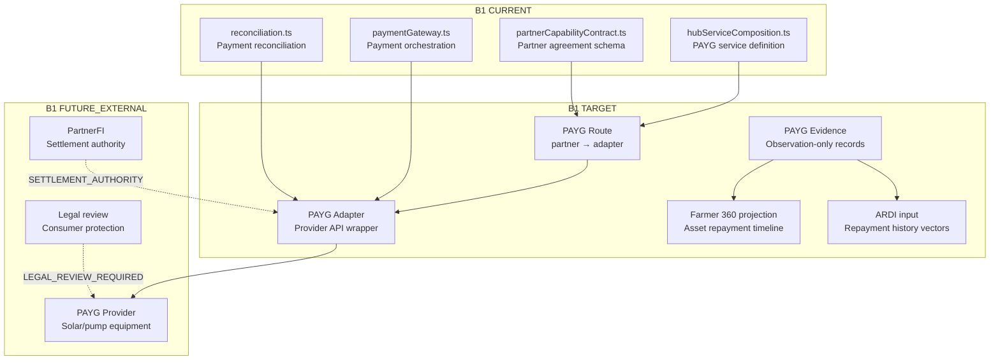

### B1 Seam Mappings

| Concept | Architecture Binding | Authority Owner |
|---------|---------------------|----------------|
| SERVICE | PAYG productive asset repayment | Enawuga (orchestration only) |
| CAPABILITY | Payment collection, asset tracking | Enawuga (evidence capture only) |
| PARTNER ACTOR | Solar/pump equipment provider | External — PARTNER_REQUIRED |
| ROUTE | Partner-specific route with version pinning | Enawuga |
| ADAPTER | Provider API wrapper (sandbox-only today) | Enawuga |
| EVIDENCE | Payment observations, device telemetry | Enawuga (observation-only) |
| AUTHORITY OWNER | PartnerFI for settlement, provider for fulfillment | External institutions |
| FARMER 360 | Repayment timeline, asset status projection | Enawuga (read model) |
| ARDI POLICY | Repayment regularity as evidence dimension | Enawuga (non-binding) |
| OFFLINE POLICY | Capture payment intent offline, submit when online | AT_MOST_ONCE_ATTEMPT |
| RECONCILIATION | Gateway → provider → PartnerFI three-way | External required |
| HUMAN REVIEW | OUTCOME_UNCERTAIN, payment ambiguity | Operations team |
| EXTERNAL PACKAGE | Payment evidence for PartnerFI review | Consent-gated, PPID-scoped |

### B1 Critical Constraints

- `controlEnabled: z.literal(false)` — NO remote device lock/unlock
- Payment observation ≠ debt settlement
- Telemetry ≠ device authority
- Device status is OBSERVED, not ACTUATED

---

## §63 COMMERCE ARCHITECTURE SEAM (B2)

### B2 Seam Mappings

| Concept | Architecture Binding | Authority Owner |
|---------|---------------------|----------------|
| SERVICE | Rural commerce / agri-inputs distribution | Enawuga (orchestration only) |
| CAPABILITY | Inventory tracking, order capture, delivery evidence | Enawuga (observation-only) |
| PARTNER ACTOR | FMCG distributors, agri-input suppliers | External — PARTNER_REQUIRED |
| ROUTE | Supplier-specific route with version pinning | Enawuga |
| ADAPTER | Supplier order/fulfillment API wrapper | Enawuga |
| EVIDENCE | Order records, delivery confirmations, inventory snapshots | Enawuga (observation-only) |
| AUTHORITY OWNER | Supplier for fulfillment, PartnerFI for payment | External institutions |
| FARMER 360 | Input purchase history, seasonal planning projection | Enawuga (read model) |
| ARDI POLICY | Input adoption regularity as evidence dimension | Enawuga (non-binding) |
| OFFLINE POLICY | Capture order intent offline, submit when online | AT_MOST_ONCE_ATTEMPT |
| RECONCILIATION | Order → delivery → payment three-way | External required |
| HUMAN REVIEW | Delivery disputes, inventory discrepancies | Operations team |
| EXTERNAL PACKAGE | Commerce evidence for supplier/PartnerFI review | Consent-gated, PPID-scoped |

### B2 Critical Constraints

- Inventory observation ≠ commercial settlement
- Order capture ≠ fulfillment guarantee
- No automatic re-ordering without explicit authorization

---

## §64 CLIMATE / INSURANCE ARCHITECTURE SEAM (B3)

### B3 Seam Mappings

| Concept | Architecture Binding | Authority Owner |
|---------|---------------------|----------------|
| SERVICE | Climate data aggregation, insurance evidence collection | Enawuga (observation-only) |
| CAPABILITY | Weather data capture, crop loss evidence, claims packaging | Enawuga (observation-only) |
| PARTNER ACTOR | Licensed Ethiopian insurer, EMI data provider | External — PARTNER_REQUIRED |
| ROUTE | Insurer-specific route with version pinning | Enawuga |
| ADAPTER | Climate API wrapper, insurer claims API wrapper | Enawuga |
| EVIDENCE | Weather observations, crop assessments, loss reports | Enawuga (observation-only) |
| AUTHORITY OWNER | Licensed insurer for claim decisions, EMI for data | External institutions |
| FARMER 360 | Insurance coverage status, claims history projection | Enawuga (read model) |
| ARDI POLICY | Insurance coverage as risk dimension | Enawuga (non-binding) |
| OFFLINE POLICY | Capture crop assessment offline, submit when online | AT_MOST_ONCE_ATTEMPT |
| RECONCILIATION | Claim → assessment → insurer decision | External required |
| HUMAN REVIEW | Claim ambiguity, assessment disputes | Operations + insurer |
| EXTERNAL PACKAGE | Claims evidence for insurer review | Consent-gated, PPID-scoped |

### B3 Critical Constraints

- Climate observation ≠ insurance payout authorization
- Licensed insurer DECIDES claims — Enawuga surfaces evidence
- EMI data licensing must be resolved — LEGAL_REVIEW_REQUIRED
- No automatic payouts — `DO_NOT_RESURRECT`

---

## §65 eKUB ARCHITECTURE SEAM (B4)

### B4 Seam Mappings

| Concept | Architecture Binding | Authority Owner |
|---------|---------------------|----------------|
| SERVICE | eKUB (savings group) evidence and record-keeping | Enawuga (observation-only) |
| CAPABILITY | Contribution tracking, rotation evidence, group governance | Enawuga (observation-only) |
| PARTNER ACTOR | PartnerFI/custodian where applicable; competent authority for any regulated perimeter | External — PARTNER_REQUIRED + LEGAL_REVIEW_REQUIRED |
| ROUTE | PartnerFI-specific route for eKUB operations | Enawuga |
| ADAPTER | PartnerFI custodial API wrapper | Enawuga |
| EVIDENCE | Contribution records, rotation evidence, group membership | Enawuga (observation-only) |
| AUTHORITY OWNER | PartnerFI/custodian for funds where applicable; competent authority for regulatory perimeter | External institutions / competent authority |
| FARMER 360 | Savings participation history, group membership | Enawuga (read model) |
| ARDI POLICY | **PROHIBITED — no eKUB membership, contribution, attendance, group, or community-reference data may influence any ARDI dimension or PartnerFI credit decision-support packet under MA-1.** | Enawuga firewall policy (TARGET_STAGE4_INTERNAL) |
| OFFLINE POLICY | Capture contribution evidence offline, submit when online | AT_MOST_ONCE_ATTEMPT |
| RECONCILIATION | eKUB records → PartnerFI custody records | External required |
| HUMAN REVIEW | Contribution disputes, rotation conflicts | Operations + group mediator |
| EXTERNAL PACKAGE | eKUB service evidence only for an approved non-credit purpose/recipient | DATA_ACCESS_BASIS_GATE + PPID/minimization; eKUB barred from ARDI/credit |

### B4 Critical Constraints

- eKUB participation ≠ creditworthiness
- PartnerFI CUSTODIES funds — Enawuga observes
- eKUB legal/regulatory perimeter — LEGAL_REVIEW_REQUIRED; competent authority must be identified from actual law/policy before activation
- No pool balance custody — `DO_NOT_RESURRECT`
- No automatic draws — `DO_NOT_RESURRECT`

---

## §66 UNIFIED THREAT MODEL

### Threat Register

| # | Threat | Asset | Attacker | Trust Boundary | Precondition | Control | Failure Behavior | Detection | Recovery | Residual Risk |
|---|--------|-------|----------|---------------|-------------|---------|-----------------|-----------|----------|---------------|
| T-01 | Cross-PartnerFI data leakage | Customer PII | Malicious insider / misconfigured API | Partner boundary | Multi-tenant access | PPID isolation, tenant-scoped DTOs, hub-scoped projections | Data exposed to wrong partner | Audit trail of cross-boundary access | Revoke access, notify affected parties, consent withdrawal | PPID derivation key compromise |
| T-02 | ID enumeration / harvest | Customer identity | External attacker | API boundary | Access to search endpoints | HMAC blind index (no plain SHA-256), rate limiting, bounded result sets | Customer identities exposed | Rate limit triggers, anomalous query patterns | Rotate blind index key, purge cached results | Insider with blind index key access |
| T-03 | Raw PII leakage | Phone numbers, names | SQL injection / API misconfiguration | Storage boundary | Database access | Encrypted at rest, field-level encryption for phones, PPID for cross-boundary | PII exposed in logs/responses | Log scanning for PII patterns, audit events | Incident response, customer notification | In-memory PII during processing |
| T-04 | Offline device theft | Cached evidence, queue data | Physical attacker | Device boundary | Device in attacker possession | GhostSync IndexedDB encryption, device-local key derivation, session expiry | Offline evidence exposed | Device reported lost/stolen | Remote session revocation, re-key device | Pre-encryption queue data in RAM |
| T-05 | Malicious agent | Customer trust, financial integrity | Compromised agent | Agent-system boundary | Agent credentials | Role-based access, operation audit, supervisor oversight, amount limits | Unauthorized transactions submitted | Anomalous transaction patterns, supervisor alerts | Revoke agent session and device pairing. Execute LOCAL_INTENT_CANCELLATION on unsubmitted queued envelopes (CANCELLED_BY_SUPERVISOR). Flag ambiguous submitted transactions as RECONCILIATION_REQUIRED. Notify PartnerFI fraud operations for external investigation and bilateral settlement adjudication. Enawuga cannot reverse external provider or PartnerFI-acknowledged transactions. | Social engineering of farmer |
| T-06 | Stale permissions | Unauthorized access after role change | Former authorized user | Role boundary | Delayed revocation | Session expiry (configurable TTL), session revocation API, CSRF tokens | Access after deauthorization | Session audit, login monitoring | Revoke sessions, force re-authentication | TTL window exposure |
| T-07 | Replay attack | Transaction integrity | Network attacker | Transport boundary | Captured valid request | Dual-digest idempotency (business intent + event content), scoped reservation, monotonic sequences | Duplicate transaction processing | Idempotency conflict detection, audit events | Idempotent rejection (DUPLICATE_NOOP) | Clock skew in expiry validation |
| T-08 | Duplicate submission | Financial double-processing | Attacker / network retry | API boundary | Valid credentials | `hubWorkflowIdempotencyCertification.ts` CAS, route pinning, reservation expiry | Same operation processed twice | Idempotency store conflict, audit | DUPLICATE_NOOP with original result | Multi-host CAS race (CURRENT: single-host only) |
| T-09 | Route drift | Unintended adapter substitution | Configuration error / attacker | Route boundary | Route configuration access | Version-pinned routes, adapter registry validation, immutable route snapshots | Wrong provider receives request | Route version mismatch detection | Reject mismatched routes, human review | Configuration management vulnerability |
| T-10 | Adapter substitution | Provider impersonation | Attacker | Provider boundary | Adapter registry access | Adapter registry type validation, partner capability contract verification | Requests sent to wrong provider | Adapter type mismatch, contract validation failure | Reject invalid adapter, quarantine | Insider with registry access |
| T-11 | Compromised partner callback | Forged payment confirmations | Attacker impersonating provider | Callback boundary | Callback endpoint access | HMAC-SHA256 callback signature verification, nonce validation | Fake settlement confirmations | Signature verification failure, audit | Reject, flag for reconciliation | HMAC key compromise |
| T-12 | Forged evidence package | Fake evidence for external review | Attacker | Evidence boundary | Access to evidence format | Ed25519 signature on packages (TARGET), SHA-256 digest chain, deterministic canonicalization | External reviewer trusts forged evidence | Signature verification failure | Revoke package, notify recipients | Signing key compromise |
| T-13 | Signing key compromise | All signed evidence integrity | Attacker | Key management boundary | KMS/HSM access | Key rotation, version-tracked signatures, HSM-backed keys (TARGET), key audit trail | Forged signatures verified as valid | Key usage anomaly detection | Emergency rotation, re-sign with new key, notify all recipients | Time between compromise and detection |
| T-14 | Stale content bundle | Outdated legal/financial terms | Attacker / network failure | Content boundary | Offline device with expired bundle | Bundle version checking, expiry enforcement, degraded-mode UI for expired content | Users see outdated regulatory language | Bundle version comparison on sync | Force bundle update on next connection | Prolonged offline period |
| T-15 | Malicious translation change | Wrong financial terms in local language | Insider / supply chain | Content boundary | Translation pipeline access | Content bundle signing (TARGET), reviewer approval workflow, human/local-speaker/domain review plus applicable legal wording review | Incorrect translated terms shown to farmers | Bundle signature verification, reviewer audit | Revert to previous approved bundle | Translation review process failure |
| T-16 | Audit log tampering | Evidence of who did what | Insider | Audit boundary | Audit store access | Append-only audit store (TARGET), Merkle checkpoints (TARGET), WORM retention (TARGET) | Audit evidence destroyed or modified | Merkle root mismatch, checkpoint verification | Restore from backup, flag tampered period | Compromise before first checkpoint |
| T-17 | Role escalation | Unauthorized privilege gain | Authenticated user | Authorization boundary | Valid session | Zod-validated role assignment, server-side role checking, no client-side role claims | User gains unauthorized access | Access denied audit events, anomalous role patterns | Revoke session, investigate | Server-side authorization bypass |
| T-18 | Direct URL access | Unauthorized page/data access | Authenticated user | Route boundary | Valid session with wrong role | Server-side authorization on every API endpoint, not just navigation | User accesses restricted data | Access denied audit events | Reject request, audit | Missing server-side check on new endpoint |
| T-19 | Package oversharing | Excessive data in external package | Misconfiguration | Sharing boundary | Package generation access | Recipient-scoped projections, PPID isolation, consent verification, redaction rules | More data shared than authorized | Package content audit, consent scope comparison | Revoke package, notify recipient and data subject | Redaction rule misconfiguration |
| T-20 | Consent withdrawal race | Data shared after consent withdrawn | Concurrent requests | Consent boundary | Active sharing + withdrawal | Atomic consent state check before sharing, synchronous withdrawal processing | Data shared despite withdrawal | Consent state audit, sharing audit comparison | Notify recipient of revocation | In-flight package generation |
| T-21 | Ambiguous provider outcome | Uncertain payment/fulfillment state | Network/provider failure | Provider boundary | Provider API timeout/error | `OUTCOME_UNCERTAIN` state, `RECONCILIATION_REQUIRED` flag, no optimistic completion | Wrong settlement state recorded | Reconciliation scheduler, state consistency checks | Manual reconciliation, human review | Prolonged ambiguity |
| T-22 | Database crash / partial write | Data loss or corruption | Hardware/software failure | Persistence boundary | Any write operation | Atomic write-temp-rename pattern (CURRENT), WAL + fsync (TARGET), transaction boundaries | Data lost or corrupt | Startup consistency check, checksum validation | Restore from backup, replay WAL | Filesystem metadata corruption |
| T-23 | Multi-process concurrency | Race conditions in shared state | Multiple server processes | Process boundary | Multi-process deployment | Local file lease system (CURRENT), database transactions + row-level locking (TARGET) | Inconsistent state, double processing | Lease conflicts, CAS failures, duplicate detection | Fail closed, human review | Lease timing edge cases |
| T-24 | Future multi-host concurrency | Distributed state inconsistency | Multiple hosts | Host boundary | Multi-host deployment | Database-backed locking (TARGET), no claims of distributed consensus | Split-brain, duplicate processing | Health checks, consensus monitoring | Manual reconciliation, designated primary | Network partition during write |

---

## §67 NON-FUNCTIONAL ARCHITECTURE REQUIREMENTS

| Requirement | Current Value | Target | Status |
|-------------|-------------|--------|--------|
| Availability class | Single-process, single-host | REQUIRES_TARGET_DECISION — evaluate active/passive vs active/active | REQUIRES_TARGET_DECISION |
| Recovery Point Objective (RPO) | Last fsync (current filesystem) | ≤ 1 transaction (WAL/database) | REQUIRES_TARGET_DECISION |
| Recovery Time Objective (RTO) | Process restart (~seconds) | ≤ 5 minutes (container restart + consistency check) | REQUIRES_TARGET_DECISION |
| Durability | fsync + atomic rename (proven) | Database WAL + backup | ACCEPTED_INTERNAL |
| Request latency (P95) | No authoritative benchmark captured in this architecture package | Target to be set from representative workload benchmark | REQUIRES_BENCHMARK |
| Offline duration | Unbounded capture, submit on reconnect | ≤ 7 days (bundle expiry) | REQUIRES_TARGET_DECISION |
| Sync behavior | Manual Data Mule transport | Automatic on connectivity restoration | REQUIRES_TARGET_DECISION |
| Evidence verification time | Current digest checks only; no package-signature benchmark | Target to be set after device/browser benchmark | REQUIRES_BENCHMARK |
| Low-end device support | Current web/mobile-responsive target; representative device floor not formally benchmarked | Define supported-device profile from field/device testing | REQUIRES_TARGET_DECISION |
| Bundle size | Current build size requires measurement | Set budgets after measured build/device/network profiling | REQUIRES_BENCHMARK |
| Accessibility | Partial (PR #69 improvements) | WCAG 2.1 AA equivalent for outdoor rural use | ACCEPTED_INTERNAL |
| Observability | Audit events only | Structured logging + metrics + alerting | REQUIRES_TARGET_DECISION |
| Data minimization | Field-level via DTO projections (TARGET) | Principle of least privilege per role | ACCEPTED_INTERNAL |
| Retention | No defined period | REQUIRES_TARGET_DECISION + LEGAL_REVIEW_REQUIRED | EXTERNAL_BLOCKED |
| Key rotation | No rotation infrastructure | Annual rotation with version tracking | ACCEPTED_INTERNAL |

---

## §68 TEST ARCHITECTURE

### Validation Pyramid

```mermaid
flowchart TD
    subgraph L1["Level 1: Foundation"]
        UNIT["UNIT tests<br/>Current: 61 test files<br/>Coverage: domain, persistence, auth"]
        INVARIANT["DOMAIN INVARIANT tests<br/>Current: z.literal(false) validations<br/>Coverage: 42 authority boundary fields"]
    end
    
    subgraph L2["Level 2: Property & Behavior"]
        PROP["PROPERTY-BASED tests<br/>Target: Randomized input testing<br/>Coverage: Idempotency, CAS, state machines"]
        PERSIST["PERSISTENCE tests<br/>Current: persistence.test.ts + specific<br/>Coverage: Crash recovery, atomic writes"]
        CRASH["CRASH-RECOVERY tests<br/>Current: restart.test.ts, recovery-audit.test.ts<br/>Coverage: Process restart durability"]
        CONCUR["CONCURRENCY tests<br/>Current: stale-lock-recovery.test.ts<br/>Coverage: Lease conflicts, CAS races"]
    end
    
    subgraph L3["Level 3: Integration"]
        INTEG["INTEGRATION tests<br/>Current: API tests (hub-api, payment-gateway-api, etc.)<br/>Coverage: End-to-end API flows"]
        SEC["SECURITY tests<br/>Current: auth.test.ts, telebirr-hardening.test.ts<br/>Coverage: CSRF, rate limiting, injection"]
        PRIV["PRIVACY tests<br/>Target: PPID isolation, cross-partner leakage<br/>Coverage: helpers/audit-privacy.ts foundation"]
    end
    
    subgraph L4["Level 4: Specialized"]
        ROLE["ROLE/PROJECTION tests<br/>Target: DTO schema per role<br/>Coverage: Field visibility, forbidden fields"]
        OFFLINE["OFFLINE tests<br/>Current: edge-storage.test.ts<br/>Coverage: IndexedDB, queue behavior"]
        L10N["LOCALIZATION tests<br/>Current: localization-catalog.test.ts<br/>Coverage: Catalog completeness, language keys"]
        A11Y["ACCESSIBILITY tests<br/>Current: frontend-f8-accessibility-resilience.test.ts<br/>Coverage: Touch targets, contrast, navigation"]
    end
    
    subgraph L5["Level 5: End-to-End"]
        E2E["PLAYWRIGHT E2E<br/>Target: Full role journeys<br/>Coverage: Agent → Supervisor → Operations"]
        CLAIM["CLAIM/TRUTH tests<br/>Current: audit-truth-sync.test.ts<br/>Coverage: No false authority claims"]
    end
    
    subgraph L6["Level 6: Architecture (TARGET)"]
        MIGRATE["MIGRATION tests<br/>Target: Filesystem → Database"]
        BACKUP["BACKUP/RESTORE tests<br/>Target: Point-in-time recovery"]
        SIGROT["SIGNATURE/KEY-ROTATION tests<br/>Target: Key version compatibility"]
        EXTPKG["EXTERNAL-PACKAGE tests<br/>Target: Package generation, redaction, consent"]
    end
    
    L1 --> L2 --> L3 --> L4 --> L5 --> L6
```

### Invariant-to-Test Mapping

| Invariant | Current Test | Target Test |
|-----------|-------------|-------------|
| Recommendation ≠ Decision | `audit-truth-sync.test.ts` | Property: no ARDI output creates PartnerFI decision |
| Queued ≠ Submitted | `hub-workflow-envelope.test.ts` | Property: offline envelope never auto-submits |
| Digest ≠ Semantic Truth | `hub-evidence-manifest.test.ts` | Integration: digest display carries disclaimer |
| eKUB ≠ Creditworthiness | Domain tests | Property: no eKUB data flows to credit scoring |
| PPID isolation | N/A (TARGET) | Integration: cross-partner PPID linkage computationally unlinkable under HMAC-SHA256 PRF assumption |
| Consent gating | N/A (TARGET) | Integration: no sharing without consent |
| Missing ≠ Failed | `payment-gateway.test.ts` | Property: OUTCOME_UNCERTAIN ≠ GATEWAY_FAILED state |

---

## §69 EXTERNAL DEPENDENCY REGISTER

| # | Dependency | Required Party | Blocking Domains | Status | Architecture Response |
|---|-----------|---------------|-----------------|--------|---------------------|
| 1 | eKUB / regulated-service legal perimeter clarification | Competent Ethiopian authority / legal counsel as applicable | B4, D6 | NOT_INITIATED | LEGAL_REVIEW_REQUIRED — no sandbox/permit assumed |
| 2 | Insurance carrier partnership | Licensed Ethiopian insurer | B3, D6 | NOT_INITIATED | ARCHITECTURALLY_BOUNDED — adapter seam defined |
| 3 | PartnerFI bilateral agreements | Licensed commercial bank(s) | B1-B4, D4, D5, D6 | NOT_INITIATED | ARCHITECTURALLY_BOUNDED — partner capability contract schema exists |
| 4 | PAYG asset provider | Solar/pump equipment provider | B1, D6 | NOT_INITIATED | ARCHITECTURALLY_BOUNDED — adapter seam defined |
| 5 | Production hosting/residency solution | Approved Ethiopian infrastructure/provider subject to actual legal/security requirements | D1, D2 | NOT_INITIATED | EXTERNAL_VALIDATION_REQUIRED — no provider preselected |
| 6 | Fayda identity verification | Ethiopian national digital ID | D2, D4 | MOCK_ONLY | ARCHITECTURALLY_BOUNDED — mock provider interface exists |
| 7 | Local-language/domain/legal wording review | Qualified local-speaker/domain reviewers and applicable legal reviewers | D3 | NOT_INITIATED | EXTERNAL_VALIDATION_REQUIRED — catalog structure ready |
| 8 | Privacy impact assessment | Independent privacy assessor | D2, D6 | NOT_INITIATED | PRIVACY_REVIEW_REQUIRED |
| 9 | ARDI fairness evaluation | Independent methodology designer | D5 | NOT_INITIATED | EXTERNAL_VALIDATION_REQUIRED |
| 10 | ISO 20022 / EATS conformity | Payment standards body | D6 | NOT_INITIATED | EXTERNAL_VALIDATION_REQUIRED |
| 11 | Ethiopian agricultural terminology | MoA / ATI | D3 | NOT_INITIATED | EXTERNAL_VALIDATION_REQUIRED |
| 12 | Payment/provider sandbox dependencies | Existing registered sandbox/testbed providers only where current repository evidence supports them | D1, D6 | SANDBOX_ONLY | Provider evidence only; no settlement/live authority |
| 13 | ArifPay production gateway | ArifPay Technologies | D1, D6 | SANDBOX_ONLY | ARCHITECTURALLY_BOUNDED — sandbox adapter exists |

**Total: 13 dependencies — 0 initiated, 2 sandbox-only, 11 not initiated**

---

## §70 LEGAL / PRIVACY / PARTNER GATES

| Gate | Required For | Current Status | Architecture Can | Architecture Cannot |
|------|-------------|----------------|-----------------|-------------------|
| eKUB legal/regulatory perimeter | eKUB service activation | NOT_INITIATED | Define interface/schema/evidence boundary | LEGAL_REVIEW_REQUIRED / competent-authority determination |
| PAYG consumer protection review | PAYG service activation | NOT_INITIATED | Ensure controlEnabled: false, observation-only | Make legal determination |
| Climate data licensing (EMI) | Insurance evidence service | NOT_INITIATED | Define adapter with licensing placeholder | License data |
| Partner willingness assessment | Any live service | NOT_INITIATED | Define partner onboarding protocol | Secure partners |
| ARDI fairness methodology | ARDI activation | NOT_INITIATED | Ensure non-binding output, explanation transparency | Validate fairness |
| Privacy Impact Assessment | Cross-boundary data sharing | NOT_INITIATED | Design privacy-by-architecture | Certify compliance |
| Ethiopian hosting approval | Production deployment | NOT_INITIATED | Define logical ET-resident topology | Provision infrastructure |
| Translation/legal terminology review | Localized production UI | NOT_INITIATED | Design review workflow, bundle governance | Certify translations |
| Farmer adoption validation | Scale decisions | NOT_INITIATED | Design pilot evidence framework | Validate adoption |
| Real pilot evidence | Scale decisions | NOT_INITIATED | Design pilot gate evaluation engine | Conduct pilot |

**Architecture resolves INTERNAL TECHNICAL questions. Production activation remains EXTERNALLY BLOCKED.**

---

## §71 DO_NOT_RESURRECT REGISTER (15 ITEMS)

### Current Main Status of Quarantined Anti-Patterns

| Anti-Pattern | Source | Wave | Current Main Status | Classification |
|-------------|--------|------|-------------------|----------------|
| Automatic dynamic credit line issuance | DemoPresenter.tsx | C | STILL_ACTIVE (unmounted) | DO_NOT_RESURRECT |
| Sovereign Core settlement claims | DemoPresenter.tsx | C | STILL_ACTIVE (unmounted) | DO_NOT_RESURRECT |
| CommunityCoin token rewards | AgentLms.tsx | C | STILL_ACTIVE (unmounted) | DO_NOT_RESURRECT |
| Web3 DAO quadratic voting | GovernanceCouncil.tsx | C | STILL_ACTIVE (unmounted) | DO_NOT_RESURRECT |
| Fake NBE permit issuance | AuditCompliance.tsx | C | STILL_ACTIVE (unmounted) | DO_NOT_RESURRECT |
| Remote physical device lockout | hub.ts controlEnabled | B | QUARANTINED — `z.literal(false)` | DO_NOT_RESURRECT |
| Unauthenticated webhooks | app.ts endpoints | C | QUARANTINED — 403 PROTOTYPE_OPERATION_DISABLED | DO_NOT_RESURRECT |
| ISO 20022 ungrounded dossier wizard | AuditCompliance.tsx | C | STILL_ACTIVE (unmounted) | DO_NOT_RESURRECT |
| Single scalar universal credit score | Wave A historical | A | REMOVED — ARDI outputs vectors | DO_NOT_RESURRECT |
| Automated insurance smart-contract payouts | AgriTrustInsurance.tsx | B | STILL_ACTIVE (unmounted) | DO_NOT_RESURRECT |
| eKUB pool balance custody | SmartCycle.tsx | B | STILL_ACTIVE (unmounted) | DO_NOT_RESURRECT |
| Peer social credit index | Wave A | A | REMOVED | DO_NOT_RESURRECT |
| Hyperledger Fabric as default dependency | Wave A historical | A | NOT PRESENT in current main | DO_NOT_RESURRECT |
| Blockchain for architecture prestige | Wave A historical | A | NOT PRESENT in current main | DO_NOT_RESURRECT |
| Zero-knowledge claims without a mathematically specified ZK proof system | Wave D Closure Audit | D | CORRECTED in v1.1.1 — D2.8 renamed to "Client-Side Offline Cryptographic Verification" | DO_NOT_RESURRECT |

**Architecture Decision: ARCH-16 (Legacy quarantine) remains P0-CRITICAL. Unmounted files should be formally removed from the governed build tree in Stage-4 implementation.**

---

## §72 IMPLEMENTATION DEPENDENCY GRAPH

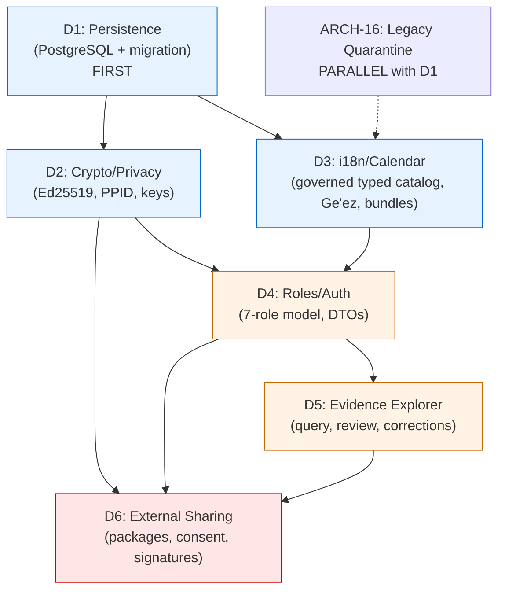

---

## §73 BOUNDED IMPLEMENTATION SEQUENCE

### Phase 0: Prerequisite (Parallel with Phase 1)
- **ARCH-16**: Remove/quarantine legacy anti-pattern files from build tree
- Remove unmounted routes from `App.tsx`
- Delete DemoPresenter, AgentLms, GovernanceCouncil, AuditCompliance fake permits

### Phase 1: Foundation — D1 Persistence
1. Design PostgreSQL schema for all persistence stores
2. Implement new persistence adapters implementing existing interfaces
3. Implement migration tooling: filesystem → PostgreSQL data migration
4. Add transaction boundaries and WAL configuration
5. Replace `AtomicJson*` adapters with PostgreSQL adapters behind feature flag
6. Verify crash recovery, backup/restore
7. Run existing 61 tests against new persistence backend

### Phase 2A: Cryptography — D2 (Parallel with 2B)
1. Implement Ed25519 key generation, rotation, versioning
2. Implement PPID derivation (HMAC-SHA256 with per-partner keys)
3. Implement HMAC blind index for phone lookup
4. Implement evidence manifest signing
5. Implement audit checkpoint signing and Merkle chains
6. Implement consent schema (ConsentGrant)
7. Refactor `partnerCustomerId` from single string to `Map<PartnerOrgId, PPID>`

### Phase 2B: Internationalization — D3 (Parallel with 2A)
1. Extend the governed compile-time typed catalog and dynamic bundle loader selected by ADR-D3-01
2. Extract all hardcoded strings into locale bundles
3. Implement Ethiopian calendar display conversion
4. Implement locale-aware number/currency/date formatting
5. Add Tigrinya and Somali locale stubs
6. Implement content bundle versioning and digest verification
7. Implement PWA/Service Worker for offline asset caching

### Phase 3: Authorization — D4
1. Extend role model: add PARTNERFI_REVIEWER, AUDITOR, PILOT_REVIEWER
2. Implement role-specific Zod DTO projection schemas
3. Replace `structuredClone()` with validated projections
4. Implement scoped attributes (tenant, partner, hub, purpose)
5. Design external authentication architecture (OIDC/SAML) — DO NOT IMPLEMENT
6. Add read-access audit events

### Phase 4: Evidence & Review — D5
1. Implement unified Evidence Explorer with role-parameterized views
2. Implement evidence query API (filter by ID, workflow, service, partner, date, status)
3. Implement evidence detail projection with multi-dimensional quality indicators
4. Implement append-only correction schema
5. Implement Human Review Queue with case lifecycle
6. Implement derived evidence invalidation cascade

### Phase 5: External Sharing — D6
1. Implement evidence package generator with recipient-scoped projections
2. Implement Ed25519 detached signature on packages
3. Implement consent gate verification before any export
4. Implement PPID-only identifiers in external packages
5. Implement negative assurance headers (machine + human readable)
6. Implement package expiry and revocation
7. Implement package download audit trail

### External Activation (NOT part of bounded Stage-4)
- Partner onboarding (requires bilateral agreements)
- Provider production adapter activation (requires provider agreements)
- ET-resident infrastructure provisioning (requires approval)
- Sensitive financial/legal content review (qualified local-speaker/domain review + applicable legal review)
- Pilot deployment (requires all above + pilot approval)
- Scale deployment (requires pilot evidence + scale authority)
# WAVE D — VERDICTS, EXIT CRITERIA & FINAL ASSESSMENT

---

## §74 WAVE-D EXIT CRITERIA ASSESSMENT

### 40 Exit Criteria Questions — v1.1.1 Reconciled

| # | Question | Answer | Evidence |
|---|---|---|---|
| 1 | What is CURRENT live architecture? | Canonical main remains SHA 9a8578858e0be1f1e78ce1572119ee85fdcfbf85 with the bounded synthetic Stage-4 baseline described in D0. | §4 D0.1 |
| 2 | Which Wave-C gaps remain implementation work? | The D0 reconciliation remains the baseline; architecture decisions do not convert open implementation gaps into current capability. | §5 |
| 3 | Which Wave-C gaps were closed by later merges? | Persistence/localization closures recorded in D0 remain source-backed; no later repo drift is assumed in this document. | §5 |
| 4 | What is the target persistence architecture? | PostgreSQL-backed transactional state with append-only evidence/audit structures, evolving from current filesystem adapters. | ADR-D1-01 |
| 5 | What requires transactional durability? | Governed transactional state, idempotency/reservations and other D1 storage classes designated as durable; exact physical schema is implementation work. | §10 |
| 6 | How is idempotency preserved? | Preserve current fail-closed idempotency semantics; target database implementation uses transactional uniqueness/CAS patterns without claiming distributed exactly-once. | §12 |
| 7 | How does multi-host evolution work? | Move from current single-host filesystem semantics to database-backed coordination before multi-host activation; no distributed-consensus claim. | §12 |
| 8 | How is evidence stored? | APPEND_ONLY_EVIDENCE target class; legal retention remains unresolved. | §10, ADR-D1-03 |
| 9 | How is audit stored? | Append-only target audit class with governed recovery/backup; legal retention remains unresolved. | §14, §23 |
| 10 | How are evidence packages signed? | Architecture supports Ed25519 internal/edge and ECDSA P-256 compatibility profiles. External recipient profile acceptance is PARTNER_DECISION_REQUIRED / REGULATORY_REQUIREMENT_UNVERIFIED. | ADR-D2-01, §56 |
| 11 | How are PPIDs generated/scoped? | HMAC-SHA256-derived partner/service scopes intended to be computationally unlinkable under stated PRF/key-secrecy assumptions; auxiliary-data and key-compromise risks remain. | ADR-D2-02 |
| 12 | How are phone/low-entropy identifiers protected? | Target uses a keyed blind index plus authenticated field encryption; unkeyed phone hashes are rejected. Exact rate limits/performance require benchmark. | §21 |
| 13 | How are keys versioned/rotated? | Versioned logical key hierarchy with rotation/revocation; physical KMS/HSM choice and numeric rotation periods are external/benchmark decisions. | ADR-D2-03 |
| 14 | How is consent/purpose represented? | Through DATA_ACCESS_BASIS_GATE. CONSENT uses a scoped ConsentGrant; other bases remain disabled unless separately approved and verifiable. | §24, ADR-D2-04 |
| 15 | What i18n architecture is selected? | Governed compile-time typed catalog with dynamic governed bundle lifecycle, extending the PR #76 localization foundation. | ADR-D3-01 |
| 16 | How are canonical states separated from translation? | Domain/wire state remains canonical; localization is presentation/content projection only. | §28 |
| 17 | How is Ethiopian-calendar presentation handled? | Canonical UTC/ISO time remains internal; localized calendar/time is a display projection whose implementation must be tested. | ADR-D3-02 |
| 18 | How are offline content bundles governed? | Versioned/digest-checked target bundles with freshness/expiry policy; numeric expiry defaults are engineering policy requiring validation, not legal rules. | ADR-D3-03 |
| 19 | What is the unified role model? | Seven-role target model in three governance classes; current implementation remains the verified current role baseline until D4 is implemented. | ADR-D4-01 |
| 20 | How are role projections enforced? | Server-enforced S-ABAC evaluates bounded scope predicates plus DATA_ACCESS_BASIS_GATE; strict DTO projections replace generic exposure at future wire boundaries. | ADR-D4-02, ADR-D4-04 |
| 21 | What is the external-review authentication boundary? | Future OIDC-compatible federation with upstream privilege claims stripped/ignored; Enawuga owns authorization; reviewer verbs default read-only. Exact IdP/session profile is partner/security dependent. | ADR-D4-03, §40 |
| 22 | What is the Evidence Explorer architecture? | Shared evidence core plus role-specific projections. | ADR-D5-01 |
| 23 | How are corrections/disputes represented? | Append-only correction/supersession evidence; original evidence is preserved and derived projections are invalidated/recomputed as required. | ADR-D5-03 |
| 24 | What is the Human Review architecture? | Common governed queue with explicit authority owner; Enawuga review cannot override external regulated authority. | ADR-D5-02 |
| 25 | How are Farmer 360 projections produced? | Governed longitudinal read model from authorized evidence sources with role/purpose projections; not a universal system of record. | §49 |
| 26 | How does ARDI consume evidence? | Governed evidence → quality/freshness → product-specific multidimensional recommendation → explanation → non-binding PartnerFI decision-support. | §50 |
| 27 | How are ARDI outputs kept non-binding? | No scalar universal score; missing evidence is UNKNOWN; eKUB data is prohibited from all ARDI/credit decision-support paths; PartnerFI decision remains required. | §50 |
| 28 | How are external packages produced? | Target recipient projection + DATA_ACCESS_BASIS_GATE + minimization/negative assurance + canonical JSON + detached algorithm-agile signature. | §§53-60 |
| 29 | What format is used? | Canonical JSON is Enawuga's canonical package representation; optional PDF/A-3 is a human-review derivative; W3C VC remains deferred. | ADR-D6-01 |
| 30 | How are packages redacted? | Default-deny typed recipient projections with PPIDs/minimization and purpose/basis policy; effectiveness requires executable leakage tests. | §54, §58 |
| 31 | How are packages expired/revoked? | Versioned freshness lifecycle plus basis-aware revocation/re-evaluation; freshness TTLs are engineering policy and legal retention is external. | §59, ADR-D6-05 |
| 32 | How do B1-B4 services plug in? | Through SERVICE != CAPABILITY != ROUTE != ADAPTER plus evidence, projection, offline/reconciliation and authority-owner seams. | §§62-65 |
| 33 | Where does external authority remain? | PartnerFI retains regulated account/credit/posting/settlement authority; insurer retains claim/payout authority; suppliers/providers retain their contractual fulfillment authority; competent authorities retain regulatory authority. | §70 |
| 34 | What does the threat model require? | Preserve fail-closed handling across cross-partner leakage, replay, ambiguity, authorization, key, evidence, offline and concurrency threats; target controls are not current capability until implemented/tested. | §66 |
| 35 | What remains externally blocked? | Hosting/residency approval, partner agreements, privacy/legal review, ARDI fairness evaluation, human/local-language review, production key custody, and other external dependencies in §69. | §69 |
| 36 | What can be implemented now in bounded Stage 4? | Phase 0 legacy quarantine and Phase 1 internal persistence work after the final consistency gate. Later D2/D3 internal foundations follow the dependency graph; external activation does not. | §§72-73 |
| 37 | What cannot be activated without external review? | Real partner auth/sharing, real-person data use, B1-B4 live services, production key/hosting profiles, regulated/live financial mode and externally governed translations/disclosures. | §§69-70 |
| 38 | What is the bounded sequence? | Phase 0 → D1 → D2/D3 → D4 → D5 → D6, with dependency-specific gates and no automatic external activation. | §73 |
| 39 | Is architecture coherent enough for implementation? | YES after v1.1.1 consistency verification: 23 ADRs, corrected authority/privacy boundaries, and no known material architecture contradiction. This is an architecture gate, not implementation proof. | v1.1.1 verification |
| 40 | Is live financial execution authorized? | NO. syntheticOnly remains true; etResidencyApproved remains false; regulatedModeAllowed remains false. | §76 |

All 40 architecture questions now have a bounded answer. Items dependent on law, partners, infrastructure, benchmark, or assurance remain explicitly external/unresolved rather than being invented.

---

## §75 STAGE-4 IMPLEMENTATION READINESS MATRIX

### Internal Architecture Readiness

| Workstream | ADR Count | Status | Blocking Dependencies | Ready for Stage-4? |
|-----------|-----------|--------|--------------------|-------------------|
| D1 Persistence | 3 | ACCEPTED_INTERNAL | None (ET hosting for production only) | **YES** |
| D2 Crypto/Identity | 4 | ACCEPTED_INTERNAL | None (KMS for production only) | **YES** |
| D3 i18n/Accessibility | 4 | 3 ACCEPTED, 1 WITH_CONDITIONS | Human/local-speaker/domain review and applicable legal wording review for external/pilot content | **YES** (internal framework) |
| D4 Roles/Authorization | 4 | 3 ACCEPTED, 1 WITH_CONDITIONS | Partner agreements (for external auth) | **YES** (internal roles) |
| D5 Evidence Explorer | 3 | ACCEPTED_INTERNAL | D1 + D2 + D4 | **YES** (after D1-D4) |
| D6 External Sharing | 5 | ACCEPTED_WITH_CONDITIONS | D2 + D4 + partner agreements | **PARTIALLY** (internal only) |

### External Staging Readiness

| Requirement | Status | Blocking Party |
|-------------|--------|---------------|
| ET-resident hosting/residency solution approved | NOT_INITIATED | EXTERNAL_INFRASTRUCTURE / LEGAL_POLICY_DEPENDENT |
| PartnerFI bilateral agreement | NOT_INITIATED | Licensed bank(s) |
| PAYG provider agreement | NOT_INITIATED | Solar/pump provider |
| Insurance carrier agreement | NOT_INITIATED | Licensed insurer |
| Human/local-speaker and legally appropriate financial wording review | NOT_INITIATED | EXTERNAL_REVIEW_REQUIRED |
| Privacy impact assessment | NOT_INITIATED | Independent assessor |
| ARDI fairness methodology | NOT_INITIATED | Independent designer |

### Controlled Live Pilot Readiness

| Requirement | Status |
|-------------|--------|
| Internal architecture implemented | NOT_STARTED |
| ET-resident infrastructure provisioned | NOT_STARTED |
| At least 1 PartnerFI agreement | NOT_INITIATED |
| Privacy impact assessment complete | NOT_INITIATED |
| Human-reviewed pilot-language content and applicable legal wording review | NOT_INITIATED |
| ARDI fairness baseline established | NOT_INITIATED |
| Pilot approval from governance council | NOT_INITIATED |

---

## §76 FINAL ARCHITECTURE VERDICTS

### A. INTERNAL ARCHITECTURE

**Verdict: `ARCHITECTURE_APPROVED_FOR_BOUNDED_STAGE4_IMPLEMENTATION`**

**Reasoning:**
- 23 Architecture Decision Records reconciled across 6 workstreams
- All 40 exit criteria answered
- All 30 governance invariants preserved
- 33 Wave C gaps reconciled (3 closed, 5 partially closed, 25 with architecture decisions)
- Clean interface separation enables incremental migration
- Current filesystem persistence is tested for the bounded baseline; PostgreSQL migration is a controlled implementation change requiring migration, rollback, concurrency, and recovery tests
- Bounded internal implementation can proceed only within each ADR's internal scope; external activation, real-person use, production key/hosting profiles, and partner/regulatory interfaces retain their external gates
- Legacy quarantine (ARCH-16) can proceed immediately

**Conditions:**
1. Implementation MUST follow the bounded sequence (D1 → D2/D3 → D4 → D5 → D6)
2. All 30 invariants MUST be preserved in implementation
3. syntheticOnly MUST remain true until an explicit authorized mode transition satisfies all applicable program, partner, privacy, legal, infrastructure, and assurance gates
4. All tests MUST continue passing after each phase
5. No ADR implementation may expand Enawuga's authority

### B. EXTERNAL PARTNER STAGING

**Verdict: `NOT_READY`**

**Reasoning:**
- 0 of 13 external dependencies initiated
- No bilateral partner agreements exist
- No ET-resident hosting selected
- No privacy impact assessment conducted
- No completed human/local-speaker and applicable legal review of pilot financial wording
- Architecture is READY — external engagement has NOT BEGUN

**Path to CONDITIONALLY_READY:**
1. Initiate ET-resident hosting selection
2. Begin at least 1 PartnerFI relationship discussion
3. Engage independent privacy assessor
4. Engage qualified local-language/domain reviewers and applicable legal reviewers for pilot wording

### C. CONTROLLED LIVE FINANCIAL PILOT

**Verdict: `NOT_READY`**

**Reasoning:**
- Internal architecture not yet implemented
- No ET-resident infrastructure
- No partner agreements
- No privacy assessment
- No ARDI fairness baseline
- No pilot approval

**Path to CONDITIONALLY_READY:**
1. Complete Stage-4 internal implementation (Phases 0-5)
2. Achieve CONDITIONALLY_READY for External Partner Staging
3. Complete privacy impact assessment
4. Establish ARDI fairness baseline with independent methodology
5. Obtain pilot approval from governance council

### D. PRODUCTION

**Verdict: `NOT_READY`**

**Reasoning:**
- All prerequisites for Controlled Live Pilot plus:
- No pilot evidence exists
- No scale authority
- No regulatory approval for regulated services
- No production provider agreements

**The project is explicitly NOT authorized for live financial execution.**

`syntheticOnly: true`
`etResidencyApproved: false`
`regulatedModeAllowed: false`

These declarations are architectural virtues. They will be removed ONLY when independent evidence justifies each removal.

---

## OPEN ARCHITECTURE QUESTIONS

| # | Question | Blocking | Status |
|---|---------|---------|--------|
| OAQ-1 | PostgreSQL exact version and configuration | D1 implementation | REQUIRES_TARGET_DECISION |
| OAQ-2 | Connection pooling strategy (PgBouncer vs pgpool) | D1 multi-host | REQUIRES_TARGET_DECISION |
| OAQ-3 | WAL archiving storage location | D1 backup | REQUIRES_TARGET_DECISION |
| OAQ-4 | HSM/Cloud KMS vendor selection | D2 key management | EXTERNAL_BLOCKED |
| OAQ-5 | Edge device StrongBox availability survey | D2 edge keys | REQUIRES_TARGET_DECISION |
| OAQ-6 | Exact retention periods per storage class | D1 retention | LEGAL_REVIEW_REQUIRED |
| OAQ-7 | Tigrinya and Somali translator availability | D3 localization | EXTERNAL_VALIDATION_REQUIRED |
| OAQ-8 | Partner OIDC IdP compatibility survey | D4 external auth | PARTNER_REQUIRED |
| OAQ-9 | Evidence query pagination strategy | D5 explorer | REQUIRES_TARGET_DECISION |
| OAQ-10 | ARDI fairness evaluation methodology | D5 ARDI | EXTERNAL_VALIDATION_REQUIRED |
| OAQ-11 | W3C VC applicability reassessment timeline | D6 format | DEFERRED |
| OAQ-12 | Multi-host deployment topology | D1 scale | REQUIRES_TARGET_DECISION |

---

*End of ENAWUGA WAVE D — BOUNDED ARCHITECTURE DECISION PACKAGE (v1.1 AMENDED)*

*Document generated: 2026-10-17 (v1.1 amended from v1.0 of 2026-10-16)*
*Amendment authority: ENAWUGA_WAVE_D_ARCHITECTURE_CLOSURE_RECONCILIATION.md*
*Research program: Waves A → B → C → D*
*Verified live main HEAD: `9a8578858e0be1f1e78ce1572119ee85fdcfbf85`*
*Total ADRs: 23 (17 ACCEPTED_INTERNAL, 4 ACCEPTED_WITH_CONDITIONS, 2 EXTERNAL_BLOCKED)*
*Mandatory amendments applied: 6/6 (MA-1 through MA-6)*
*Editorial corrections applied: 12/12 (EC-1 through EC-12)*
*Closure verdict: B — IMPLEMENTATION_BASELINE_CLEAN_WITH_EDITORIAL_CORRECTIONS*
*Next phase: Stage-4 Bounded Implementation (pending approval)*
*syntheticOnly: true | etResidencyApproved: false | regulatedModeAllowed: false*

